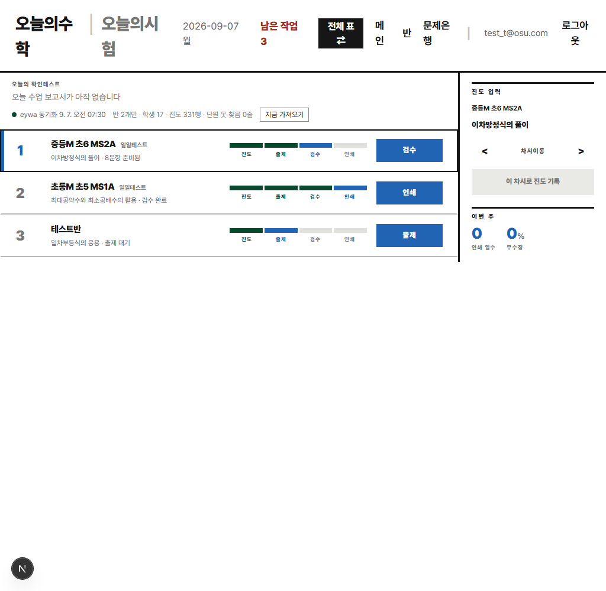
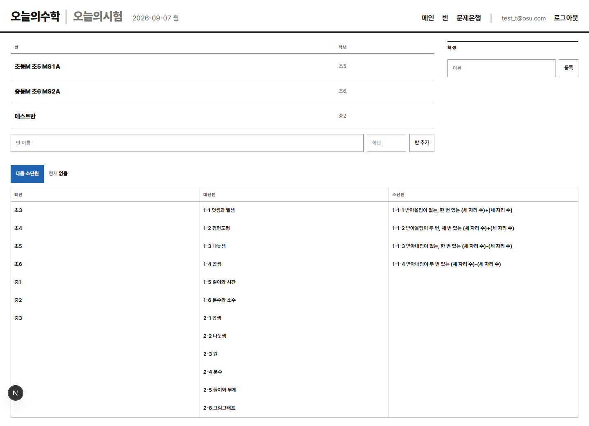
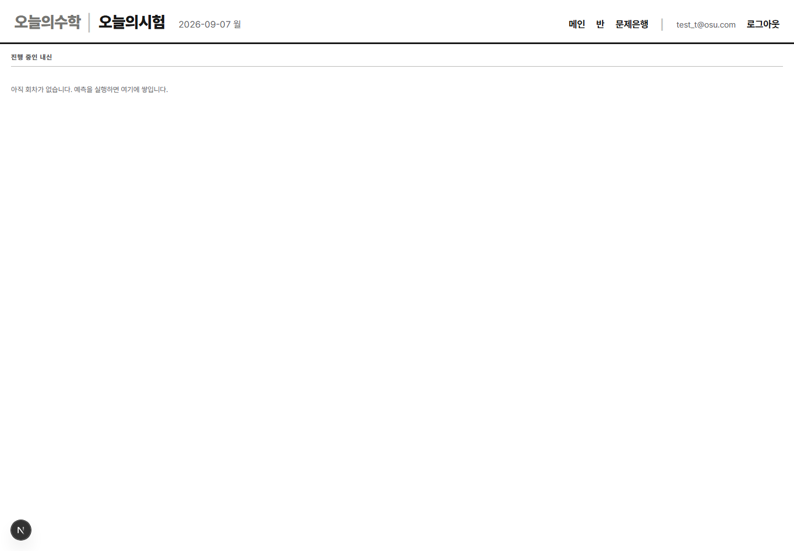
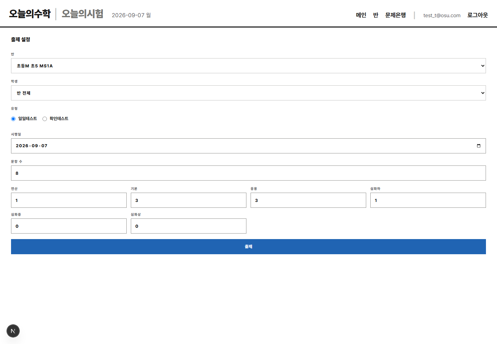
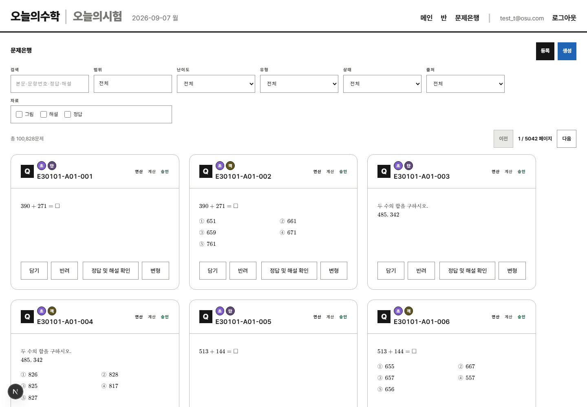

# 오늘의수학 웹앱 디자인 상세 검토

작성일: 2026-09-07  
문서 상태: 검토 결과 및 개선 제안 — 디자인 변경 미적용  
검토 기준: 현재 로컬 실행 화면, 작업 중인 변경을 포함한 소스, 기존 디자인 결정

### 추가 대조: 기존 확정 결정과의 관계

2026-09-07 외부 검토 의견을 받아 디자인 결정과 소스를 다시 대조했다. 최초 문서는 제안이 미확정임을 밝혔지만, **기존 확정 사양을 바꾸는 제안**과 **그 사양 안에서 구현을 보완하는 작업**의 관계를 항목마다 충분히 표시하지 않았다. 아래 표와 상세 항목으로 이를 보완한다. 스크린샷은 최초 검토 시점의 기록이며 이번 추가 대조에서 새로 촬영하지 않았다.

타입 스케일은 디자인 시스템 §3.2, 공통 헤더 크기는 §8.6에 확정돼 있다. 출제 설정의 전폭 폼도 §8.6 S-04의 확정 사항이다. 따라서 UI-04의 폼 폭 제한과 UI-05의 글자 크기 변경은 기존 디자인 결정의 재검토 제안이다. 해당 화면을 현재 사양에서 벗어난 구현 결함으로 분류하지 않는다.

| 항목 | 기존 결정과의 관계 | 후속 작업의 성격 |
|---|---|---|
| UI-01: 1024px | PC 중심 범위에서 실제 레이아웃 문제가 관찰됨. 헤더 크기와 계정 상시 노출은 이미 확정 | 확정된 정보·크기를 고려한 PC 배치 보완. 구조가 바뀌면 해당 배치안을 검토 |
| UI-01: 390px | 모바일 앱은 기획 범위 밖이고 제품은 PC 중심. 모바일 웹 지원 범위도 이번 검토에서 확정하지 않음 | 참고 관찰. 현재 PC 개선의 완료 조건에서 제외 |
| UI-02 | 선택 반의 학생 목록이라는 기능은 확정. 선택 상태가 화면에 드러나지 않는 구현상 공백 | 기존 메인의 선택 표현을 재사용하는 보완 후보 |
| UI-03 | 별도 예측기 트랙의 생성·입력 흐름과 연결됨 | 제품·운영 경로 확인 및 안내 보완. 앱 내 생성 기능 추가를 자동으로 전제하지 않음 |
| UI-04 | §8.6 S-04에 전폭 폼이 확정돼 있음 | 폭·배치 변경은 확정 사양 재검토. 배분 합계 안내는 구분해서 검토 |
| UI-05 | §3.2의 글자 크기, §8.6의 헤더 크기가 확정돼 있음 | 기존 타입 체계 재검토. 크기 변경은 §0의 Wire → Hi-fi 결정 절차 대상 |
| UI-06 | §8.6 S-05는 검수 카드·교체·하단 동작을 규정하나 시험 식별 머리말은 구체화하지 않음 | 정보 보완 제안. 새 머리말의 구성·배치는 시안으로 결정 |
| UI-07 | 담기 우선 배치·담김 표시·잠긴 사유 노출에 기존 결정이 있음 | 해당 상태를 유지한 채 행동 위계를 재평가. 잠긴 문항 화면은 추가 확인 필요 |
| UI-08 | §2.1은 구분선과 컨트롤을 구분하고 §8.8은 계정 구분선 색을 직접 지정 | 컨트롤·구분선·확정된 예외를 구분한 제한적 정리 |
| UI-09 | §3.1에 명조 폰트 미적재가 이미 기록돼 있음 | 새로 발견한 결함으로 보지 않음. 실제 사용 폰트·측정 도구·출력의 일치 여부를 먼저 조사 |

근거: [디자인 시스템](../../planning/05-design-system.md)의 §0, §2.1, §3.1~3.2, §8.6, §8.8. 본문의 디자인 판단은 비교 검토를 위한 의견이며, 과거에 확정됐다는 이유로 재평가할 수 없는 것은 아니다. 다만 확정 사양의 구현 오류와는 변경 절차·판단 근거가 다르다.

## 1. 종합 평가

오늘의수학은 흰 바탕, 검정 구분선, 굵은 한글 워드마크, 진행 상태를 보여 주는 계기판이라는 시각적 정체성을 갖고 있다. 학원 선생님이 매일 반복해서 사용하는 업무 도구라는 성격과 잘 맞는다. 불필요한 장식을 억제하고, 반별로 다음 작업을 보여 주며, 문제와 인쇄 지면의 연결을 중요하게 다룬다는 점이 강점이다.

현재의 가장 큰 과제는 **화면별 정보 위계와 작업 맥락의 일관성**이다. 같은 앱 안에서도 메인에서는 선택한 반이 분명한 반면 반 관리에서는 선택 표시가 보이지 않는다. 검수 화면은 문제와 해설을 잘 배치했지만 정작 어떤 반의 어떤 시험인지 알려 주는 정보가 부족하다. 출제 설정은 넓은 화면을 사용하면서도 라벨과 제목은 작아 공간 사용과 정보 크기가 어울리지 않는다.

개선 방향은 기존의 시각 문법을 기준으로 다음 세 가지를 더 잘 전달하는 것이다.

1. 지금 어느 반의 어떤 시험을 다루는가.
2. 현재 상태는 무엇이며 다음에 무엇을 해야 하는가.
3. 화면 크기가 달라져도 같은 정보를 편하게 읽고 조작할 수 있는가.

이 문서는 관찰한 사실, 사용성에 대한 판단, 변경 제안을 구분한다. 제안된 크기·배치·문구는 확정된 디자인 사양이 아니다.

## 2. 검토 범위와 방법

### 2.1 제품과 사용자

제품의 중심 사용자는 반별·학생별 진도를 관리하고 수학 시험지를 만드는 학원 원장과 강사다. 주요 업무 흐름은 다음과 같다.

```text
반·학생 확인 → 진도 확인·입력 → 출제 설정 → 문항 검수 → 확정 → 인쇄
                                  ↑
                         문제은행 검색·선택
```

검토에서는 시각적 인상뿐 아니라 반복 작업 속도, 작업 대상의 식별, 상태 이해, 잘못된 대상을 수정할 가능성을 함께 살폈다. PC 중심 제품이라는 기존 기획을 반영해 작은 PC 창의 안정성을 모바일 전면 대응보다 먼저 평가했다.

### 2.2 직접 확인한 화면

| 화면 | 확인 상태 | 화면 폭 | 비고 |
|---|---|---|---|
| 로그인 | 기본 폼 | 1440px | 로그인 제출·실패 흐름은 실행하지 않음 |
| 가입 | 기본 폼 | 1440px | 계정 생성은 실행하지 않음 |
| 초기 설정 | 기존 반·학생이 있는 계정의 표시 상태 | 1440px | 신규 계정의 전체 온보딩을 검증한 것은 아님 |
| 메인 | 반 3개, 서로 다른 출제 단계 | 1440·1024·390px | 작은 창의 헤더 및 고정 진도 패널 확인 |
| 반 관리 | 목록·학생·진도, 반 선택 전후 | 1440px | 반 선택에 따른 시각 변화 확인 |
| 출제 설정 | 기본 일일테스트 설정 | 1440·390px | 폼 폭·라벨 크기·난이도 배치 확인 |
| 문제은행 | 기본 목록·필터, 첫 문항 해설 펼침 | 1440·1024px | 담기·승인·반려·변형 실행은 제외 |
| 오늘의시험 | 회차가 없는 빈 상태 | 1440px | 회차가 있는 상세 화면은 직접 검토하지 않음 |
| 검수 | 기존 확정 시험 8문항 | 1440·1024px | 교체·확정은 실행하지 않음 |
| 인쇄 미리보기 | 기존 일일테스트 문제지 | 1440px | 실물 인쇄·PDF 출력은 제외 |

기본 브라우저 뷰포트 높이는 1000px이다. 일부 이미지는 전체 페이지 캡처이므로 이미지 높이가 1000px보다 길다.

### 2.3 검토 환경과 증거 해석

- 로컬 개발 서버의 현재 앱을 사용했다. 배포 환경과 완전히 동일하다고 단정하지 않는다.
- 검토 당시 Git 기준 커밋은 `d291455808943f466f2721e35029808a08853e52`였으며 기존 미커밋 변경이 함께 적용된 상태였다.
- 기존 테스트 계정과 저장된 시험을 사용했다. 문제 생성, 반·학생 추가, 진도 기록, 승인·반려 및 인쇄 상태 변경을 실행하지 않았다.
- 별도 검토 브라우저에서는 API 쓰기 요청을 차단하고 화면 열람과 로컬 UI 선택만 수행했다.
- 캡처에는 해당 계정의 반·학생 목록과 계정 표시가 포함돼 있다. 문서 및 이미지는 프로젝트 내부 검토 자료로 보관한다.
- Orca 병렬 검토는 런타임 연결 및 조정자 바인딩 오류로 성립하지 않았다. 이 문서의 판단은 주 검토자가 직접 확인한 결과이며, 독립된 두 검토자의 합의 결과는 아니다.
- 검토용 작업트리는 변경·미병합 커밋·실행 작업이 없는 것을 확인한 뒤 제거했고 브랜치는 보존했다.

이 문서 작성으로 앱 코드나 업무 데이터를 변경하지 않았다. 새로 저장한 것은 검토 문서와 당시 캡처 이미지다.

### 2.4 판단의 종류

| 구분 | 의미 | 예 |
|---|---|---|
| 관찰 사실 | 화면·DOM·소스에서 직접 확인 | 1024px에서 로고 줄바꿈, 선택 행의 흰 배경 |
| 디자인 판단 | 관찰에 기반한 시각·사용성 평가 | 헤더에 비해 작업 정보가 작게 느껴짐 |
| 개선 제안 | 비교·결정 후 적용할 후보 | 필드 묶음, 선택 테두리, 상태 문구 |
| 추가 검증 필요 | 이번 검토로 결론 내릴 수 없는 영역 | 실제 프린터 출력, 다른 OS의 명조 폰트 |

## 3. 유지할 디자인 자산

### 3.1 흰 바탕과 검정 구분선

흰 화면과 검정 룰은 종이·시험지라는 제품의 작업 대상과 잘 연결된다. 굵은 구분선이 화면의 큰 구조를 만들고, 얇은 선이 행과 세부 영역을 나누는 방식은 유지할 가치가 있다.

페이지 아래에 여백이 많이 남는다는 이유만으로 카드나 통계를 추가할 필요는 없다. 평가해야 할 것은 빈 면적 자체가 아니라, 업무 정보가 적절한 크기와 간격으로 묶여 있는지다.

### 3.2 진행 상태 계기판

메인의 반별 단계와 다음 행동 버튼은 현재 해야 할 일을 찾는 데 도움이 된다. 완료·현재·대기 상태가 시각적으로 구분되고, 선택한 반은 테두리와 파란 인셋 표시로 드러난다.

이 선택 표현을 반 관리 등 다른 화면에 연결하면 사용자에게 새 규칙을 학습시키는 부담을 줄일 수 있다.

### 3.3 문제와 인쇄 지면의 연속성

문제은행의 고정 문항 폭과 검수 화면의 문제·해설 병렬 배치는 인쇄 중심 제품의 목적에 맞는다. 문제 영역을 화면 폭에 맞춰 무조건 늘리면 인쇄 지면과 줄바꿈이 달라질 수 있으므로, 이 제약을 유지하면서 주변 UI를 정리하는 편이 적절하다.

### 3.4 상시 계정 표시와 조작 크기

계정이 항상 보이는 구성은 현재 누구의 데이터로 작업하는지 확인하는 데 의미가 있다. 버튼과 입력칸 다수가 44px 높이를 확보한 점도 좋다. 글자를 키우더라도 이 조작 면적을 유지하고, 많은 정보를 넣기 위해 버튼을 무조건 줄이지 않는 방향을 권한다.

### 3.5 인쇄물의 별도 표현

명조 중심 본문, 금색 문항번호, 풀이 영역은 선생님용 작업 화면과 학생이 받는 시험지를 역할에 맞게 구별한다. 인쇄용 색·서체가 화면 UI와 다른 것 자체를 불일치로 보지 않았다.

관련 기준: [기존 디자인 시스템](../../planning/05-design-system.md), [화면 색상 토큰](../../../src/app/globals.css), [지면 토큰](../../../src/components/print/tokens.ts).

## 4. 개선 항목 요약

우선순위는 이번 디자인 검토 내의 상대적 순서다. 높음은 작업의 식별·접근·진행에 직접 영향을 주는 항목이고, 중간은 가독성과 반복 작업 효율을 개선하는 항목이다. 보안·서비스 장애 등급을 의미하지 않는다.

| ID | 우선순위 | 항목 | 판단 근거 | 필요한 변경 성격 |
|---|---|---|---|---|
| UI-01 | 높음 | 좁은 창에서 헤더와 메인 배치 붕괴 | 화면·실측·소스 | 반응형 레이아웃 |
| UI-02 | 높음 | 반 관리의 선택 표시 부재 | 선택 전후 화면·소스 | 선택 상태 및 대상 표시 |
| UI-03 | 높음 | 오늘의시험 빈 상태의 시작 경로 부재 | 빈 화면·소스 | 제품 흐름 및 기능 연결 |
| UI-04 | 중간 | 출제 설정의 과도한 폭과 약한 구획 | 화면·실측·소스 | 폼 구조 및 정보 위계 |
| UI-05 | 중간 | 작은 글자와 굵기의 화면별 불균형 | 화면·실측·소스 | 화면용 타입 체계 |
| UI-06 | 중간 | 검수 화면의 시험 정보·상태 부족 | 확정 시험 화면·소스 | 작업 맥락 및 상태 표시 |
| UI-07 | 중간 | 문제은행 주요·관리 동작의 비슷한 무게 | 화면·소스 | 동작 배치 및 강조 |
| UI-08 | 중간 | 공통 컨트롤 토큰의 부분적 불일치 | 화면·소스 | 공통 스타일 정리 |
| UI-09 | 추가 검증 | 인쇄 명조 서체의 기기별 일관성 | 제공 폰트·로딩 목록·소스 | 폰트 제공 및 출력 검증 |

이 우선순위는 영향도 판단이다. 즉시 구현 가능한 순서를 뜻하지 않는다. 특히 UI-04·UI-05는 확정 사양 재검토, UI-03은 제품 흐름 판단, UI-09는 측정 선행 항목이다. UI-01의 390px 관찰은 높은 우선순위의 PC 수정 범위에 포함하지 않는다.

## 5. 항목별 상세 검토

### UI-01. 좁은 창에서 헤더와 메인 배치가 무너진다

기존 결정과의 관계: §8.6의 헤더 크기와 §8.8의 계정 상시 노출은 확정 사항이다. 1024px 관찰은 PC 사용 범위의 문제이고, 390px 관찰은 참고 자료다. 모바일 대응 범위를 추가로 정하지 않는 한 390px 수정은 이번 권장 작업의 필수 조건이 아니다.

#### 관찰 사실

1440px에서는 헤더가 한 줄로 정렬된다. 1024px 메인에서는 로고, 메뉴, 로그아웃이 단어 중간에서 줄바꿈된다. ‘오늘의수학’의 마지막 글자나 ‘메인’의 일부가 다음 줄로 내려가면서 제품명과 메뉴를 한 번에 읽기 어렵다.

| 화면 | 뷰포트 폭 | 문서 폭 | 확인 결과 |
|---|---:|---:|---|
| 메인 | 1440px | 1440px | 기본 배치 유지 |
| 메인 | 1024px | 1024px | 가로 넘침은 없지만 헤더 단어가 분절됨 |
| 메인 | 390px | 575px | 가로 넘침 및 작업 목록 압축 |
| 출제 설정 | 390px | 480px | 헤더 영역 가로 넘침 |

1024px 메인의 헤더 높이는 123px, 1440px 기본 헤더는 80px로 측정됐다. 390px 메인에서는 250px 고정 진도 패널이 남아 왼쪽 목록이 좁아지고, 반 이름과 상태를 읽기 어려워진다.



#### 사용자 영향

PC에서도 창을 나란히 배치하거나 브라우저를 확대하면 업무용 화면 폭이 줄어든다. 따라서 이 문제는 모바일에만 한정되지 않는다. 작업 영역보다 공통 헤더가 더 크게 흐트러지는 것은 앱 전체 완성도에 영향을 준다.

#### 원인 근거

[AppChrome](../../../src/components/chrome/AppChrome.tsx)은 로고·날짜·작업 수·메뉴·계정을 하나의 flex 행에 배치한다. 공간 부족 시 의미 단위로 재배치하는 규칙이 없다. [ProgressPanel](../../../src/components/main/ProgressPanel.tsx)은 `w-[250px] shrink-0`으로 고정돼 있다.

#### 개선 제안

- 1024px 수준의 PC 창 대응을 먼저 정리한다.
- 로고, 상태 정보, 메뉴와 계정을 각각 의미 있는 묶음으로 두고 폭에 따라 재배치한다.
- 기존 ‘계정 상시 노출’ 결정을 유지한다. 계정을 숨기는 방식으로만 해결하지 않는다.
- 모바일 지원 범위를 정한 뒤 진도 패널의 세로 전환을 검토한다.
- 가로 넘침 검사 외에 단어 중간 줄바꿈도 직접 확인한다.

#### 변경 후 확인 기준

1024px에서도 제품명과 주요 메뉴를 자연스럽게 읽을 수 있고 계정·로그아웃이 보일 것. 반 이름과 현재 단계, 주 행동 버튼이 식별될 것. 390px까지 지원한다면 목록과 진도 패널이 서로를 밀어내지 않을 것. 125%·150% 확대는 후속 검증 항목이며 이번에 실행한 결과는 아니다.

추가 화면: [1440px 메인](2026-09-07/home-1440.png), [390px 메인](2026-09-07/home-390.png), [390px 출제 설정](2026-09-07/setup-390.png).

### UI-02. 반 관리에서 현재 선택한 반이 시각적으로 드러나지 않는다

#### 관찰 사실

다른 반을 선택하면 학생 목록과 진도 정보는 바뀐다. 그러나 선택 행의 스타일은 흰 배경뿐이고, 나머지 행도 흰 바탕 위에 있어 선택 상태를 눈으로 구분하기 어렵다. `aria-pressed`는 정상적으로 바뀐다.

우측 제목은 ‘학생’, 하단은 ‘현재 단원’으로 표시돼 해당 정보가 어느 반의 것인지 다시 확인할 단서도 약하다.



#### 사용자 영향

여러 반을 오가며 학생을 등록하거나 진도를 수정할 때 작업 대상을 기억에 의존하게 된다. 실제 오등록이 발생했다고 확인한 것은 아니지만, 선택 상태가 보이지 않아 실수 가능성을 높이는 구조다.

#### 원인 근거

[ClassTable](../../../src/components/class/ClassTable.tsx)의 선택 행은 `selected ? "bg-white" : undefined`로 구분된다. [ClassManage](../../../src/components/class/ClassManage.tsx)와 [StudentList](../../../src/components/class/StudentList.tsx)는 학생·진도 영역에 선택한 반 이름을 함께 표시하지 않는다.

#### 개선 제안 및 확인 기준

메인과 연결되는 선택 테두리나 인셋 표시를 사용하고, 우측 제목을 ‘선택한 반 이름 · 학생’처럼 바꿀 것을 제안한다. 진도 영역에서도 대상을 확인할 수 있어야 한다. 선택 전환 후에는 행 표시·학생 제목·현재 진도가 같은 반을 가리키는지 확인한다. 클릭 위치에 포커스가 남는 것과 지속적인 선택 표시는 별개로 검증한다.

### UI-03. 오늘의시험 빈 상태에서 다음 행동으로 이어지지 않는다

기존 결정과의 관계: [예측기 설계 문서](../../planning/11-score-predictor.md) §0은 엔진·리포트를 먼저 만들고 앱 화면을 이후 단계로 두며, §7은 시험 범위·실점수 입력 화면이 필요한 별도 결정임을 적고 있다. 현재 운영 경로를 파악한 뒤 안내를 정리할 항목이다. 이번 대조만으로 회차 생성이 항상 앱 밖에서 이뤄져야 한다는 확정 규칙까지 확인한 것은 아니다.

#### 관찰 사실

회차가 없는 화면에는 다음 문구만 있다.

> 아직 회차가 없습니다. 예측을 실행하면 여기에 쌓입니다.

하지만 해당 화면에는 예측 실행 또는 회차 생성 버튼이 없다. [ExamDashboard](../../../src/components/exam/ExamDashboard.tsx)에는 생성 API·폼이 없어 시안의 ‘새 회차’ 버튼을 제외했다는 주석이 있다.



#### 사용자 영향

화면을 처음 연 사용자는 예측을 어디서 실행해야 하는지 알 수 없다. 안내 문구가 다음 행동을 암시하지만 그 행동으로 이동할 수 없어 사용 흐름이 끊긴다.

#### 개선 제안

실제로 제공되는 운영 경로에 맞춰 안내와 진입점을 설계해야 한다. 앱에서 회차를 생성할 계획이라면 필요한 입력 폼·처리 흐름을 함께 연결한다. 현재 별도 운영 과정으로 만들어지는 데이터라면 준비 상태와 해당 절차를 정확하게 설명한다. 이 항목은 버튼 스타일만 바꿔 완료할 수 있는 작업이 아니다.

#### 변경 후 확인 기준

처음 방문한 사용자가 첫 회차를 만드는 방법 또는 데이터가 준비되는 조건을 이해할 수 있을 것. 화면의 주 행동은 실제로 작동하는 흐름으로 이어질 것. 회차가 있는 상세 화면의 완성도는 별도 검토한다.

### UI-04. 출제 설정의 폼 폭과 정보 구획이 맞지 않는다

기존 결정과의 관계: 디자인 시스템 §8.6 S-04에는 `/tests/new`를 **전폭 폼**으로 명시하고 있다. 아래의 최대 폭 제한 제안은 그 결정을 바꾸는 재설계 후보다. 전폭이라는 이유만으로 현재 구현이 사양을 어겼다고 보지 않는다. 배분 합계·문항 단위 안내의 보완은 폼 폭 변경과 분리해서 검토할 수 있다.

#### 관찰 사실

1440px 화면에서 반·학생 선택칸은 각각 1376px 폭이다. 제목은 15px, 라벨은 10px로 표시된다. 반·학생·유형·시행일·문항 수가 대부분 전체 폭으로 세로 배치돼 있고, 난이도 6개는 4열 그리드에서 4+2로 나뉜다.



#### 디자인 판단

짧은 값을 고르는 필드가 지나치게 넓어 관련 정보를 한 덩어리로 읽기 어렵다. 여백의 양보다 필드가 서로 어떤 관계인지 드러나지 않는 것이 문제다. 난이도 입력도 값의 단위와 전체 문항 수와의 관계를 처음 보는 사람이 바로 이해하기 어렵다.

#### 개선 제안

출제 대상을 고르는 정보, 시험 구성 정보, 난이도 배분을 구분한다. 다음은 구조 방향을 설명하기 위한 개념도이며 확정 와이어프레임은 아니다.

```text
출제 설정

출제 대상      [반]             [학생 또는 반 전체]
시험 구성      [유형]           [시행일]       [문항 수]
난이도 배분    [연산] [기본] [응용] [심화하] [심화중] [심화상]
              배분 합계 8 / 총 8문항

              [출제]
```

폼은 내용에 맞는 최대 폭을 두고, 좁은 창에서는 읽는 순서대로 재배치하는 방향을 제안한다. 난이도에는 ‘문항’ 단위와 배분 합계를 보여 주면 입력의 의미가 명확해진다. 합계 불일치는 이미 제출 시 검증하지만, 현재 입력 상태에서도 관계를 보여 줄 수 있다.

#### 변경 후 확인 기준

- 출제 대상과 시험 구성을 구분해서 읽을 수 있을 것.
- 난이도 6개가 하나의 배분 체계로 보일 것.
- 전체 문항 수와 배분 합계를 제출 전에 비교할 수 있을 것.
- 합계 오류가 발생했을 때 고쳐야 할 필드가 명확할 것.
- 확인테스트의 범위 편집이 열려도 앞뒤 정보 관계가 유지될 것. 이 펼침 상태는 후속 검증 대상이다.

소스: [GenerateSetup](../../../src/components/test/GenerateSetup.tsx), [출제 설정 상태·검증](../../../src/components/test/useGenerateSetup.ts).

### UI-05. 화면용 글자 크기와 굵기의 위계가 불균형하다

기존 결정과의 관계: §3.2의 Logo 28.5px, Class Name 15px, Body 12.5px, Meta 11.5px, Micro Label 9~10.5px와 §8.6의 공통 헤더 크기는 **기존 확정값**이다. 현재 체계가 없어서 새로 만드는 작업으로 읽으면 안 된다. 아래 평가는 확정된 체계를 실제 사용 화면에서 다시 비교해 보자는 제안이며, 채택할 경우 §0의 디자인 결정 절차를 거쳐야 한다.

문서 간 정합성도 확인할 필요가 있다. 같은 디자인 시스템의 §6.1에는 ‘화면 본문 최소 14px’라는 체크리스트가 남아 있어 §3.2의 Body 12.5px와 기준이 맞지 않는다. 이 체크리스트를 근거로 확정 크기를 임의로 교체할 수는 없다. 실제 적용 기준과 미갱신 기록을 정리하는 작업을 함께 다룬다.

#### 확인한 크기

| 역할 | 현재 확인값 | 평가 |
|---|---:|---|
| 워드마크 | 28.5px | 제품 정체성을 강하게 전달 |
| 공통 메뉴 | 17.25px | 작업 제목보다 시각적 비중이 큼 |
| 출제·검수·로그인 제목 | 15px | 페이지 제목으로서 상대적으로 약함 |
| 일반 입력 텍스트 | 12.5px | 큰 PC 화면에서 작게 느껴질 수 있음 |
| 폼·섹션 라벨 | 10~10.5px | 정보 식별에 필요한 글자가 작음 |
| 주간 지표 설명 | 9.5px | 숫자에 비해 의미 설명이 매우 작음 |

작은 크기에 굵은 글씨와 자간을 함께 사용하는 부분이 많다. 이는 실제 크기가 충분한 것과 다른 효과다. 선이 굵어도 글자 자체가 작으면 세부를 읽는 부담은 남는다. 다만 이 평가는 시각적 판단이며 사용자를 대상으로 피로도나 읽기 속도를 측정한 결과는 아니다.

#### 개선 제안

화면용 제목·필드 라벨·입력 본문·보조 설명을 몇 가지 역할로 정리하고 대표 화면에서 비교한다. 첫 비교 후보로 주요 라벨 12~13px, 일반 조작 본문 14px 안팎을 고려할 수 있다. 해당 수치는 확정안이 아니다.

문제 본문·정답·해설은 인쇄와 연결된 크기 규칙이 있으므로 화면 UI와 별도로 검토해야 한다. 앱 전체에 일괄적인 글자 크기 확대를 적용하는 접근은 권하지 않는다.

#### 변경 후 확인 기준

제목, 필드 라벨, 입력값, 설명의 차이가 읽힐 것. 큰 화면과 작은 창에서 제목이 공통 헤더에 묻히지 않을 것. 글자가 커져도 값이 잘리거나 조작 대상이 지나치게 빽빽해지지 않을 것. 명조 문항 본문과 화면용 고딕 UI가 각각 자신의 역할을 유지할 것.

소스: [AppChrome](../../../src/components/chrome/AppChrome.tsx), [ProgressPanel](../../../src/components/main/ProgressPanel.tsx), [AuthField](../../../src/components/auth/AuthField.tsx), [Input](../../../src/components/ui/Input.tsx).

### UI-06. 검수 화면에서 어떤 시험을 보는지와 현재 상태가 부족하다

기존 결정과의 관계: §8.6 S-05에서 정한 문제 카드와 하단 동작을 바탕으로, 구체화되지 않은 시험 식별 머리말을 보완하는 제안이다. 정보 부족의 관찰과 머리말의 최종 디자인은 별개의 판단이며, 새 구획·크기·문구는 시안으로 결정한다.

#### 관찰 사실

기존 확정 시험의 검수 화면 상단에는 ‘검수’와 ‘8문항’만 표시된다. 반 이름·시험명·시행일은 없다. 하단의 ‘확정’ 버튼은 비활성화돼 있지만 이를 설명하는 ‘확정됨’ 상태 문구가 없다.

#### 사용자 영향

여러 반의 시험을 연속으로 처리하거나 페이지를 다시 열었을 때 문항 내용과 이전 행동을 기억해야 시험을 식별할 수 있다. 비활성 버튼만으로는 이미 완료된 상태인지, 어떤 조건이 부족한지 파악하기 어렵다.

#### 개선 제안

상단에 반·시험명·시행일·문항 수·초안/확정 상태를 간결하게 묶는다. 예를 들어 ‘반 이름 / 일일테스트 / 시행일 / 8문항 / 확정됨’과 같은 정보 구성이다. 구체적인 문구와 구분 기호는 화면 비교 후 결정한다.

현재의 문제·해설 병렬 배치는 유지할 가치가 있다. 하단 동작 영역도 초안에서는 확정 행동을, 확정된 상태에서는 현재 상태와 인쇄 행동을 명확히 보여 주는 방향을 제안한다.

#### 변경 후 확인 기준

문항을 읽기 전에 시험을 식별할 수 있을 것. 확정 버튼의 비활성 이유를 설명할 것. 초안·확정·처리 중·실패 상태가 구별될 것. 상태 문구는 실제 저장 상태와 일치할 것.

근거: [1440px 검수](2026-09-07/review-1440.png), [1024px 검수](2026-09-07/review-1024.png), [TestReview](../../../src/components/test/TestReview.tsx), [ReviewProblemCard](../../../src/components/test/ReviewProblemCard.tsx).

### UI-07. 문제은행의 주요 행동과 관리 행동이 비슷한 무게로 보인다

검토 시점 보완: 최초 검토는 미커밋 변경을 포함했고, 당시 확인한 소스에도 잠긴 사유를 글자로 보여 주는 `data-ineligible-reason` 처리가 있었다. 이후 `f5506d43`에 관련 변경이 커밋됐다. 추가 대조에서도 주요 버튼이 `CARD_ACTION_CLASS`를 공유하는 것은 확인했다. 사유 표시 추가와 버튼 위계는 서로 다른 평가 축이다. 다만 캡처는 일반 문항 중심이므로 잠긴 문항·담김·처리 중 상태를 시각적으로 모두 검증한 결과는 아니다. 후속 디자인 결정 전에는 해당 상태를 포함해 재확인한다.

#### 관찰 사실

문항 카드마다 ‘담기’, ‘반려’, ‘정답 및 해설 확인’, ‘변형’이 비슷한 테두리 버튼으로 반복된다. 담기가 첫 번째에 있고 담긴 상태가 별도로 표현되는 점은 좋다. 다만 기본 상태에서는 사용 빈도와 목적이 다른 동작이 같은 중요도로 보인다.



#### 디자인 판단

출제를 위한 선택과 문제 관리가 한 줄에 함께 나타나면서 화면의 동작 밀도가 높아진다. 한 카드에서는 이해할 수 있는 구성이어도 여러 카드에서 반복되면 주 행동을 고르는 비용이 커질 수 있다. 실제 사용 빈도를 계측한 결과는 아니며, 제품의 출제 업무 목적과 현재 배치에 기반한 판단이다.

#### 개선 제안

- ‘담기’의 위치와 선택 상태를 중심으로 출제용 행동을 먼저 읽히게 한다.
- 반려·변형은 간격이나 배치로 관리 행동임을 구분한다.
- 정답·해설 펼침은 문제를 읽는 과정과 연결된 행동으로 유지한다.
- 모든 카드에 강한 색 버튼을 추가하기보다 기본·선택 상태의 차이를 활용한다.
- 출처 배지의 색상과 고정 문항 폭은 기존 결정이므로 그 자체를 오류로 취급하지 않는다.

#### 변경 후 확인 기준

처음 보는 카드에서도 담기 위치를 빠르게 찾을 수 있을 것. 담김과 미선택 상태가 명확할 것. 관리 동작을 실행하려는 사용자가 필요한 기능을 찾을 수 있을 것. 해설이 펼쳐져도 동작 위치와 읽는 순서가 지나치게 흔들리지 않을 것.

소스: [ProblemCard](../../../src/components/problem/ProblemCard.tsx), [ProblemBank](../../../src/components/problem/ProblemBank.tsx). 추가 화면: [해설 펼침](2026-09-07/problem-answer-expanded.png), [1024px 목록](2026-09-07/problems-1024.png).

### UI-08. 일부 화면 컨트롤이 공통 색상·테두리 규칙과 다르다

적용 범위: `#C2C2C0`이 등장하는 모든 곳을 `--control`로 치환하지 않는다. §2.1에서 카드·행 구분선과 조작 가능한 컨트롤 경계는 다른 역할이고, §8.8 D-77의 계정 구분선에는 `#C2C2C0`이 명시적으로 확정돼 있다. 확정된 구분선의 색을 유지하면서 같은 값의 토큰으로 옮기는 작업과, 컨트롤 경계를 현재 기준 색으로 바꾸는 작업도 구분해야 한다.

#### 관찰 사실

| 위치 | 사용값 또는 방식 | 비교 대상 |
|---|---|---|
| 출제 설정 select | 테두리 `#C2C2C0`, 초점색 `#1A73E8` 직접 지정 | 공통 Input의 `control`, `g-blue` 토큰 |
| 일반 화면의 기능 파랑 | `#2064B3` | 현재 공통 색상 토큰 |
| 인쇄 미리보기의 인쇄하기 버튼 | `#1A73E8` 직접 지정 | 일반 화면의 기능 파랑 |

같은 폼에서도 select와 Input의 경계 강도가 달라 보인다. 예전 스타일이 일부 화면에 남아 있음을 소스에서 확인할 수 있다. 이번 검토에서 모든 컨트롤의 대비를 수치로 재측정한 것은 아니다.

#### 개선 제안 및 확인 기준

화면 컨트롤의 기본·초점·오류·비활성 상태는 공통 토큰으로 연결한다. 인쇄 미리보기의 툴바는 화면 UI이므로, 종이에 찍히는 지면과 구분해서 정리한다. 종이 위의 금색·명조·지면 배경은 별도 목적의 디자인으로 유지한다.

변경 후 같은 상태의 select·input·button이 같은 시각 규칙을 따르는지 확인한다. 색상 토큰 변경이 실제 화면에 반영되는지, 인쇄 지면까지 의도치 않게 바뀌지 않았는지도 확인해야 한다.

소스: [출제 설정 필드 스타일](../../../src/components/test/labels.ts), [공통 Input](../../../src/components/ui/Input.tsx), [화면 토큰](../../../src/app/globals.css), [인쇄 미리보기 CSS](../../../src/components/print/TestPrint.module.css).

### UI-09. 인쇄 명조 서체의 기기 간 일관성은 추가 검증이 필요하다

기존 결정과의 관계: §3.1에 명조 폰트 미적재가 이미 기록돼 있으므로 알려진 미완료 항목을 재확인한 것이다. 우선할 작업은 폰트 교체가 아니라 실제 글리프에 사용된 폰트, 넘침 측정 도구의 폰트, 인쇄 환경의 폰트가 같은지 확인하는 일이다. CSS의 `font-family` 문자열만으로 실제 대체 폰트를 확정할 수 없다.

#### 관찰 사실과 한계

지면 서체에는 `KoPubBatang`, `Nanum Myeongjo`, `Noto Serif KR`, `Batang`, `serif`가 순서대로 지정돼 있다. 제공되는 `public/fonts` 파일은 Pretendard이며, 검토 브라우저의 웹폰트 목록에서도 별도 명조 웹폰트가 로드된 것을 확인하지 못했다.

따라서 명조 본문은 기기 설치 폰트에 의존할 수 있다. 다만 이번 검토에서는 각 문자의 실제 대체 서체를 추적하지 않았고, 다른 OS에서 같은 시험지를 비교하지도 않았다. 특정 기기에서 반드시 깨진다는 결론은 아니다.

#### 사용자 영향과 개선 방향

서체가 바뀌면 글자 폭·줄바꿈·문항 높이·페이지 분할에 영향을 줄 수 있다. 인쇄물을 중요하게 다루는 제품에서는 검토 화면의 인상뿐 아니라 출력 환경 간 결과 차이도 관리할 필요가 있다.

제공할 명조 서체와 폴백 정책을 결정하고, 실제 사용 기기에서 문제지와 정답지를 비교할 것을 제안한다. 서체가 바뀌면 지면 조판에도 영향이 있으므로 폰트 선언만 바꾸고 완료 처리하지 않는다.

#### 후속 검증 기준

대표 시험의 긴 발문, 분수·근호 등 수식, 도형 라벨, 정답·해설 페이지가 목표 환경에서 잘리지 않을 것. 화면·PDF·실물 출력의 줄바꿈과 페이지 구성이 허용 범위 안에 있을 것. 인쇄 기록 변경이나 실제 출력은 검증 작업 범위에 포함할 때 수행한다.

근거: [인쇄 첫 화면](2026-09-07/print-viewport-1440.png), [전체 문제지 미리보기](2026-09-07/print-1440.png), [지면 폰트 토큰](../../../src/components/print/tokens.ts), [화면 폰트 적재](../../../src/app/fonts.ts).

## 6. 화면별 보완 메모

### 6.1 로그인·가입

불필요한 장식 없이 입력에 집중할 수 있는 구성이다. 제목·라벨이 작은 문제는 공통 타입 체계 정리와 함께 다룰 수 있다. 제출 중 상태, 잘못된 자격 증명, 네트워크 실패, 키보드 이동은 별도 동작 검증이 필요하다. 기본 화면만으로 인증 경험 전체가 완성됐다고 판단하지 않았다.

화면: [로그인](2026-09-07/login-1440.png), [가입](2026-09-07/signup-1440.png).

### 6.2 초기 설정

반 만들기 → 학생 이름 → 진도라는 세 단계의 순서는 이해하기 쉽다. 이번에는 기존 반과 학생이 있는 계정으로 확인했으므로 신규 사용자의 빈 상태나 단계별 완료 흐름까지 평가한 것은 아니다. 후속 검토에서는 현재 단계·완료된 단계의 구분, 학생을 여러 명 입력하는 흐름, 많은 단원 중 진도를 찾는 경험을 확인할 필요가 있다.

화면: [초기 설정](2026-09-07/onboarding-1440.png).

### 6.3 메인과 문제은행의 밀도 차이

메인은 반별 진행을 훑는 화면이고 문제은행은 문항을 비교하는 화면이므로 서로 다른 밀도를 갖는 것은 자연스럽다. 모든 화면을 동일한 카드 그리드나 동일한 여백으로 맞출 필요는 없다. 통일할 대상은 작업 제목, 선택 상태, 버튼의 의미, 글자 크기의 역할이다.

### 6.4 빈 상태·로딩·오류 상태

오늘의시험의 빈 상태는 직접 확인했다. 나머지 화면의 모든 오류·로딩 상태를 의도적으로 발생시켜 검증한 것은 아니다. 후속 검토에서는 ‘무슨 일이 일어났는지’, ‘입력값이 유지되는지’, ‘어떻게 다시 진행하는지’를 함께 확인한다. 오류 문구의 색을 바꾸는 것만으로 복구 경험이 완성되지는 않는다.

## 7. 제안하는 적용 순서

추가 대조를 반영해 구현 보완, 측정, 디자인 결정의 순서를 나눈다. 아래는 작업 분류이며 구현 착수나 커밋을 승인하는 기록은 아니다.

| 순서 | 작업 묶음 | 포함 항목 | 먼저 다루는 이유 |
|---|---|---|---|
| 1 | 기존 표현을 이용한 보완 범위 확정 | UI-02, UI-08 | 선택 표시 공백과 제한된 컨트롤 토큰 정리를 구체화. 확정 구분선은 일괄 변경에서 제외 |
| 2 | PC 배치·출력 환경 확인 | UI-01의 1024px, UI-09 실측 | PC의 실제 문제를 다루고 폰트 변경 전 조판·측정 환경의 일치를 확인 |
| 3 | 핵심 화면의 정보 보완 시안 | UI-06, UI-04의 합계 안내 | 시험 식별과 배분 이해를 먼저 개선. 폼 폭 변경과 분리해 판단 |
| 4 | 기존 확정 디자인 재검토 여부 결정 | UI-04의 폼 폭·배치, UI-05 | 전폭 폼과 타입 스케일의 기존 결정을 명시한 뒤 비교 시안으로 판단 |
| 5 | 제품 흐름·추가 상태 재검토 | UI-03, UI-07 | 실제 회차 생성 경로 확인 및 잠긴 문항 등 미검증 상태 확인 |

UI-01의 390px 대응은 지원 범위를 정하기 전까지 참고 항목으로 둔다. UI-09의 폰트 적재·교체는 실측 결과와 실제 출력 검증 범위를 정한 후 다룬다.

모바일 지원 범위, 반응형 헤더의 구체적 배치, 타입 크기, 오늘의시험의 생성 흐름, 인쇄 서체는 구현 전에 디자인·제품 결정이 필요한 항목이다. 이 문서의 저장은 해당 제안을 승인하거나 구현하는 행위가 아니다. 적용 시에는 [기존 디자인 결정 기록](../../planning/05-design-system.md)과 함께 범위를 정한다.

## 8. 후속 작업의 공통 확인 기준

아래 항목은 앞으로 변경을 적용한 뒤 확인할 기준이며 이번에 모두 통과했다는 뜻이 아니다.

- [ ] PC 기준 폭에서 로고·메뉴가 단어 중간에 분절되지 않는다.
- [ ] 선택한 반·학생·시험을 행동 직전에 확인할 수 있다.
- [ ] 선택 상태는 포커스·hover와 별도로 지속해서 표시된다.
- [ ] 페이지 제목·본문·설명·보조 정보의 위계가 읽힌다.
- [ ] 초안·확정·처리 중·오류·빈 상태가 다음 행동과 연결된다.
- [ ] 출제 난이도 배분과 전체 문항 수의 관계가 명확하다.
- [ ] 공통 컨트롤의 기본·초점·오류·비활성 스타일이 일치한다.
- [ ] 문제은행의 담기와 관리 동작이 구분된다.
- [ ] 화면 UI 변경이 문항의 지면 폭과 인쇄 조판을 바꾸지 않는다.
- [ ] 인쇄 서체 변경은 목표 환경의 PDF·실물 확인을 거친다.

## 9. 캡처 자료와 문서 관리

캡처 파일은 이 문서와 같은 위치의 [2026-09-07 폴더](2026-09-07/)에 보관한다. 임시 디렉터리에 대한 의존성을 없애고, 다른 컴퓨터에서도 상대경로로 열 수 있게 했다. 이미지는 이전 검토에서 생성한 원본이며 이번 문서화 과정에서 화면을 새로 구성하거나 편집하지 않았다.

| 묶음 | 자료 |
|---|---|
| 메인 | [1440px](2026-09-07/home-1440.png), [1024px](2026-09-07/home-1024.png), [390px](2026-09-07/home-390.png) |
| 반 관리 | [기본 화면](2026-09-07/classes-1440.png), [다른 반 선택](2026-09-07/classes-second-selected.png) |
| 출제 설정 | [1440px](2026-09-07/setup-1440.png), [390px](2026-09-07/setup-390.png) |
| 문제은행 | [첫 화면](2026-09-07/problems-viewport-1440.png), [1024px 전체 목록](2026-09-07/problems-1024.png), [해설 펼침](2026-09-07/problem-answer-expanded.png) |
| 오늘의시험 | [빈 상태](2026-09-07/exam-1440.png) |
| 검수 | [1440px](2026-09-07/review-1440.png), [1024px](2026-09-07/review-1024.png) |
| 인쇄 | [첫 화면](2026-09-07/print-viewport-1440.png), [전체 문제지](2026-09-07/print-1440.png) |
| 인증·초기 설정 | [로그인](2026-09-07/login-1440.png), [가입](2026-09-07/signup-1440.png), [초기 설정](2026-09-07/onboarding-1440.png) |

후속 구현이 진행되면 UI-01~UI-09 ID를 기준으로 변경 위치, 선택한 시안, 변경 후 캡처, 확인 결과를 연결할 수 있다. 과거 관찰을 현재의 오류로 오해하지 않도록 검토 날짜와 개선 적용 여부를 함께 관리한다.

## 10. 추가 대조 기록

| 날짜 | 변경 | 범위 |
|---|---|---|
| 2026-09-07 | 외부 검토 의견과 기존 디자인 결정의 관계를 재대조 | UI-04 전폭 폼·UI-05 타입 스케일이 확정 사양임을 명시 |
| 2026-09-07 | 작업 분류 보완 | 390px를 참고 항목으로 분리, UI-03 제품 흐름 확인, UI-09 실측 선행 |
| 2026-09-07 | 색상 정리 범위 구체화 | 컨트롤·일반 구분선·D-77 확정 구분선을 구분 |
| 2026-09-07 | UI-07 검토 시점 보완 | 미커밋 사유 표시 처리와 이후 커밋, 일반 문항 캡처의 범위를 명시 |

이번 추가 대조는 문서만 수정했다. 앱 코드·디자인 사양·인쇄 서체를 변경하거나 Git 커밋을 만들지 않았다.
