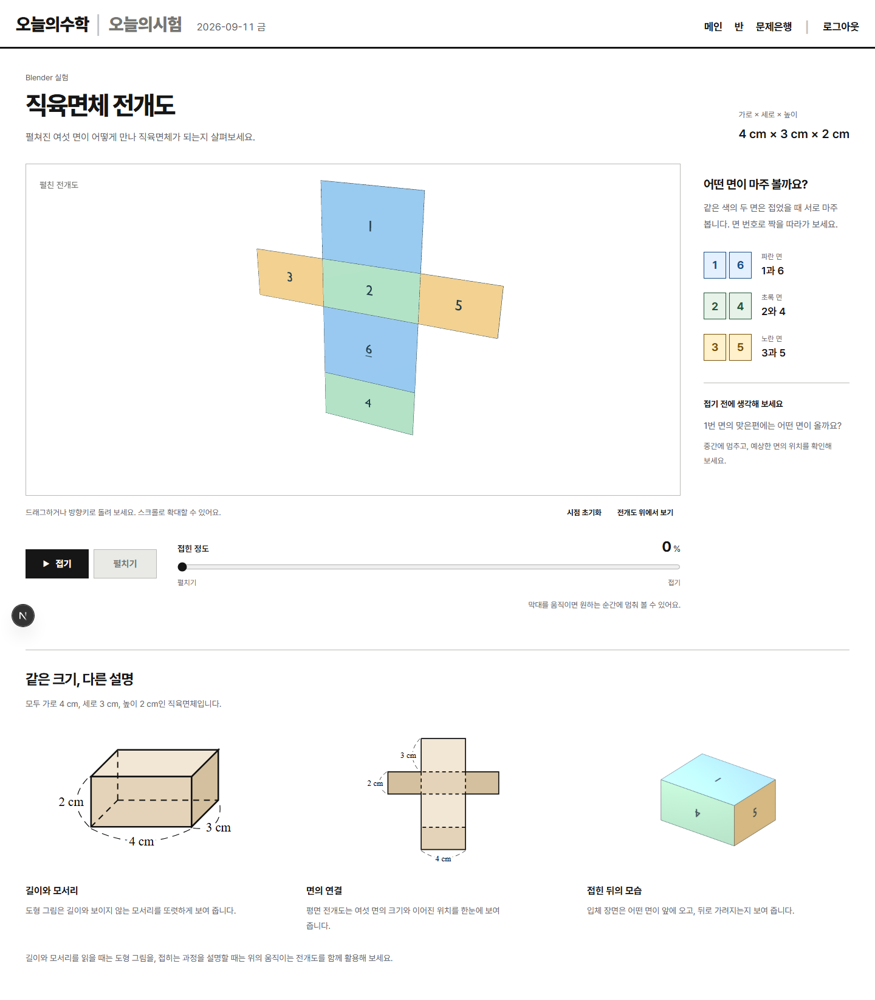
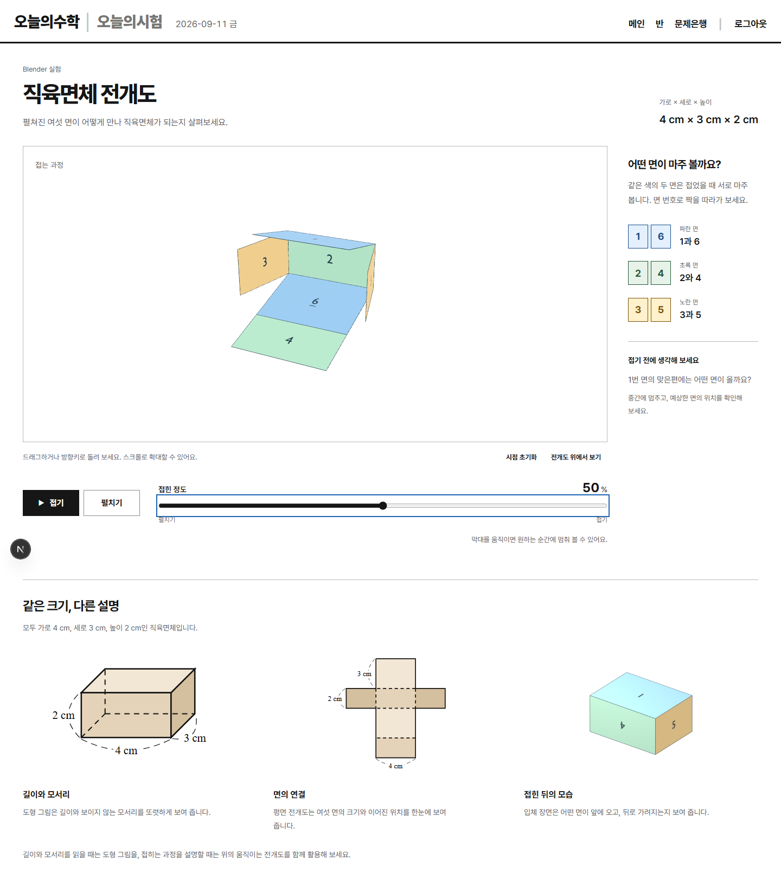

# Blender 설명 도형 실험 검수

2026-09-11, `http://localhost:3000/dev/blender`에서 확인했다. 구현과 활용 판단은 [생성 도구 문서](../../../../scripts/blender/README.md)에 있다.

- 실제 Blender 5.2.1 LTS로 생성한 GLB를 불러오며 `Fold` 애니메이션 길이는 3초다. UI는 설명에 맞춰 6초에 걸쳐 재생한다.
- Blender에서 91개 프레임의 면적·회전축과 닫힌 입체의 꼭짓점·모서리를 검사했다. 내보낸 GLB를 Three.js로 독립 검증한 결과도 통과했다.
- 컴포넌트 테스트 8개, 전체 TypeScript 검사, 관련 ESLint 검사가 통과했다.
- Chromium 실제 브라우저에서 접기 완료(2.999초), 펼치기 완료(0초), 50% 탐색(1.5초), 중간 일시정지, Home/End, 시점 초기화와 드래그 회전을 확인했다.
- 390 × 844 모바일에서 가로 넘침이 없고, 움직임 줄이기 설정에서는 즉시 목표 상태로 이동한다.
- GLB 요청을 한 번 503으로 실패시킨 뒤 재시도했다. 첫 요청 실패 때 조작이 비활성화되고, 두 번째 요청 성공 후 정상 조작으로 복구됐다.
- 인쇄 매체 렌더에서는 조작 화면이 숨겨지고 번호 있는 정적 SVG가 표시된다. 이 확인은 브라우저의 인쇄 CSS 검수이며 종이 출력이나 페이지 나눔 검증은 포함하지 않는다.
- 비교용 그림의 grid 최소 크기 때문에 전개도가 설명문을 덮는 문제를 발견해 수정했다. 세 그림 모두 지정된 240px 영역 안에 표시된다.
- Orca 내장 브라우저에서도 모델의 `loaded: true`를 확인했다. 개발 서버와 이 탭을 열어 두었다.
- 작업 브랜치를 `main`에 병합했다. 완료 보고 후 작업 터미널과 워크트리를 제거하고 `BIGSHOL/blender-dev-ui` 브랜치는 보존했다.

| 펼친 상태                      | 접는 과정                      |
| ------------------------------ | ------------------------------ |
|  |  |

[접힌 상태](desktop-folded.png), [모바일 화면](mobile.png), [인쇄 CSS 화면](print.png).
