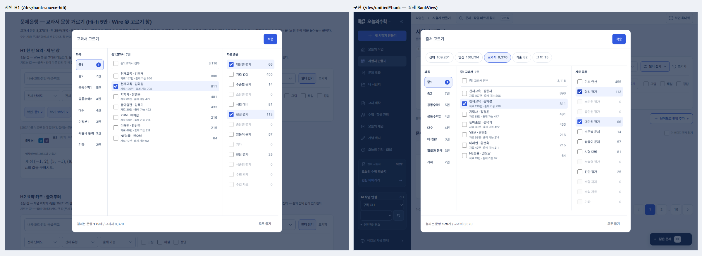
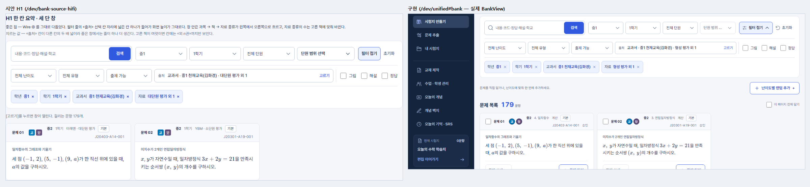
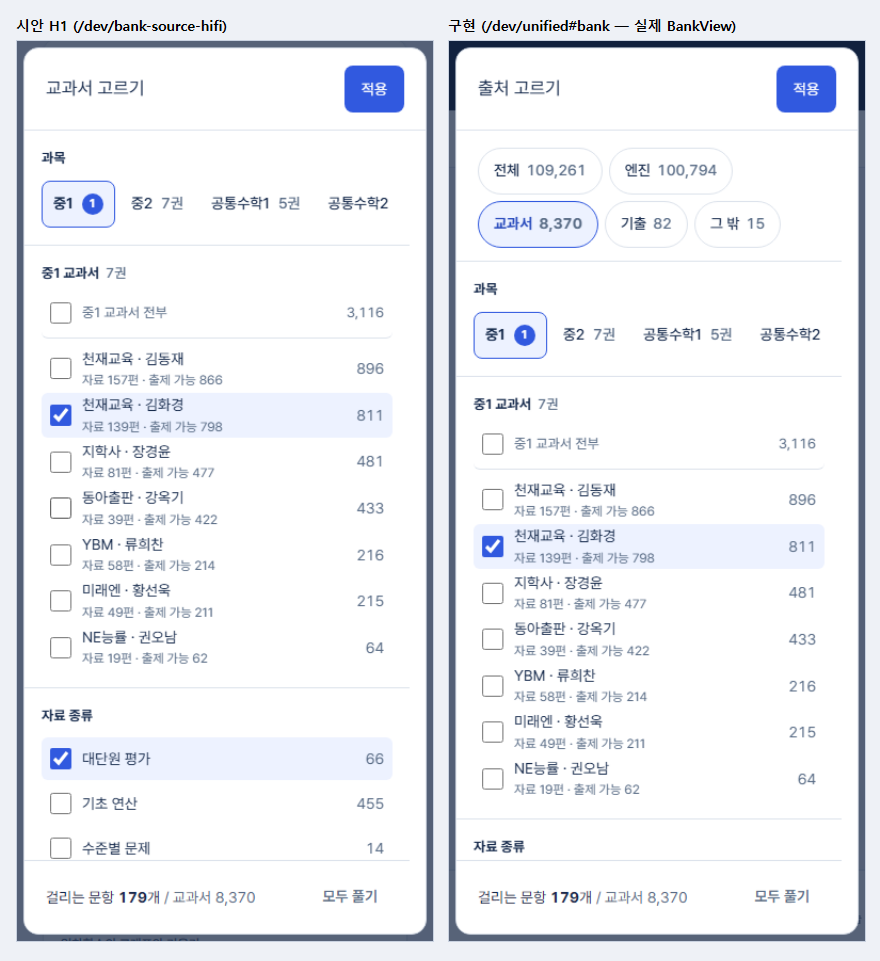

# 문제은행 «출처 고르기» H1 실구현 (D-161 · 2026-10-08)

작업트리 `bank-source-h1` · 가지 `chrismathone/bank-source-h1`(origin/main `6ecf0ee99` 에서 갈라짐).
지시서 `E:\todays-math-textbook-import\briefs\brief-bank-source-h1.md` · 확정 사양 05 S-08 «교과서 문항 거르기 `[확정 — 2026-10-08]`»(리드 가지).
🔴 공유 DB 는 건드리지 않았다(스키마 변경 0 · 마이그레이션 0). main 에 밀지 않았다 — 이 가지에 커밋하고 원격 가지까지만.

## 0. 한 줄

작업실 문제은행(`BankView` — 운영 `/#bank`)의 필터 둘째 줄 «출처» 선택 칸 자리에 **H1 한 칸 요약**을 세우고, 누르면 공용
고르기 창(`PickerDialog`, 규칙 11)이 **출처 줄 → 과목 │ 책 │ 자료 종류 세 단 → 걸리는 문항 · 모두 풀기**로 열린다. 첫 줄에는
**학기** 칸이 섰다. 목록 · 랜덤 추가가 같은 새 조건 넷(`semester` · `sourceGroup` · `books` · `materialKinds`)을 쓰고, 창의 수는 새
라우트 `GET …/problems/sources` 가 준다. 세부 ⑴~⑷ 는 화면 시험이 하나씩 겨눈다.

## 1. 리드에게 물어 정한 것 (2026-10-08 · `orca ask`)

| 물음 | 답 |
|---|---|
| Q1 시안의 «학기» 칸이 실제 코드 어디에도 없다 | **이번 범위에 넣는다** — «전체 학기 / 1학기 / 2학기» · `unit.semester` · 모든 출처에 듣는다 · 학기 없는 차시(고등 선택 과목)는 «전체 학기»일 때만 · 칩 «학기 1학기» |
| Q2 출처 줄의 «엔진» · «그 밖» | `sourceGroup`(engine \| school_textbook \| past_exam \| other) 새 값 · **엔진 = `source = manual` 전부 · 그 밖 = 변형 + AI 생성** · 옛 `source`(한 값)도 그대로 받는다 · 칩 «출처 엔진» · `SOURCE_LABEL`(«자작»)은 고치지 않는다 |
| Q3 창 안의 수 | 시안 그대로 — **다른 필터와 무관하게** 공용 풀(`pool = shared`)의 문항으로 센다. 책의 큰 수 = 실린 문항 · «출제 가능 n» = 출제 자격 · «걸리는 문항» = 책 × 자료 종류 |

⚠️ **«엔진»은 `source = manual` 전부다.** manual 에는 엔진 표지(`familyKey`) 없는 옛 수작업 행이 섞여 있다
(`provenance.ts` `classifyOrigin` 의 `unknown` — `provenance.ts:209`). 출처 줄은 표지를 보지 않고 출처 값으로만 가른다.
그래서 출처 줄의 «엔진»과 문항 상세의 출처 이름(`SOURCE_LABEL.manual` = «자작»)은 다른 말이다(리드 결정 — 상세 쪽은 그대로).

## 2. 바꾼 것

### 계약 (`src/contracts/bankSource.contract.ts` — 새 파일)

- `unifiedBankQuerySchema` — 옛 `problemFilterQuerySchema` 에서 이 화면이 쓰는 칸 + 새 넷. 엄격(모르는 열쇠 400).
  - `books` · `materialKinds` 는 **쉼표로 이은 한 값**(이웃 필터와 같은 «열쇠 하나 · 값 하나»)을 계약이 배열로 푼다 · 겹친 것은 하나로 ·
    빈 조각만이면 400. 책 열쇠는 `source_book.id`(uuid) · 자료 종류는 `SOURCE_MATERIAL_KINDS` 밖이면 400 · 책은 한 번에 100권까지.
  - 🔴 **책 · 자료 종류는 교과서 출처(`sourceGroup=school_textbook` 또는 옛 `source=school_textbook`)에만** — 다른 출처와 섞이면 조용히 0건이
    되므로 400 으로 알린다.
- `BANK_SOURCE_GROUPS` · `BANK_SOURCE_GROUP_SOURCES`(갈래 → 출처 값 — 출처 값 다섯이 한 갈래에 하나씩, 시험이 지킨다) · `bankSemesterSchema`.
- `bankSourceCountsSchema` — 창이 받는 수: 갈래별 수 + 전체 · 교과서 전체(자료 없는 교과서 문항까지) · 책이 있는 과목(교육과정 차례) ·
  자료 종류(계약 차례) · 책마다 `count` · `open` · `materials` · 자료 종류별 수 `kinds`.

### 서버

| 파일 | 무엇 |
|---|---|
| `src/lib/unifiedPreview.ts` | 조회 조건을 `unifiedBankQuerySchema` 로. `semester` → `{ unit: { semester } }` · `sourceGroup` → `{ source: { in } }` · `books` → `{ sourceMaterial: { bookId: { in } } }` · `materialKinds` → `{ sourceMaterial: { kind: { in } } }`(둘 사이는 «그리고»). 학기를 고르면 단원 목록(`chapters`)도 그 학기만. 차시 목록(`units`)은 `UnitEntity` 칸만 싣는다(학기 칸을 흘리지 않게). 랜덤 추가(`unifiedBankSelection`)는 같은 함수를 쓰므로 그대로 따라온다 |
| `src/lib/bankSourceCounts.ts` (새) | 창의 수. 묶음 셈 셋(출처별 · 자료별 실린 수 · 자료별 출제 가능 수 — `groupBy`) + 책 · 자료 · 차시 목록. **문항 행을 읽지 않는다.** 문항 없는 책 · 문제집(`kind = workbook`)은 목록에 없다 |
| `src/app/api/studio/problems/sources/route.ts` (새) | 운영 라우트 — `withErrorLog` · 관문은 이웃 목록 라우트와 같은 `authorizeStudio`(경로가 `/api/studio/problems` 아래라 메뉴 권한도 같은 `bank`) |
| `src/app/api/dev/unified/problems/sources/route.ts` (새) | dev 짝 — 운영 빌드 404(이웃과 같다) |

### 화면

| 파일 | 무엇 |
|---|---|
| `src/components/unified/BankView.tsx` | 첫 줄 학년 다음 **학기** 칸 · 둘째 줄 «출처» 선택 칸 → **H1 칸**(`BankSourceField`) · 창 열기 · [적용] · 칩. 필터 상태에 `semester` · `sourceGroup` · `books` · `materialKinds` — 이웃 필터와 같은 `updateFilters` → 쿼리스트링(배열은 쉼표로 이은 한 값, 빈 고르기는 안 보낸다). 창의 수는 처음 열 때 한 번 받아 계약으로 검사한다 |
| `src/components/unified/BankSourcePicker.tsx` (새) | 창 안 — 출처 줄(수 붙음) → 교과서면 과목(책 수 · 고른 책이 있으면 파란 수 배지) │ 그 과목의 책(«○○ 교과서 전부» 줄 · «자료 n편 · 출제 가능 n» · 문항 수) │ 자료 종류(고른 책에 맞춘 수) · 아래 줄 «걸리는 문항 n개 / 교과서 N» · «모두 풀기». 교과서가 아니면 «○○ 문항은 책 · 자료 종류가 없습니다. [적용]을 누르면 출처만 걸립니다.» |
| `src/components/unified/BankSourcePicker.module.css` (새) | 시안 `hifi.module.css` 의 H1 규칙 + 출처 줄(H2 의 `segments`) — `--bank-*` 토큰만 |
| `src/components/unified/bankSourcePick.ts` (새) | 창 안의 셈(요청 없음) · 칸 · 칩의 글 · 처음 펼칠 과목 · «전체 학년»으로 돌릴지 |
| `src/components/picker-dialog/PickerDialog.tsx` | **부품을 넓혔다**(규칙 11) — Esc 를 따로 받는 `onCancel`. 주지 않으면 지금처럼 `onClose`(개념 백지 · 교재 제작은 그대로) |
| `src/components/problem/labels.ts` | `BANK_SOURCE_GROUP_LABEL`(엔진 · 교과서 · 기출 · 그 밖) |

세부 넷의 구현:

- ⑴ 필터 줄의 «출처» 선택 칸은 없어지고 칸 하나 — «전체 출처» · «엔진» · «교과서 · 중1 천재교육(김화경) 외 1권 · 형성 평가 외 1». 창 제목 «출처 고르기» · 닫는 단추 «적용».
- ⑵ 고른 책에 0문항인 자료 종류는 `opacity .45` + `disabled`, 줄은 그대로. **이미 고른 것은 0 이 돼도 체크가 남고 흐리며 풀 수 있다**(막으면 못 푼다).
- ⑶ 창은 필터 줄 학년의 과목부터 열린다(없으면 고른 첫 책의 과목 → 첫 과목). 학년 칸과 다른 과목의 책이 끼면 [적용] 때 학년을 «전체 학년»으로(단원은 학년에 딸려 같이 푼다).
- ⑷ 창 안의 체크는 초안이다 — 목록 요청은 [적용]에서만 나가고 바뀐 것이 없으면 그마저 안 나간다. Esc(`cancel`)는 초안을 버린다. 창의 수는 한 번 받으면 다시 열어도 다시 세지 않는다.

칩: 책을 고르면 «교과서 …» 하나, 자료 종류를 고르면 «자료 …» 하나 — 각각 × 로 그 차원만 푼다. 책이 없으면 «출처 교과서»(또는 «출처 엔진» …) 칩이 서고,
그 × 는 출처 차원 전부(자료 종류까지 — 서버가 섞인 조건을 막으므로)를 푼다(그때 칩의 읽기 이름에 «(자료 종류도 해제)»).

### 시험 대역 (`src/mocks/`)

`source_book` · `source_material` 표(심기 · 읽기) · 문항의 `sourceMaterial` 관계 · `problem.groupBy`(`_count._all` 만 — 모르는 집계는 던진다) ·
`unit.update`(차시 학기를 바꿔 심기) · 발췌 차시에 `semester`(DB 와 같은 원천 `semesterOfUnit` — 발췌 구간은 전부 1학기). 트랜잭션 스냅숏 · 복원에 새 표 둘(가드 시험이 본다).

## 3. 시험

| 시험 | 건수 | 겨누는 것 |
|---|---|---|
| `src/__tests__/unit/bankSource.contract.test.ts` (새) | 13 | 갈래가 출처 값을 빠짐없이 하나씩 · 쉼표 목록 풀기 · uuid · 목록 밖 종류 · 빈 조각 · 교과서 밖 400 · 학기 · 엄격 · 창의 수 꼴 |
| `src/__tests__/api/unifiedBankSource.test.ts` (새) | 15 | 빈 고르기 = 교과서 전부(자료 없는 문항까지) · 책 여럿 · 종류 여럿 · 책 × 종류 «그리고»(총수 · 쪽까지) · 갈래 셋 · 옛 `source` 호환 · 랜덤 추가가 같은 조건 · 400 여섯 · 학기(모든 출처 · 학기 없는 차시) · 학기가 단원 목록을 좁힘 · 수 세기 다섯(공용 풀 · 비공개 제외 · 잠금은 출제 가능에서만 · 자료 편수 · 문제집 · 빈 책 제외 · 과목 · 책 · 종류 차례 · dev 라우트 404) |
| `src/__tests__/api/studioWorkspace.test.ts` (+1) | 1 | 운영 수 세기 라우트 — 로그인 없으면 401 이고 세지 않는다 · 검수자도 목록 라우트와 같은 답 · `no-store` |
| `src/__tests__/unit/bankSourcePick.test.ts` (새) | 9 | 걸리는 문항 · 고른 책에 맞춘 종류 수 · 칸 · 칩 글 · 처음 펼칠 과목 · «전체 학년» 판정 |
| `src/__tests__/components/BankView.source.test.tsx` (새) | 17 | ⑴ 선택 칸 없음 · 칸 글 · 창 제목 · 적용 · 출처 줄 수 · 교과서일 때만 세 단 · 엔진 적용 / ⑵ 0 이면 막힘 · 줄 그대로 · 고른 것은 남고 흐림 / ⑶ 학년 따라 열림 · 배지 · 다른 과목이면 «전체 학년» · 같은 과목이면 그대로 / ⑷ 적용 전 요청 0 · 걸리는 문항만 바뀜 · 적용 쿼리와 칩 · Esc 는 버림 · 수는 한 번만 · 모두 풀기 · «과목 전부» 줄 / 칩 × 셋 · 초기화 · 학기 칸 · 수 실패 시 다시 시도 |
| `src/__tests__/components/BankView.filters.test.tsx` (고침) | — | 옛 «출처» 선택 칸을 쓰던 넷을 새 꼴로(학기 칸 · 출처 칸 단추). 계약 검사는 `unifiedBankQuerySchema` 로 |

변이(시험이 정말 무는지): 목록의 책 조건을 끄면 3건, 학기 조건을 끄면 1건, 수 세기의 «출제 가능»을 «실린 수»로 바꾸면 1건이 빨개졌다(전부 원복).

### 관문

| 검사 | 결과 |
|---|---|
| `npm run type-check` | 초록(남은 메모리 6GB 를 보고 돌림) |
| `npx eslint` (바꾼 · 새 파일 전부) | 오류 0 · 경고 0 |
| `npm run lint:affordance` | 초록(커밋 훅의 영향 파일 검사도 초록) |
| 새 · 바뀐 시험(위 표) | 초록 — 계약 13 · API 15 + 관문 1 · 셈 9 · 화면 17 · 이웃 BankView 셋 47 |
| **관련 묶음 354파일**(`src/__tests__/api` 전부 + 문제은행 · 작업실 · 계약 · 라벨 · 고르기 창 · 차시 픽스처 · 시험 대역 · 라우트 가드를 부르는 시험) | **350파일 초록 · 4파일 5건 빨강 — 넷 다 origin/main 그대로의 빨강**(아래) |

빨강 넷은 이 가지와 무관하다 — `src/` 를 잠시 origin/main 으로 돌려 그 넷만 돌려도 **같은 4파일 · 5건이 빨갛다**(실측 후 HEAD 로 복원):

| 파일 | 까닭(main 의 것) |
|---|---|
| `components/ProblemBank.test.tsx` «네 출처를 모두 고를 수 있다» | 옛 문제은행의 출처 칸 기대값에 «교과서»가 없다 — `SOURCE_OPTIONS` 에 `school_textbook` 이 든 것은 D-161(main) |
| `unit/errorLogRouteCoverage.test.ts` 둘 | `/api/english/questions` · `…/resolve` 가 `withErrorLog` 를 안 지난다(main `25ff36622`) — 이 가지의 새 라우트 둘은 가드를 지난다 |
| `unit/textbookTeacherBlank.test.ts` | 교재 백지 응답 계약에 `questionMode` 가 모르는 열쇠 |
| `unit/bankChoiceFigures.test.tsx` B1 | 보기 그림 지면의 HTML 지문(해시) 기준선이 어긋남 — 이 가지는 렌더 경로를 안 건드린다 |

전체 1,343파일은 돌리지 못했다 — 엔진 전수 시험이 앞에 서서 10분에 19파일 속도라 멈추고 위 관련 묶음으로 좁혔다.

## 4. 시안과 나란히 (1440 · 390)

실제 작업실 문제은행(`/dev/unified#bank` — 운영 `/#bank` 와 같은 `BankView` · 같은 카드 렌더 경로)을 dev 서버로 띄우고,
목록 · 수 요청만 브라우저에서 가로채 **리드 시안의 공유 DB 셈**(2026-10-08 오후 — 책 35 · 자료 종류 13 · 교과서 8,370 · 출처별 수)으로 채웠다.
같은 상태(학년 중1 · 학기 1학기 · 교과서 · 천재교육(김화경) · 대단원 평가 + 형성 평가)로 찍었다. 다시 찍기:
`scripts/qa/bank-source-h1/capture.mjs`(머리말 — 임시 `AUTH_SECRET` · DB `127.0.0.1:1` · Turbopack dev).

**PC 1440 — 창** (왼쪽 시안 · 오른쪽 구현)

**PC 1440 — 적용한 뒤의 필터 줄 · 칩 · 목록**

**폰 390 — 창**

구현 낱장: [pc-dialog](bank-source-h1/pc-dialog.png) · [pc-screen](bank-source-h1/pc-screen.png) ·
[phone-dialog](bank-source-h1/phone-dialog.png) · [phone-screen](bank-source-h1/phone-screen.png)(390 폭의 필터 — 출처 칸이 한 줄 전폭 · 말줄임, 가로 넘침 없음).

## 5. 시안과 다른 것 · 남은 것

### 시안과 다른 것 (확정 사양 · 계약을 따른 것)

1. **창 맨 위 출처 줄**(세부 ⑴ — 시안 H1 에는 없었다). 창 제목도 «교과서 고르기» → «출처 고르기». 폰 390 에서는 출처 줄이 두 줄로 접힌다.
2. **0문항 자료 종류는 체크를 막는다**(세부 ⑵ — 시안은 고를 수 있었다). 이미 고른 것만 0 이 돼도 남고 풀 수 있다.
3. **자료 종류의 차례는 계약의 차례**(`SOURCE_MATERIAL_KINDS` — «쉬운 것 → 넓은 것 → 그 밖», 계약 머리말이 «거르기 목록이 이 차례로 그린다»고 적었다).
   시안은 문항 수 차례였다. 그래서 칸 · 칩의 «첫 종류 외 n»도 계약 차례의 첫 것이다 — 시안 «대단원 평가 외 1» → 구현 «형성 평가 외 1»(같은 두 종류).
4. 교과서를 골랐는데 책 · 종류가 비면 칸 글은 «교과서 · 책 전부 · 자료 전부»(시안 함수대로면 «교과서 · 교과서 전부 · 자료 전부» — 같은 낱말 겹침을 피했다).
5. 책이 없을 때의 칩은 «출처 교과서»(시안에는 이 경우가 없었다) — × 는 출처 차원 전부를 푼다.
6. PC 첫 줄에 학기 칸이 들어가 1440 폭(옆 메뉴 240px 포함)에서는 «단원 범위 선택»이 «단원 범위 …»로 줄어든다(시안은 옆 메뉴 없는 1360 틀). 칸의 `title` 로 전체 글이 읽힌다.

### 남은 것

- **원장님 눈 검수** — 위 나란히 PNG 는 실제 화면이지만 수는 가로챈 셈(리드 시안의 공유 DB 셈)이다. **실 DB 로는 창의 수 · 목록 거르기를 재지 못했다**(이 작업트리에 `.env` 가 없다 · 공유 DB 무변경). 병합 뒤 운영 `/#bank` 에서 창의 수가 시안 셈(교과서 8,370 · 책 35)과 맞는지 본다.
- **수 세기 질의의 실 DB 비용** — 묶음 셈 셋(출처별은 공용 풀 전체 약 11만 행을 `source` 로 묶는다) + 책 · 자료 · 차시 목록. 창을 처음 열 때 한 번이다. 운영에서 느리면 `problem(source)` 색인 · 캐시를 본다.
- **옛 `/problems`(`ProblemBank` · `/api/problems`)는 그대로다** — 지시서가 겨눈 것은 작업실의 `BankView`. 옛 화면에는 «출처» 선택 칸(교과서 포함)이 남아 있고 학기 · 책 · 자료 종류는 없다. 그 화면의 시험 하나는 main 에서 이미 빨갛다(§3).
- 랜덤 추가(«난이도별 랜덤 추가»)는 서버가 같은 조건 함수를 쓰므로 책 · 자료 종류 · 학기를 따른다 — API 시험으로만 쟀고 화면에서 눌러 보지는 않았다.
- 칩의 책 이름은 창의 수를 받은 뒤에만 이름으로 선다(책은 창에서만 고를 수 있어 지금은 늘 받은 뒤다). 언젠가 주소 · 대시보드에서 책을 실어 들어오면 «n권»으로 적힌다(지어내지 않는다).
- main 의 빨강 넷(§3)은 이 가지에서 고치지 않았다 — 다른 세션의 몫이다.
