# 정답 없는 소단원별 표본

실제 `generateCourseSession`의 기본·응용 문항을 한 개씩 실었다. 가능한 경우 새로 작성한 재추첨 틀을 골랐다. 발문은 응답 그대로이며 정답·풀이·보기는 싣지 않았다. 그림은 저장된 `figureSpec`을 제품의 `renderFigureSpec`으로 그렸다.

## 5-1-1-1 덧셈과 뺄셈 / 곱셈과 나눗셈이 섞여 있는 식

### 기본

회차 씨앗 1256748 · 문항 씨앗 1578854 · number

$31-13+5$를 앞에서부터 계산할 때, 첫 번째 계산의 결과는 얼마입니까?

### 응용

회차 씨앗 1152019 · 문항 씨앗 1691502 · number

□ 안에 알맞은 수를 구하시오.  $12\div\square\times4=8$

## 5-1-1-2 덧셈, 뺄셈, 곱셈(나눗셈)이 섞여 있는 식

### 기본

회차 씨앗 1256748 · 문항 씨앗 1578854 · number

$51-9\times5+10$을 바르게 계산할 때, 가장 먼저 하는 계산의 결과는 얼마입니까?

### 응용

회차 씨앗 628374 · 문항 씨앗 1159938 · number

$53-3\times5+8$의 값에 $14$를 더하면 얼마입니까?

## 5-1-1-3 덧셈, 뺄셈, 곱셈, 나눗셈이 섞여 있는 식

### 기본

회차 씨앗 628374 · 문항 씨앗 950480 · number

주스가 $27$ L 있습니다. 이 주스를 통 $3$개에 똑같이 나누어 담은 뒤, 그중 한 통에 주스를 $4$ L씩 $4$번 더 부었습니다. 이 통에서 $18$ L를 덜어 내면 이 통에 남는 주스는 몇 L입니까?

### 응용

회차 씨앗 104729 · 문항 씨앗 636293 · number

$3\times9+27-15\div3$에서 곱셈의 결과와 나눗셈의 결과를 더하면 얼마입니까?

## 5-1-2-1 약수와 배수

### 기본

회차 씨앗 1152019 · 문항 씨앗 1474125 · number

$24$의 약수는 모두 몇 개입니까?

### 응용

회차 씨앗 1047290 · 문항 씨앗 1578854 · number

$18$의 약수 중에서 $1$과 자기 자신을 뺀 수는 모두 몇 개입니까?

## 5-1-2-2 약수와 배수의 관계

### 기본

회차 씨앗 1047290 · 문항 씨앗 1369396 · number

$27$은 $3$의 배수입니다. $27$을 $3$으로 나누면 몫은 얼마입니까?

### 응용

회차 씨앗 1256748 · 문항 씨앗 1796231 · number

$2\times5=10$에서 알 수 있는 $10$의 약수는 모두 몇 개입니까?

## 5-1-2-3 공약수와 최대공약수

### 기본

회차 씨앗 1152019 · 문항 씨앗 1474125 · number

$20$과 $16$의 최대공약수를 구하시오.

### 응용

회차 씨앗 1047290 · 문항 씨앗 1578854 · number

$28$과 $42$의 공약수 중에서 짝수를 모두 더하면 얼마입니까?

## 5-1-2-4 최대공약수 구하는 방법

### 기본

회차 씨앗 1256748 · 문항 씨앗 1578854 · number

두 수 $16$, $20$의 최대공약수로 $20$을 나누면 나머지는 얼마입니까?

### 응용

회차 씨앗 1256748 · 문항 씨앗 1796231 · number

두 수 $24$, $40$의 최대공약수와, $24$을 최대공약수로 나눈 몫을 곱하면 얼마입니까?

## 5-1-2-5 공배수와 최소공배수

### 기본

회차 씨앗 942561 · 문항 씨앗 1264667 · number

$4$와 $10$의 공배수 중에서 짝수인 수 중 가장 작은 수를 구하시오.

### 응용

회차 씨앗 942561 · 문항 씨앗 1474125 · number

$6$과 $15$의 공배수 중에서 $62$보다 큰 수 중 가장 작은 수를 구하시오.

## 5-1-2-6 최소공배수 구하는 방법

### 기본

회차 씨앗 1256748 · 문항 씨앗 1578854 · number

어떤 두 수를 공약수 $4$로 나누었더니 몫이 $3$과 $5$가 되었고 두 몫의 공약수는 $1$뿐입니다. 공약수와 두 몫을 모두 곱하면 얼마입니까?

### 응용

회차 씨앗 1256748 · 문항 씨앗 1788312 · number

가로가 $10$ cm, 세로가 $15$ cm인 직사각형 모양 색 카드를 겹치지 않게 빈틈없이 늘어놓아 가장 작은 정사각형을 만들었습니다. 사용한 색 카드는 모두 몇 장입니까?

## 5-1-3-1 두 양 사이의 대응 관계

### 기본

회차 씨앗 1256748 · 문항 씨앗 1578854 · number

표는 □가 $4$부터 $1$씩 커질 때의 △를 나타낸 것입니다. 표에 있는 △를 모두 더하면 얼마입니까?

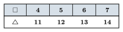

그림 사양: `{"version":"elem-1","kind":"table","headers":["□","4","5","6","7"],"rows":[["△","11","12","13","14"]]}`

### 응용

회차 씨앗 1256748 · 문항 씨앗 1796231 · number

표는 □가 $1$부터 $1$씩 커질 때의 △를 나타낸 것입니다. 표에 있는 △를 모두 더한 뒤 가장 큰 △를 빼면 얼마입니까?

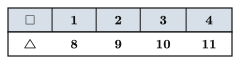

그림 사양: `{"version":"elem-1","kind":"table","headers":["□","1","2","3","4"],"rows":[["△","8","9","10","11"]]}`

## 5-1-3-2 대응 관계를 식으로 나타내기

### 기본

회차 씨앗 209458 · 문항 씨앗 531564 · number

표의 대응 관계는 $\triangle=\square\times\text{㉠}$입니다. ㉠에 알맞은 수를 구하시오.

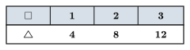

그림 사양: `{"version":"elem-1","kind":"table","headers":["□","1","2","3"],"rows":[["△","4","8","12"]]}`

### 응용

회차 씨앗 104729 · 문항 씨앗 636293 · number

표와 같은 대응 관계에서 □가 $8$일 때의 △와 □가 $12$일 때의 △의 합을 구하시오.

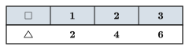

그림 사양: `{"version":"elem-1","kind":"table","headers":["□","1","2","3"],"rows":[["△","2","4","6"]]}`

## 5-1-3-3 생활 속에서 대응 관계를 찾아 식으로 나타내기

### 기본

회차 씨앗 104729 · 문항 씨앗 314187 · self-check

형은 동생보다 $5$살 많습니다. 동생의 나이를 □, 형의 나이를 △라고 할 때, 두 양 사이의 대응 관계를 식으로 나타내시오.

### 응용

회차 씨앗 104729 · 문항 씨앗 636293 · number

누나는 동생보다 $6$살 많습니다. 동생이 $15$살일 때 누나는 몇 살입니까?

## 5-1-4-1 크기가 같은 분수 알아보기

### 기본

회차 씨앗 418916 · 문항 씨앗 741022 · number

$\frac{1}{3}$과 $\frac{3}{9}$은 크기가 같습니다. 분모는 몇 배가 되었습니까?

### 응용

회차 씨앗 733103 · 문항 씨앗 1264667 · number

$\frac{5}{6}$와 크기가 같은 분수 중에서 분자가 $20$인 분수의 분모를 구하시오.

## 5-1-4-2 분수를 간단하게 나타내기

### 기본

회차 씨앗 104729 · 문항 씨앗 426835 · number

주어진 분수 $\frac{4}{10}$에 대해 크기가 같은 기약분수의 분자는 얼마입니까?

### 응용

회차 씨앗 104729 · 문항 씨앗 636293 · number

두 분수 $\frac{10}{15}$, $\frac{6}{9}$에 대해 각각 크기가 같은 기약분수로 만들었습니다. 두 기약분수의 분모의 합은 얼마입니까?

## 5-1-4-3 통분

### 기본

회차 씨앗 1256748 · 문항 씨앗 1578854 · number

분모가 $6$인 분수와 분모가 $8$인 분수를 두 분모의 최소공배수를 공통분모로 하여 통분할 때, 공통분모는 얼마입니까?

### 응용

회차 씨앗 942561 · 문항 씨앗 1474125 · number

$\frac{3}{4}$과 $\frac{9}{10}$를 두 분모의 최소공배수를 공통분모로 하여 통분했을 때, 두 분자의 곱을 구하시오.

## 5-1-4-4 분수의 크기 비교

### 기본

회차 씨앗 1256748 · 문항 씨앗 1578854 · number

분모가 $12$으로 같은 $\frac{1}{12}$과 $\frac{4}{12}$ 중에서 더 작은 분수의 분자를 구하시오.

### 응용

회차 씨앗 1152019 · 문항 씨앗 1683583 · number

분자가 $1$인 $\frac{1}{6}$과 $\frac{1}{4}$ 중에서 분모가 더 작은 분수의 분모를 구하시오.

## 5-1-4-5 분수와 소수의 크기 비교

### 기본

회차 씨앗 1152019 · 문항 씨앗 1474125 · number

$0.45$와 $\frac{3}{25}$ 중 더 큰 수를 쓰시오.

### 응용

회차 씨앗 1152019 · 문항 씨앗 1683583 · number

$\frac{2}{5}$, $0.85$, $0.7$ 중에서 크기가 가운데인 수를 쓰시오.

## 5-1-5-1 진분수의 덧셈

### 기본

회차 씨앗 104729 · 문항 씨앗 314187 · number

지호는 주스 $\frac{2}{3}$ L를, 도윤은 $\frac{1}{10}$ L를 가지고 있습니다. 두 사람이 가진 주스는 모두 몇 L입니까?

### 응용

회차 씨앗 1256748 · 문항 씨앗 1796231 · number

$\frac{3}{5}$과 $\frac{1}{8}$의 합에 얼마를 더해야 $1$이 됩니까?

## 5-1-5-2 대분수의 덧셈

### 기본

회차 씨앗 1256748 · 문항 씨앗 1578854 · number

$2\frac{3}{8}$과 $3\frac{3}{4}$를 더할 때, 분수부끼리 더한 값은 얼마입니까?

### 응용

회차 씨앗 104729 · 문항 씨앗 531564 · number

물이 $3\frac{1}{4}$ L 든 통과 $2\frac{1}{7}$ L 든 통의 물을 모두 한 통에 모았습니다. 그중 $1\frac{1}{4}$ L를 사용한 뒤 남은 물은 몇 L입니까?

## 5-1-5-3 진분수의 뺄셈

### 기본

회차 씨앗 104729 · 문항 씨앗 314187 · number

민준은 밀가루 $\frac{11}{12}$ kg을, 서아는 $\frac{1}{3}$ kg을 가지고 있습니다. 민준은 서아보다 몇 kg 더 많이 가지고 있습니까?

### 응용

회차 씨앗 104729 · 문항 씨앗 523645 · number

끈 한 개의 $\frac{8}{12}$을 어제 쓰고, $\frac{3}{12}$을 오늘 썼습니다. 남은 끈은 전체의 얼마입니까?

## 5-1-5-4 대분수의 뺄셈

### 기본

회차 씨앗 1152019 · 문항 씨앗 1474125 · number

$4\frac{3}{8}$에서 $2\frac{4}{5}$를 뺄 때, 자연수부끼리 뺀 값은 얼마입니까?

### 응용

회차 씨앗 104729 · 문항 씨앗 539483 · number

가 통에는 물이 $6\frac{1}{3}$ L, 나 통에는 $4\frac{1}{6}$ L 있었습니다. 가 통에서 $1\frac{1}{6}$ L, 나 통에서 $2\frac{1}{5}$ L를 사용했습니다. 두 통에 남은 물의 양의 차는 몇 L입니까?

## 5-1-6-1 정다각형과 사각형의 둘레

### 기본

회차 씨앗 837832 · 문항 씨앗 1159938 · number

가로가 $11$ cm, 세로가 $4$ cm인 직사각형의 가로와 세로의 합은 몇 cm입니까?

### 응용

회차 씨앗 1152019 · 문항 씨앗 1683583 · number

가로 $14$ cm, 세로 $8$ cm인 직사각형의 가로만 $6$ cm 늘이면 둘레는 몇 cm 늘어납니까?

## 5-1-6-2 1cm², 직사각형과 정사각형의 넓이

### 기본

회차 씨앗 104729 · 문항 씨앗 314187 · number

다음 정사각형 모양 타일의 넓이는 몇 cm²입니까?

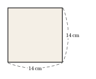

그림 사양: `{"version":"elem-1","kind":"areaPoly","shape":"rect","base":14,"height":14}`

### 응용

회차 씨앗 837832 · 문항 씨앗 1369396 · number

가로 $11$ cm·세로 $4$ cm인 직사각형과 가로 $11$ cm·세로 $10$ cm인 직사각형의 넓이의 합은 몇 cm²입니까?

## 5-1-6-3 1cm²보다 더 큰 넓이의 단위

### 기본

회차 씨앗 523645 · 문항 씨앗 845751 · number

가로 $6$ m, 세로 $5$ m인 직사각형의 넓이는 몇 $\mathrm{cm}^2$입니까?

### 응용

회차 씨앗 1152019 · 문항 씨앗 1691502 · number

가로가 $600$ cm, 세로가 $3$ m인 직사각형의 넓이는 몇 $\mathrm{m}^2$입니까?

## 5-1-6-4 평행사변형과 삼각형의 넓이

### 기본

회차 씨앗 837832 · 문항 씨앗 1159938 · number

넓이가 $21$ cm²인 삼각형의 높이가 $7$ cm입니다. 밑변은 몇 cm입니까?

### 응용

회차 씨앗 1047290 · 문항 씨앗 1578854 · number

밑변 $6$ cm, 높이 $12$ cm인 평행사변형과 밑변·높이가 같은 삼각형이 있습니다. 삼각형의 넓이는 몇 cm²입니까?

## 5-1-6-5 마름모와 사다리꼴의 넓이

### 기본

회차 씨앗 1152019 · 문항 씨앗 1474125 · number

두 대각선이 $16$ cm, $6$ cm인 마름모에서 두 대각선의 곱은 얼마입니까?

### 응용

회차 씨앗 1256748 · 문항 씨앗 1788312 · number

넓이가 $85$ cm²인 사다리꼴의 아랫변이 $11$ cm, 높이가 $10$ cm입니다. 윗변은 몇 cm입니까?

## 5-2-1-1 이상과 이하 알아보기

### 기본

회차 씨앗 1256748 · 문항 씨앗 1578854 · number

$12$ 이상인 자연수 중에서 가장 작은 수는 얼마입니까?

### 응용

회차 씨앗 1256748 · 문항 씨앗 1796231 · number

$23$ 이상 $34$ 이하인 자연수 중에서 $3$의 배수는 모두 몇 개입니까?

## 5-2-1-2 초과와 미만 알아보기

### 기본

회차 씨앗 1256748 · 문항 씨앗 1578854 · number

$42$ 미만인 자연수 중에서 가장 큰 수는 얼마입니까?

### 응용

회차 씨앗 1256748 · 문항 씨앗 1796231 · number

$42$ 초과 $53$ 미만인 자연수 중에서 짝수는 모두 몇 개입니까?

## 5-2-1-3 수의 범위를 알고 문제 해결하기

### 기본

회차 씨앗 1256748 · 문항 씨앗 1578854 · number

택배 회사에서 보통 요금으로 부치려면 무게가 $7$ kg 이상이어야 합니다. 상자의 무게가 $7,\ 2,\ 11,\ 6,\ 5$ kg일 때, 조건에 맞는 무게중 가장 작은 값은 얼마입니까?

### 응용

회차 씨앗 104729 · 문항 씨앗 636293 · number

물건 한 개의 배송 요금은 무게가 $3$ kg 이하이면 $3000$원, 초과이면 $6000$원입니다. 무게가 $4$ kg인 물건에서 포장재 $1$ kg을 덜어 내어 보냈습니다. 배송 요금은 얼마 줄었습니까?

## 5-2-1-4 올림 알아보기

### 기본

회차 씨앗 418916 · 문항 씨앗 741022 · number

$6686$을 올림하여 백의 자리까지 나타낼 때 더해지는 수는 얼마입니까?

### 응용

회차 씨앗 942561 · 문항 씨앗 1474125 · number

어떤 자연수를 올림하여 백의 자리까지 나타냈더니 $3700$이 되었습니다. 어떤 수가 될 수 있는 가장 작은 수는 얼마입니까?

## 5-2-1-5 버림 알아보기

### 기본

회차 씨앗 1152019 · 문항 씨앗 1474125 · number

$3719$를 버림하여 천의 자리까지 나타내시오.

### 응용

회차 씨앗 1047290 · 문항 씨앗 1578854 · number

어떤 자연수를 버림하여 백의 자리까지 나타냈더니 $8500$이 되었습니다. 어떤 수가 될 수 있는 가장 작은 수는 얼마입니까?

## 5-2-1-6 반올림 알아보기와 어림의 활용

### 기본

회차 씨앗 209458 · 문항 씨앗 531564 · number

$387$에 반올림을 적용하여 십의 자리까지 나타낸 수와 원래 수의 차를 구하시오.

### 응용

회차 씨앗 1256748 · 문항 씨앗 1796231 · number

어떤 자연수를 반올림하여 백의 자리까지 나타냈더니 $7100$이 되었습니다. 어떤 수가 될 수 있는 가장 큰 수는 얼마입니까?

## 5-2-2-1 (분수)×(자연수)의 계산

### 기본

회차 씨앗 209458 · 문항 씨앗 539483 · number

$\frac{3}{10}\times4$의 값을 대분수로 나타낼 때 자연수 부분은 얼마입니까?

### 응용

회차 씨앗 628374 · 문항 씨앗 1159938 · number

$\frac{3}{10}$과 $4$를 곱한 값에서 $\frac{3}{10}$를 빼면 얼마입니까?

## 5-2-2-2 (자연수)×(분수)의 계산

### 기본

회차 씨앗 1256748 · 문항 씨앗 1578854 · number

$2\times\frac{1}{8}$를 계산하여 기약분수로 나타낼 때 분모는 얼마입니까?

### 응용

회차 씨앗 1152019 · 문항 씨앗 1683583 · number

물 $5$ L 중에서 전체의 $\frac{1}{10}$을 썼습니다. 남은 물은 몇 L입니까?

## 5-2-2-3 진분수의 곱셈

### 기본

회차 씨앗 1047290 · 문항 씨앗 1369396 · number

$\frac{1}{8}\times\frac{2}{9}$를 기약분수로 나타낼 때 분모는 얼마입니까?

### 응용

회차 씨앗 1256748 · 문항 씨앗 1812069 · number

□ 안에 알맞은 진분수를 구하시오.  $\square\times\frac{5}{6}=\frac{1}{4}$

## 5-2-2-4 여러 가지 분수의 곱셈

### 기본

회차 씨앗 1256748 · 문항 씨앗 1578854 · number

$4\frac{7}{10}\times4$를 계산할 때, 잘못하여 자연수 부분만 곱하면 얼마가 됩니까?

### 응용

회차 씨앗 523645 · 문항 씨앗 1055209 · number

□ 안에 알맞은 자연수를 구하시오.  $2\frac{3}{10}\times\square=4\frac{3}{5}$

## 5-2-3-1 도형의 합동 알아보기

### 기본

회차 씨앗 104729 · 문항 씨앗 426835 · number

그림에서 서로 합동인 도형은 몇 쌍입니까?

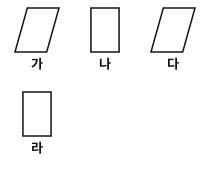

그림 사양: `{"version":"elem-1","kind":"namedShapes","items":[{"shape":"para","label":"가"},{"shape":"rect","label":"나"},{"shape":"para","label":"다"},{"shape":"rect","label":"라"}]}`

### 응용

회차 씨앗 104729 · 문항 씨앗 636293 · number

그림에서 합동인 도형끼리는 한 개만 남기려고 합니다. 지워야 할 도형은 모두 몇 개입니까?

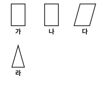

그림 사양: `{"version":"elem-1","kind":"namedShapes","items":[{"shape":"rect","label":"가"},{"shape":"rect","label":"나"},{"shape":"para","label":"다"},{"shape":"isoTri","label":"라"}]}`

## 5-2-3-2 합동인 도형의 성질 알아보기

### 기본

회차 씨앗 1256748 · 문항 씨앗 1578854 · number

서로 합동인 두 삼각형이 있습니다. 한 삼각형의 세 변이 $8$ cm, $9$ cm, $7$ cm일 때, 다른 삼각형의 가장 긴 변은 몇 cm입니까?

### 응용

회차 씨앗 1256748 · 문항 씨앗 1796231 · number

어떤 이등변삼각형과 합동인 삼각형의 꼭지각이 $80^\circ$입니다. 밑각의 크기는 몇 도입니까?

## 5-2-3-3 선대칭도형과 그 성질 알아보기

### 기본

회차 씨앗 1256748 · 문항 씨앗 1578854 · number

정팔각형의 대칭축 개수와 이등변삼각형의 대칭축 개수의 차는 얼마입니까?

### 응용

회차 씨앗 628374 · 문항 씨앗 1159938 · number

점선을 대칭축으로 하는 선대칭도형을 색칠하여 완성하려고 합니다. 완성한 뒤 칠하지 않은 칸은 모두 몇 칸입니까?

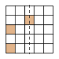

그림 사양: `{"version":"elem-1","kind":"symmetry","axis":"v","n":5,"cells":[[0,4],[0,2],[2,1]]}`

## 5-2-3-4 점대칭도형과 그 성질 알아보기

### 기본

회차 씨앗 1256748 · 문항 씨앗 1578854 · number

점대칭인 육각형의 한 변이 $14$ cm입니다. 이 변과 마주 보는 변의 길이는 몇 cm입니까?

### 응용

회차 씨앗 1256748 · 문항 씨앗 1796231 · number

점대칭인 육각형의 이웃한 세 변이 $10$ cm, $7$ cm, $4$ cm일 때, 가장 짧은 변은 몇 cm입니까?

## 5-2-4-1 (1보다 작은 소수)×(자연수)의 계산

### 기본

회차 씨앗 942561 · 문항 씨앗 1264667 · number

□ 안에 알맞은 소수를 구하시오.  $\square\times3=2.4$

### 응용

회차 씨앗 837832 · 문항 씨앗 1369396 · number

한 병에 우유 $0.6$ L씩 들어 있습니다. 이런 것이 $9$병 있을 때 그중 $4.3$ L를 썼다면 남은 우유는 몇 L입니까?

## 5-2-4-2 (1보다 큰 소수)×(자연수)의 계산

### 기본

회차 씨앗 1152019 · 문항 씨앗 1474125 · number

$1.1$과 $9$를 곱할 때, 소수점을 잠시 무시하고 자연수끼리 곱하면 얼마입니까?

### 응용

회차 씨앗 1256748 · 문항 씨앗 1796231 · number

길이가 $1.9$ m인 막대 $2$개의 길이와 $4.9$ m인 막대 $9$개의 길이의 차는 몇 m입니까?

## 5-2-4-3 (자연수)×(1보다 작은 소수)의 계산

### 기본

회차 씨앗 1256748 · 문항 씨앗 1578854 · number

$7\times0.8$의 값에서 소수 첫째 자리 숫자는 무엇입니까?

### 응용

회차 씨앗 1152019 · 문항 씨앗 1683583 · number

$2$의 $0.5$배와 $2$의 $0.4$배의 차는 얼마입니까?

## 5-2-4-4 (자연수)×(1보다 큰 소수)의 계산

### 기본

회차 씨앗 1152019 · 문항 씨앗 1474125 · number

$3$과 $4.5$를 곱할 때, 소수점을 잠시 무시하고 자연수끼리 곱하면 얼마입니까?

### 응용

회차 씨앗 1256748 · 문항 씨앗 1796231 · number

$4$ m인 끈의 $2.8$배와 $4$ m인 끈의 $3.9$배의 차는 몇 m입니까?

## 5-2-4-5 (1보다 작은 소수)×(1보다 작은 소수)의 계산

### 기본

회차 씨앗 1047290 · 문항 씨앗 1377315 · number

□ 안에 알맞은 소수를 구하시오.  $\square\times0.6=0.24$

### 응용

회차 씨앗 314187 · 문항 씨앗 845751 · number

가로가 $0.3$ m, 세로가 $0.2$ m인 직사각형 종이에서 넓이가 $0.01$ m²인 조각을 잘라 냈습니다. 남은 종이의 넓이는 몇 m²입니까?

## 5-2-4-6 (1보다 큰 소수)×(1보다 큰 소수)의 계산

### 기본

회차 씨앗 942561 · 문항 씨앗 1264667 · number

□ 안에 알맞은 소수를 구하시오.  $1.7\times\square=7.99$

### 응용

회차 씨앗 314187 · 문항 씨앗 845751 · number

가로가 $1.5$ m, 세로가 $1.7$ m인 직사각형과 한 변이 $1.5$ m인 정사각형이 있습니다. 두 도형의 넓이의 차는 몇 m²입니까?

## 5-2-4-7 곱의 소수점의 위치

### 기본

회차 씨앗 837832 · 문항 씨앗 1159938 · number

$6.49$의 소수점을 오른쪽으로 한 칸 옮기면 얼마입니까?

### 응용

회차 씨앗 523645 · 문항 씨앗 1055209 · number

$9.39\times10$의 값과 $9.39\times100$의 값의 차를 구하시오.

## 5-2-5-1 직사각형 6개로 둘러싸인 도형

### 기본

회차 씨앗 1256748 · 문항 씨앗 1578854 · number

가로가 $6$ cm, 세로가 $9$ cm, 높이가 $4$ cm인 직육면체의 모서리는 몇 개입니까?

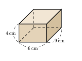

그림 사양: `{"version":"elem-1","kind":"cuboid","w":6,"d":9,"h":4}`

### 응용

회차 씨앗 104729 · 문항 씨앗 636293 · number

가로가 $5$ cm, 세로가 $6$ cm, 높이가 $7$ cm인 직육면체 모양 상자의 모든 모서리에 끈을 한 번씩 붙였습니다. 처음 끈의 길이가 $93$ cm였다면 남는 끈은 몇 cm입니까?

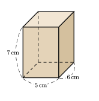

그림 사양: `{"version":"elem-1","kind":"cuboid","w":5,"d":6,"h":7}`

## 5-2-5-2 정사각형 6개로 둘러싸인 도형

### 기본

회차 씨앗 1152019 · 문항 씨앗 1474125 · number

한 모서리의 길이가 $5$ cm인 정육면체의 면은 몇 개입니까?

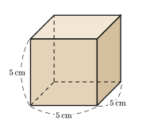

그림 사양: `{"version":"elem-1","kind":"cuboid","w":5,"d":5,"h":5}`

### 응용

회차 씨앗 104729 · 문항 씨앗 636293 · number

한 모서리가 $9$ cm인 정육면체 모양 틀을 $2$개 만들려고 합니다. 모든 모서리를 철사로 만들 때 필요한 철사는 모두 몇 cm입니까?

그림 사양: `{"version":"elem-1","kind":"cuboid","w":9,"d":9,"h":9}`

## 5-2-5-3 직육면체의 성질

### 기본

회차 씨앗 1256748 · 문항 씨앗 1578854 · number

가로가 $10$ cm, 세로가 $9$ cm, 높이가 $5$ cm인 직육면체에서 가장 넓은 면의 넓이는 몇 cm²입니까?

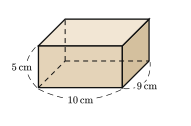

그림 사양: `{"version":"elem-1","kind":"cuboid","w":10,"d":9,"h":5}`

### 응용

회차 씨앗 104729 · 문항 씨앗 636293 · number

가로가 $9$ cm, 세로가 $3$ cm, 높이가 $5$ cm인 직육면체에서 가장 넓은 면과 가장 좁은 면의 넓이의 차는 몇 cm²입니까?

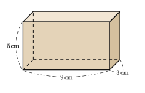

그림 사양: `{"version":"elem-1","kind":"cuboid","w":9,"d":3,"h":5}`

## 5-2-5-4 직육면체의 겨냥도

### 기본

회차 씨앗 1256748 · 문항 씨앗 1578854 · number

가로가 $11$ cm, 세로가 $9$ cm, 높이가 $2$ cm인 직육면체의 겨냥도에서 보이는 모서리는 몇 개입니까?

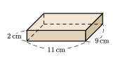

그림 사양: `{"version":"elem-1","kind":"cuboid","w":11,"d":9,"h":2}`

### 응용

회차 씨앗 104729 · 문항 씨앗 636293 · number

가로가 $8$ cm, 세로가 $7$ cm, 높이가 $6$ cm인 직육면체의 겨냥도입니다. 보이지 않는 모서리 중 가장 긴 것 한 개와 가장 짧은 것 한 개의 길이를 더하면 몇 cm입니까?

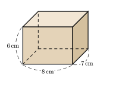

그림 사양: `{"version":"elem-1","kind":"cuboid","w":8,"d":7,"h":6}`

## 5-2-5-5 정육면체의 전개도

### 기본

회차 씨앗 1256748 · 문항 씨앗 1578854 · number

한 모서리의 길이가 $5$ cm인 정육면체의 전개도를 접으면 모서리는 몇 개입니까?

그림 사양: `{"version":"elem-1","kind":"netCuboid","w":5,"d":5,"h":5}`

### 응용

회차 씨앗 1256748 · 문항 씨앗 1796231 · number

한 모서리의 길이가 $6$ cm인 정육면체의 전개도 둘레와, 접어 만든 정육면체의 모든 모서리 길이의 합의 차는 몇 cm입니까?

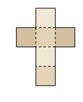

그림 사양: `{"version":"elem-1","kind":"netCuboid","w":6,"d":6,"h":6}`

## 5-2-5-6 직육면체의 전개도

### 기본

회차 씨앗 1256748 · 문항 씨앗 1578854 · number

가로가 $11$ cm, 세로가 $7$ cm, 높이가 $2$ cm인 직육면체의 전개도에서 면은 몇 개입니까?

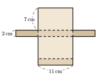

그림 사양: `{"version":"elem-1","kind":"netCuboid","w":11,"d":7,"h":2}`

### 응용

회차 씨앗 1256748 · 문항 씨앗 1796231 · number

가로가 $7$ cm, 세로가 $4$ cm, 높이가 $3$ cm인 직육면체의 전개도입니다. 이 전개도의 둘레는 몇 cm입니까?

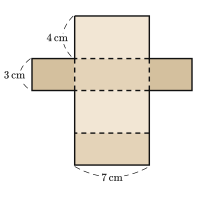

그림 사양: `{"version":"elem-1","kind":"netCuboid","w":7,"d":4,"h":3}`

## 5-2-6-1 평균 알아보기

### 기본

회차 씨앗 209458 · 문항 씨앗 539483 · number

자료 $3$개의 평균이 $13$입니다. 각 자료에 똑같이 $4$씩 더하면 새 평균은 얼마입니까?

### 응용

회차 씨앗 1256748 · 문항 씨앗 1796231 · number

다섯 날 읽은 쪽수가 차례로 $24,\ 22,\ 21,\ 20,\ 23$ 쪽입니다. 하루 평균과 같은 쪽수를 읽은 날은 며칠입니까?

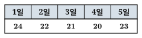

그림 사양: `{"version":"elem-1","kind":"table","headers":["1일","2일","3일","4일","5일"],"rows":[["24","22","21","20","23"]]}`

## 5-2-6-2 평균을 이용하여 문제해결하기

### 기본

회차 씨앗 314187 · 문항 씨앗 636293 · number

자료 $3$개의 평균이 $12$입니다. 각 자료에 똑같이 $4$씩 더하면 새 평균은 얼마입니까?

### 응용

회차 씨앗 733103 · 문항 씨앗 1264667 · number

$4$경기까지의 평균 점수가 $15$점입니다. 남은 $3$경기를 마친 뒤 전체 경기의 평균을 $18$점으로 만들려면, 남은 경기에서 경기당 평균 몇 점을 얻어야 합니까?

## 5-2-6-3 일이 일어날 가능성

### 기본

회차 씨앗 104729 · 문항 씨앗 426835 · number

주머니에는 빨간 구슬과 파란 구슬만 들어 있습니다. 파란 구슬은 $6$개이고 빨간색을 꺼낼 가능성은 반반입니다. 빨간 구슬의 수를 구하시오.

### 응용

회차 씨앗 104729 · 문항 씨앗 636293 · number

주머니에 빨간 구슬 $2$개와 파란 구슬 $8$개만 있습니다. 파란 구슬을 먼저 $3$개 꺼낸 뒤, 빨간 구슬만 더 넣어 빨간색을 꺼낼 가능성을 반반으로 만들려고 합니다. 빨간 구슬을 몇 개 더 넣어야 합니까?
