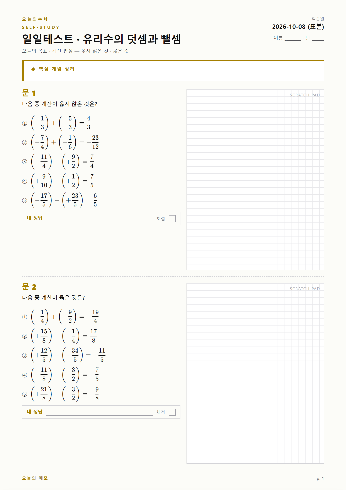
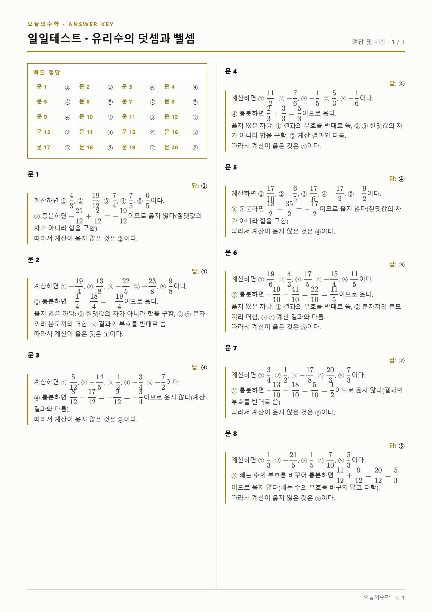

# 엔진 보강 0 · 1단계 — 판정형 등록부 배선 · ① 중1 유리수 덧셈 · 뺄셈 계산 판정 (2026-10-08)

지시서: `E:\todays-math-textbook-import\briefs\brief-engine-judge-step01.md` · 합의안: 리드 가지의 `docs/planning/tracks/engine-upgrade-consensus-20261008.md` §5 의 0 · 1 단계(§6 2회전 반영).
가지 `chrismathone/engine-judge`(origin/main `6ecf0ee99` 에서 갈림) · 커밋 넷:

| 커밋 | 무엇 |
|---|---|
| `5e2a8b261` | 0단계 — 판정형 계약 · 등록부(빈 것) · 적재기 target · 미적재 검사 정확한 키 · 제자리 갱신 배선 · `isChooseAll` ㄱㄴㄷ 반례 |
| `a3785665c` | 1단계 — 판정형 셋 등록(덧셈 · 뺄셈 · 네 항 혼합) · 시험 · 변이 하네스 · 적재 계획 |
| `03375fbca` | 1단계 고침 — 해설을 넉 줄로(표본을 떠 보니 정답지에서 해설이 통째로 빠졌다) |
| `cdc36e1e7` | 1단계 고침 — 공용 오답 후보에 «나올 수 있는 분모» 조건(표본에 $-\frac{19}{11}$) |

🔴 **공유 DB 에 적재하지 않았다**(드라이런 · 읽기만) · **main 에 밀지 않았다**(원격 가지까지).
🔴 판정형 셋을 등록했으므로 **적재 전에는 pre-push 의 `checkUnloadedTypes` 가 빨갛다**(아래 §4) — 적재는 리드가 병합 때 한다.

## 1. 요약

1. 판정형을 RPM 등록부 · 결합형과 **따로 둔 등록부**(`src/lib/middle/judge/`)로 세우고, 적재기 · 미적재 검사 · 제자리 갱신을 **한 분기 함수 `buildTargetRows`** 에 묶었다. 모르는 target 은 이제 던진다(종전에는 중등 유형으로 흘렀다).
2. 미적재 검사는 판정형을 **정확한 키**로 센다 — 비슷한 키(`…|calc-add2` ⊂ `…|calc-add2x`)를 «나갔다»로 읽는 반례가 시험에 있다. 실행마다 자기 점검(`judgeKeyProbe`)도 한다.
3. ① 중1 «유리수의 덧셈과 뺄셈» 계산 판정 셋 — 보기 다섯은 **같은 원천 유형 · 같은 꼴**, 틀린 값은 후보(실제 실수 · `numericMistakes` · 부호 반대)일 뿐이고 **등록부가 지면 글을 BigInt 교차곱으로 다시 재서** «다른 하나가 정확히 하나»를 확인한다. 시험은 셋째 셈(매 걸음 약분)으로 또 잰다.
4. 표본 20문항을 제품 `TestPrint` 로 떠 보니 정답지에서 해설 8문항이 사라졌다 → 해설을 넉 줄로 다시 짜고 제품의 정답지 자를 시험 관문으로 박았다. 지금 표본은 경고 0 · 실물 잘림 0.
5. 남은 것: **적재(리드)** · 원장님 확인 넷(§7).

## 2. 0단계 — 배선

### 2.1 판정형 계약 · 등록부 (`src/lib/middle/judge/`)

| 파일 | 내용 |
|---|---|
| `contract.ts` | `JudgeDefinition`(등록 단위 `grade + unitSection + familyId` · 물음 `asks` · 허용 원천 `sources` · 꼴의 난이도 `difficulty` + 근거 `difficultyBasis` · 규칙판 `ruleVersion` · 생성기 · **지면 글을 다시 재는 `truthOf`**) · `JudgeOption`(`text` · `claimedTrue` · `brief` · `detail` · `why`) · 열쇠 짓기/읽기 짝 |
| `registry.ts` | `createJudgeRegistry` · `judgementDefinitions()` · `generateJudgeProblem()` · `assembleJudge`(관문) |
| `definitions.ts` | 등록 목록 — 0단계 커밋에서는 빈 배열, 1단계에서 셋 |

열쇠(합의안 Q1 표 그대로):

```
판정키      중1|유리수의 덧셈과 뺄셈|calc-add2
familyKey   mid:judge:중1|유리수의 덧셈과 뺄셈|calc-add2
externalId  engine-mid-judge:중1|유리수의 덧셈과 뺄셈|calc-add2|r1|s20261008|v0|객관식
```

`familyId` 는 `[a-z0-9-]` 로 좁혀 열쇠 구분자(`|`) · 규칙판 꼬리(`|r1|s…`)를 흉내 낼 수 없다. 출처 판정(`provenance.ts`)은 `mid:` 접두사로 **중등 엔진**, 형식은 보기 다섯 + 번호 정답이라 **객관식**으로 읽는다(시험 ㉥).

등록부 관문(`assembleJudge`) — 생성기마다 따로 지키지 않는다:
보기 다섯 · 글 겹침 없음 · 생성기 주장의 «다른 하나» 정확히 하나 · 발문 «…것은?» · 거짓 보기에만 «틀린 까닭» · 보기를 섞은 뒤 **지면 본문에서 보기 글을 다시 읽어 `truthOf` 로 재고**, 못 읽거나 주장과 다르거나 «다른 하나»가 하나가 아니면 사유를 달고 던진다 · 객관식 공용 관문(`assertChoiceCount` · `assertChoiceMarks` · `assertChooseAllAnswerCount`). 생성기가 던지면(재시도 상한) 판정키 · 씨앗 · 변형 · 물음을 실어 다시 던진다.

### 2.2 적재기 · 미적재 검사 · 제자리 갱신

| 자리 | 바꾼 것 |
|---|---|
| `scripts/import/load-engine-problems.ts` | `engine: "judge"` target(`keys` · `variants`) · `buildJudgeRows` · **`buildTargetRows`**(elem · middle · combo · judge 넷, 모르면 던짐) · 되돌리기 식이 `engine-mid-combo:` · `engine-mid-judge:` 를 «남의 것»으로 읽어 멈추던 것 고침 |
| `scripts/qa/checkUnloadedTypes.ts` | `unloaded(…, judges)` · `loadedJudgeKeys`(정확한 키) · `judgeKeyProbe`(짓는 함수 ↔ 읽는 함수 짝 · 비슷한 키 거부를 실행마다 점검 — ㉠ 양성 대조의 판정형 몫) |
| `scripts/qa/refresh-engine-content.ts` | `rebuild` 가 적재기의 `buildTargetRows` 를 부른다(종전 자기 분기 삭제) · `rebuild` 를 내보내 시험이 판정형 계획으로 직접 잰다 |

`refreshEngineContentCore.ts` 의 판정(`classifyDiff` · `identityRisk` · `decideApply`)은 손대지 않았다 — 판정형 행도 같은 문지기를 지난다(우회 없음).
⚠️ 그림 전용 도구 `refresh-engine-figures.ts` · `fill-missing-figures.ts` 는 여전히 elem/middle 만 본다 — 판정형은 그림이 없어 이번엔 영향 없음. 그림이 있는 판정형을 들이면 같이 넓힐 것.

### 2.3 `isChooseAll` 의 ㄱㄴㄷ 반례 — 🔴 합의안의 예문은 이미 안 걸렸다

합의안 §3-1 은 «옳은 것을 모두 **고른** 것은?» 이 «모두 고르기(정답 2)»에 걸린다고 적었다. **실측하니 아니다** — `/고르/` 는 «고른»(U+B978)을 못 잡는다(«고르» U+B974). 진짜로 새던 자리는 둘이었다:

| 반례 | 고치기 전 | 고친 뒤 |
|---|---|---|
| «보기에서 옳은 것을 모두 고른 것을 **고르시오**.» | true(정답 2개 규칙에 걸림) | false |
| «다음 보기 중 옳은 것을 모두 고르면?» + 보기가 `ㄱ, ㄴ` · `㉠, ㉡` · `(가), (나)` 조합 | true | false |

규칙: ⑴ 보기 줄이 **전부** 이름표 조합이면 조합형(정답 하나) ⑵ «모두 (바르게) 고른 것» 구절을 지운 뒤 기존 순서 규칙. 음성 대조(진술 · 식 보기의 «모두 고르면?» · 조합 하나 섞인 보기 · 구절 뒤의 진짜 «모두 고르시오»)는 그대로 «모두 고르기»다. 엔진 훑기(중등 200씨앗 · 초등)의 «모두 고르시오» 바닥은 그대로 초록.

## 3. 1단계 — ① 중1 «유리수의 덧셈과 뺄셈» 계산 판정 (`src/lib/middle/judge/addSub.ts`)

| 판정키 | 원천(같은 유형 · 같은 꼴) | 난이도(직접 선언) | 규칙판 |
|---|---|---|---|
| `…|calc-add2` 두 유리수의 덧셈 | `1-1|정수와 유리수의 계산|01` | 기본 | r1 |
| `…|calc-sub2` 두 유리수의 뺄셈 | `…|03` | 기본 | r1 |
| `…|calc-mix4` 네 유리수의 덧셈과 뺄셈 | `…|04` | **응용**(원장님 확인 대상 — §7) | r1 |

물음은 «다음 중 계산이 옳지 않은 것은?» · «다음 중 계산이 옳은 것은?» — 변형 번호 차례로 번갈아. 지면은 **기존 객관식 틀**(보기 ①~⑤) 그대로.

- **재료(어댑터)** — 원천 유형 생성기를 그대로 불러 `facts`(an · ad · bn · bd · …)로 식을 세운다. 세운 식을 다시 계산해 `facts` 의 답과 다르면 던진다. 보기 왼쪽 식은 원천 발문의 식과 **글자까지 같다**(시험 ㉣ 이 120씨앗 × 셋으로 맞댄다). 표기는 `m1Calc` 의 `texSigned` · `texQ` 를 그대로 쓴다(`m1Rational` 로 내보냄 — 동작 무변경).
- **같은 꼴** — 분수 항의 수 · 항 수 · 결과가 정수인가가 다섯 다 같다. 꼴마다 따로 모아 **먼저 다섯이 차는 꼴**을 쓴다(첫 재료로 못 박으니 드문 꼴에서 상한까지 헛돌았다 — mix4 실측).
- **틀린 값 — 후보일 뿐** — 세 갈래를 무게 5 : 3 : 2 로: 실제 실수(빼는 수 부호 안 바꿈 · 분자끼리 분모끼리 · 절댓값의 합) · 공용 `numericMistakes`(자릿수를 통째로 바꾸는 둘은 뺌 · **분모가 항들의 최소공배수의 약수**일 때만) · 결과 부호 반대(**한 문항에 하나까지**). 참값과 다른지는 교차곱으로 거르고, `\frac` 로 오는 공용 후보는 수로 읽어 `\dfrac` 로 다시 찍는다(한 보기만 작은 분수가 되는 단서). 오른쪽 값 겹침 금지 · 자릿수 차 1 이내.
- **재시도 상한** `MAX_DRAWS = 120` — 못 채우면 «재료 120번 뽑기 초과(가장 많이 찬 꼴이 n개까지)»로 던진다. 실측 3,000씨앗 × 셋: 실패 0 · 뽑기 중앙 9~11 · 최대 24.
- **해설(넉 줄)** — 등록부가 짠다:
  ```
  계산하면 ① −6/5, ② −7/12, ③ −11/12, ④ 11/8, ⑤ −5/4이다.
  ② 통분하면 −8/12+1/12=−7/12이므로 옳지 않다(분자끼리 분모끼리 더함).
  [«옳은 것» 물음이면] 옳지 않은 까닭: ①·③ 계산 결과와 다름, ⑤ 결과의 부호를 반대로 씀.
  따라서 계산이 옳지 않은 것은 ②이다.
  ```
  보기마다 판단 근거(계산 값) · 정답 보기의 풀이 · 거짓 보기마다 «어디가 틀렸나». 까닭 문장은 그 값에 대해 **참이다**(시험이 그 실수를 다시 계산해 확인).

실측 분포(3,000씨앗 × 셋, `draw-stats`): 정답 자리 ①~⑤ 각 18~22% · 까닭 — add2: 공용 2,613 · 분자끼리 1,992 · 절댓값 합 1,633 · 부호 반대 1,262 / sub2: 공용 2,964 · 빼는 수 부호 2,766 · 부호 반대 1,344 · 분자끼리 426 / mix4: 빼는 수 부호 3,701 · 공용 2,557 · 부호 반대 1,242.

### 3.1 표본을 떠서 고친 것 둘 — 시험은 초록이었는데 지면에서 나왔다

1. **정답지에서 해설이 통째로 사라졌다.** 처음 해설은 보기마다 식 전체를 다시 적은 다섯 줄이었다. 제품 정답지는 한 쪽 8문항 · 2단이고 넘친 해설은 셋째 단으로 밀려 **사라진다**. 표본 20문항 중 제품 경고 9 · 실물 렌더 잘림 8(6 · 7 · 8 · 13~16 · 20번). → 넉 줄로 다시 짰다. 제품 자(`estimateSolutionPx`) 중앙값 234~288px → **155 / 173 / 195px**(같은 차시 RPM 유형 평균 184px). 해설 표시(`solutionForDisplay`)가 «한글 + 마침표» 뒤에서 줄을 자르므로 까닭을 명사구로 쓰고 문장 중간 마침표를 없앴다.
2. **«나올 수 없는 분모».** 분모 5 · 2 · 5 인 식의 오른쪽에 $-\frac{19}{11}$(공용 후보의 `denominator-plus`) — 계산 없이 지워 낸다. 공용 후보에만 «분모 | 항들의 최소공배수» 조건을 걸었다(실제 실수 갈래는 학생이 정말 하는 실수라 그대로 — 예: $-\frac{11}{8}+\left(-\frac{3}{2}\right)$ 에 «분자끼리 분모끼리 더함» $-\frac{7}{5}$).

같은 차시 시험지(RPM 유형 10 · 15 · 20문항 × 300벌)에 판정형 셋을 섞어 제품 정답지 자로 잰 «해설이 빠질 시험지»: 고치기 전 108 · 123 · 168 → 고친 뒤 **59 · 75 · 108**. 🔴 RPM 유형만으로도 48 · 67 · 81 이다 — 이 차시에 해설 549px 짜리 유형이 있다(판정형과 무관한 기존 잔고, §7).

## 4. 시험 · 변이 · 드라이런 (다 됐다는 증거)

| 시험 파일 | 건수 | 무엇을 |
|---|---:|---|
| `judgeRegistry.test.ts` | 21 | 열쇠 · 정확한 읽기 · 등록 검사 · 관문(거짓 보기를 참으로 · 참을 거짓으로 · 둘 · 없음 · 다섯 · 겹침 · 못 읽음 · 발문 끝 · 까닭 계약) · 순열 · 재시도 상한 · 출처 판정 |
| `loadJudgeRows.test.ts` | 13 | 적재 행 · 열쇠 · 모르는 키/target · 분기 함수 · **비슷한 키의 거짓 적재 반례** · RPM/결합형 오염 없음 · 제자리 갱신이 같은 함수로 되만듦 · 모르는 target 은 «던진 대상» |
| `judgeAddSub.test.ts` | 23 | 씨앗 300 × 물음 둘 × 셋을 **셋째 셈**으로 · 꼴 · 같은 유형(원천 발문 식) · 해설 짜임 · 까닭의 참 · 정답지 자(한 칸 평균 몫 241px 이하 · 8문항 둘째 쪽 · 첫 쪽 판정형 셋) · KaTeX · 재시도 상한 · 변이 · 적재 행 · 미적재 빚 |
| `chooseAllRule.test.ts` | 18 | ㄱㄴㄷ 조합형 넷 + 기존 |
| `unloadedTypes.test.ts` | +2 | 판정형 정확한 키 · `judgeKeyProbe` |

- 관련 묶음(판정형 · 미적재 · 결합형 적재 · chooseAll · m1Calc · expandEngine · refresh 둘 · provenance · printOverflow) **12파일 450건 초록** · `npm run type-check` 초록 · 바꾼 파일 ESLint 경고 0(적재기의 기존 경고 2건은 그대로).
- 전체 vitest: §8.
- **변이** — 판정 3단(파일이 바뀌었나 → 산출물 지문이 바뀌었나 → 시험이 빨개지나), 원복은 시작 때 읽은 바이트 그대로:
  - `scripts/qa/mutate-judge.mjs` **12 / 12 빨강** — 거짓 보기를 참으로 · 물음 뒤집기 · 보기를 안 섞음 · 해설 첫 줄이 순열을 안 따라감 · 정답 풀이가 다른 보기 · 정답 까닭 중복 · 정답 번호 첫 자리 · 어댑터 부호 틀림 · 까닭과 값 어긋남 · 꼴 안 맞춤 · 부호 반대 상한 풂 · 오른쪽 값 겹침. 지문은 `scripts/qa/judge-digest.ts`.
  - `scripts/qa/mutate-choose-all.py` 새 변이 둘 **빨강**. ⚠️ 구절 규칙 변이 [5] 는 처음에 «산출물이 그대로 — 판정 거부»였다 — 예문이 전부 보기 규칙에도 걸려 구절 규칙만 가르는 자리가 없었다. «ㄱ과 ㄴ» 꼴 보기를 시험 · 지문 말뭉치에 넣고 빨강을 확인했다.
- **적재 드라이런**(공유 DB 읽기만 · `--apply` 없음 · `ALLOW_SHARED_IMPORT` 없음):
  ```
  계획 「중1-계산판정-덧셈뺄셈」 · 씨앗 20261008 · 목표 1개
     · 판정형 3개 → 36문항
  서로 다른 문항 36건 · 형식 — 객관식 36
  단원 연결 36 · 이미 있음 0 · **넣을 것 36** · 그림이 붙는 문항 0건
  ```
  externalId 표본: `engine-mid-judge:중1|유리수의 덧셈과 뺄셈|calc-add2|r1|s20261008|v0|객관식` · `…|calc-sub2|r1|s20261008|v1|객관식` · `…|calc-mix4|r1|s20261008|v0|객관식` (v0 ~ v11).
- **미적재 검사**(읽기만): 적재본 109,246행 · 원장 0 → «새로 안 나가게 된 유형 3자리» = 판정형 셋 · exit 1(예상대로) · 자기 점검 통과.
- **제자리 갱신 드라이런**(`--all-plans --all-families` · 최종 커밋 기준): 되만든 행 114,215 · 던진 대상 **0** · 계획끼리 어긋난 열쇠 **0** · 적재본 100,794 중 같음 99,016 · 풀이/보기/발문 다름 **0** · **바뀌는 행 0** · 건너뜀 **0** · 문지기 거부 **0** · 출제 가능한 미대응 **0**. 판정형 36행은 «새로 생긴 행(넣지 않음)». 못 맞댄 1,778행은 전부 출제 불가로 잠긴 옛 행(이번 일과 무관 · 기존 잔고). 보고 JSON 은 저장소 밖(`.qa-artifacts/`)으로 옮겼다.

## 5. 공유 DB 실측 — 기존 RPM 경로의 «비슷한 키» 위험

판정형은 정확한 키로 바꿨지만 RPM 유형 · 결합형은 지시서 범위대로 `includes` 대조를 **그대로 뒀다**. 등록부끼리 재 보니 «다른 키의 일부»인 쌍이 **90**(`2-1|연립일차방정식|19` ⊂ `…|19A` 꼴). 공유 DB 의 externalId 109,246행으로 두 대조를 견주니(읽기만) **includes 미적재 0 · 정확한 키 미적재 0 · 숨은 빚 0** — 지금은 새는 것이 없다. 위험은 «`|19A` 만 실리고 `|19` 가 빠지는» 날 생긴다. 바꾸면 pre-push 가 모두에게 빨개질 수 있어 리드 판단으로 남긴다(측정 도구는 `.qa-artifacts/engine-judge/rpm-exact-probe.ts`).

## 6. 학생 지면 표본 20문항 (원장님께 보일 것)

적재 계획 그대로(씨앗 20261008)의 행에서 add2 7 · sub2 7 · mix4 6문항. 제품 일일테스트 지면 `TestPrint`(문제지 `JaseupTemplate` · 정답지 `PrintAnswerKeyPage`)를 Vite + Chromium 으로 떴다(`next/link` 만 대역). **문제지 10쪽 · 정답지 3쪽 · KaTeX 오류 0 · 제품 경고 0 · 정답지 실물 잘림 0**.

- 문제지: [`engine-judge-step01/questions.pdf`](engine-judge-step01/questions.pdf) · `questions-p1.png` ~ `questions-p10.png`
- 정답지: [`engine-judge-step01/answers.pdf`](engine-judge-step01/answers.pdf) · `answers-p1.png` ~ `answers-p3.png`
- 글 그대로: [`engine-judge-step01/samples.md`](engine-judge-step01/samples.md)




## 7. 남은 것

1. **적재(리드)** — 병합 뒤:
   ```
   npx tsx --env-file=<.env> scripts/import/load-engine-problems.ts --plan "scripts/import/plans/2026-10-08-중1-계산판정.json"          # 드라이런 — 넣을 것 36
   ALLOW_SHARED_IMPORT=1 npx tsx --env-file=<.env> scripts/import/load-engine-problems.ts --plan "…/2026-10-08-중1-계산판정.json" --apply
   npx tsx --env-file=<.env> scripts/qa/checkUnloadedTypes.ts                                                                    # 새로 안 나가는 0
   ```
   적재 뒤 `refresh-engine-content --all-plans --all-families` 드라이런이 판정형 36행을 «같음»으로 읽는지 되읽기. 원장(`unloaded-types.json`)은 비어 있으므로 적재만 하면 초록이다(`--write` 불필요).
2. **원장님 확인 넷**
   - `calc-mix4` 난이도 **응용**(보기마다 뺄셈 둘을 덧셈으로 바꾸고 네 항을 통분 — 다섯 번). add2 · sub2 는 기본.
   - 발문 «다음 중 계산이 옳지 않은 것은? / 옳은 것은?» · 해설 넉 줄 짜임(§3) — 표본(§6)으로 확인.
   - 정답지에서 **분수가 든 줄이 이어지면 위아래 분수가 거의 닿는다** — 판정형만이 아니라 기존 해설에도 있는 정답지 줄 간격의 성질이다(지면 코드라 이번 범위 밖 · D-07).
   - «유리수의 덧셈과 뺄셈» 차시는 RPM 유형만으로도 시험지 16~27% 에서 정답지 해설이 빠질 위험이 있다(해설 549px 유형 — §3.1). 판정형과 무관한 기존 잔고.
3. **실물 인쇄** — 지면 코드는 안 바꿨다(기존 객관식 틀). `/dev/print-check` 에 항목을 더하지 않았다. 새 문항류가 실제 종이에 나가는 것이라 원장님이 PDF 를 한 번 뽑아 보시길 권한다.
4. **2단계 이후**(합의안 §5) — 곱셈 · 나눗셈 · 식의 값 · 비교(4+1 · 가장 큰 것)는 이 등록부에 `definitions.ts` 한 줄 + 생성기 · `truthOf` 로 붙는다. 4+1 은 «값이 같은 보기 금지»(이번 `rights` 겹침 금지)와 부딪히므로 문형별로 갈라야 한다(합의안 §3-2).

## 8. 전체 vitest

여유 메모리 7.4GB 에서 한 번에 돌렸다(1,574초): **1,342파일 중 28파일 · 34,669건 중 43건 실패.** 실패 파일을 갈랐다.

| 갈래 | 파일 | 판단 |
|---|---:|---|
| 다시 돌리니 초록(전체 실행의 부하 속 시간 초과 — 예: `chooseAllRule` 의 초등 훑기 29.7초 > 상한 20초) | 16 | 제 변경과 무관 · 단독/작은 묶음에서 통과 |
| **갈래 기준 커밋 `6ecf0ee99` 에서도 같은 실패**(같은 파일 11 · 같은 20건) | 11 | 기존 잔고 — 교과서 스튜디오 · 빠른 만들기 · 회수 측정 6 · 문제은행 출처 필터(«교과서» 칸) · 그림 보기 대응 · Decision Log 머리글(«현재 160» ≠ 표 162) · 영어 라우트 둘의 `withErrorLog` 누락 · `load-school-textbook.ts:918` 기출 배선 «판단불가» |
| 그림 렌더 무거운 시험(`middleFigureRenderable` — 전체 실행에서 300초 상한) | 1 | 단독 실행 6/6 초록(149초) |

곧 **제 변경으로 생긴 실패는 0** 이다. 판정형 · 적재기 · 미적재 · 제자리 갱신 · chooseAll · m1Calc 관련 시험은 전부 초록(§4).

## 8.1 병합 준비

푸시 시점 origin/main 은 갈래 기준보다 27커밋 앞(교과서 이관 · 그림 저장소 · 합의 문서). 바꾼 파일이 겹치는 것 **0** · `git merge-tree` 충돌 **0**. 가지에 main 을 합치지 않았다 — 병합 · 적재는 리드.

## 9. 이번에 밟은 함정 (다음 사람에게)

- **시험이 다 초록이어도 지면은 따로 본다** — 해설이 정답지에서 통째로 사라지는 것은 엔진 시험이 구조적으로 못 본다. 제품 정답지 자를 관문으로 박은 까닭.
- `node -e` 의 `String.replace` 바꿀 글에 `` $` `` 가 있으면 «앞부분 끼워 넣기»로 읽힌다(TeX 의 `$…$` 와 템플릿 백틱이 붙는 자리) — 픽스처가 한 번 깨졌다. 그리고 Bash 는 작은따옴표 안에서도 역슬래시를 반으로 줄인다(기억 메모 그대로). 소스 편집은 Edit 도구로.
- 변이가 «판정 거부»면 가드가 없는 게 아니라 **가르는 자리가 말뭉치에 없는** 것일 수 있다(§4 의 [5]).
- `.qa-artifacts/` 는 tsconfig 의 `**/*.ts` 에 걸린다(무시 목록에 없음) — 거기 둔 조각 `.ts` 가 로컬 타입 검사에 섞인다.
