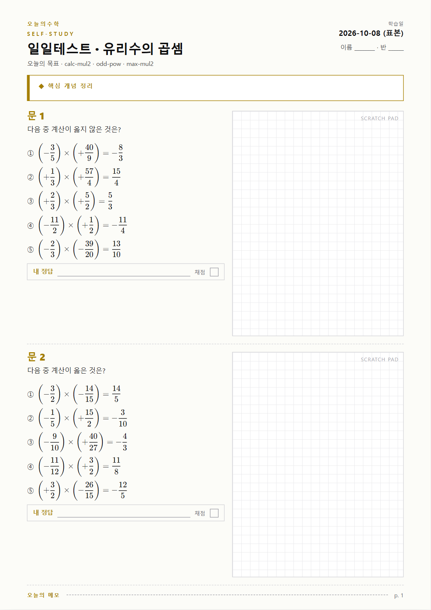
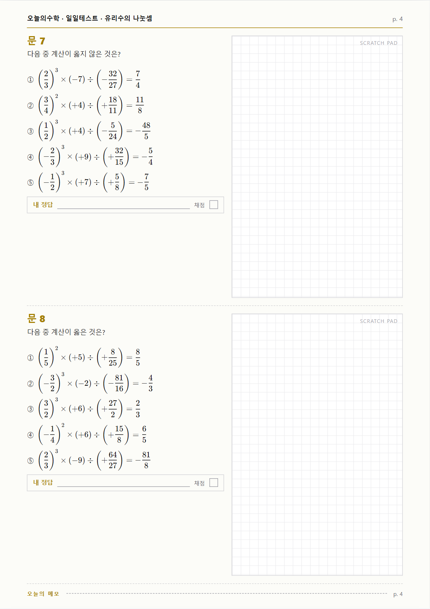
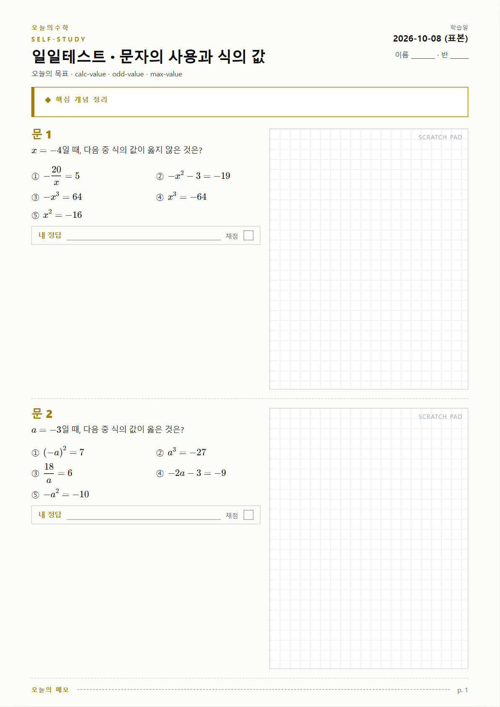
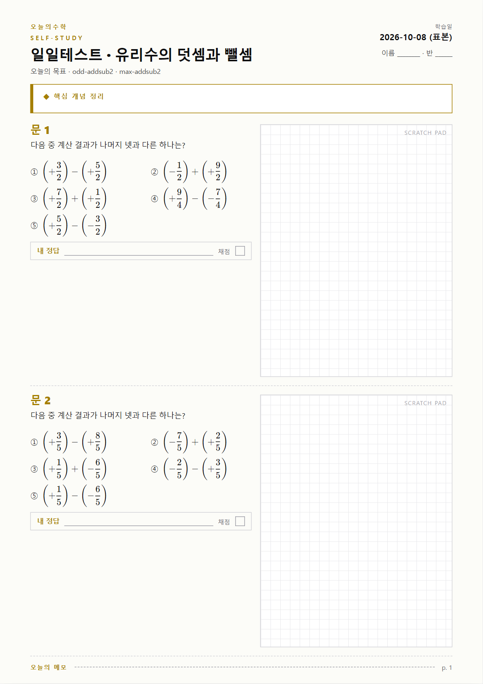
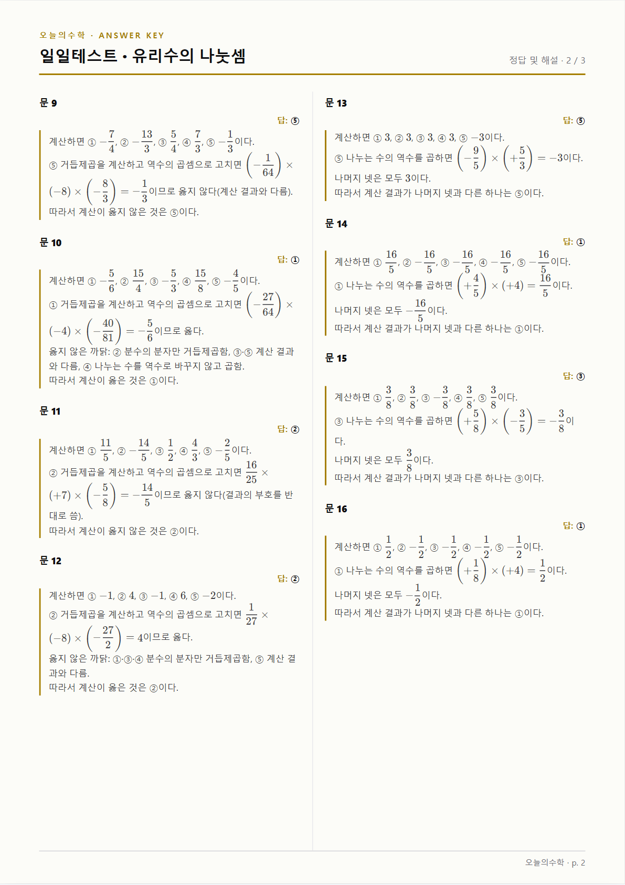
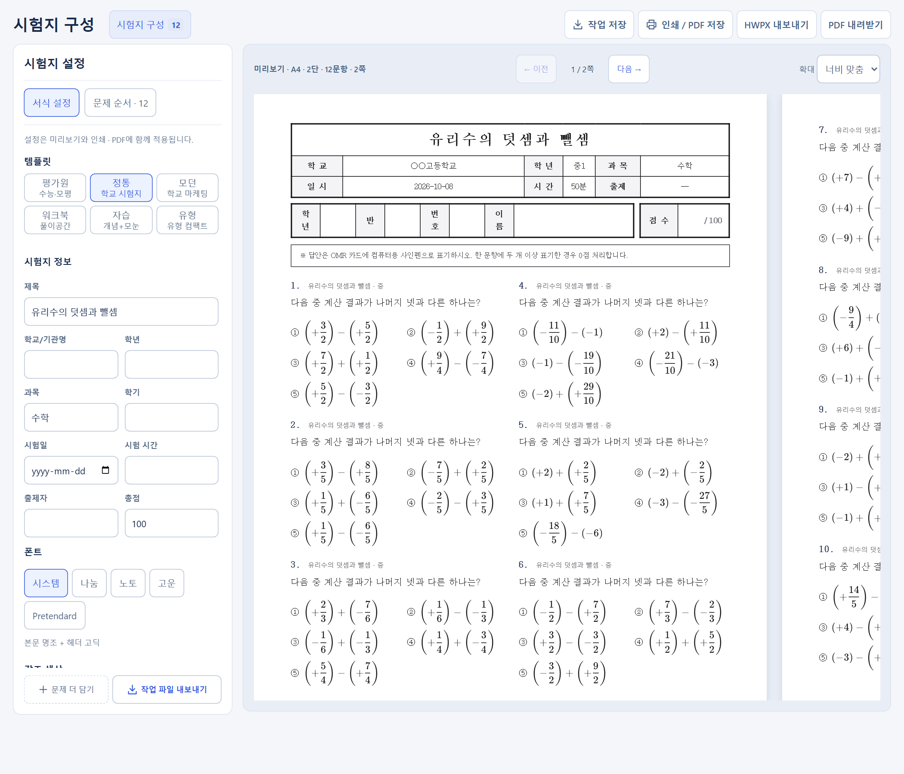

# 엔진 보강 2단계 — ① 곱셈 · 나눗셈 · 식의 값 계산 판정 + 비교형(4+1 · 가장 큰/작은 것) (2026-10-08)

지시서: `E:\todays-math-textbook-import\briefs\brief-engine-judge-step2.md` · 합의안: [`engine-upgrade-consensus-20261008.md`](../engine-upgrade-consensus-20261008.md) §3-2 · §5 의 2단계 · 앞 단계: [`engine-judge-step01.md`](engine-judge-step01.md).
가지 `chrismathone/engine-judge-2`(origin/main `ff3ca6a4e` 에서 갈림) — 원격 가지까지 밀었다.

🔴 **공유 DB 에 적재하지 않았다**(드라이런 · 읽기만) · **main 에 밀지 않았다** · **고등 배선 파일을 건드리지 않았다**
(`load-engine-problems.ts` · `checkUnloadedTypes.ts` · `refresh-engine-content.ts` · `provenance.ts` — 읽기만) · **인쇄 코드를 건드리지 않았다**.
🔴 판정형 **열둘**을 새로 등록했으므로 적재 전에는 pre-push 의 `checkUnloadedTypes` 가 빨갛다(§6.4 — 예상대로 12자리). 적재는 리드가 한다(§8).

## 1. 요약

1. 앞선 작업자가 남긴 바탕(`29450da6f` — 비교 문형 관문 · 지면 식 계산기 · 계산 판정 공용 짓기)과 미커밋 생성기 넷을 이어받아
   **판정형 열둘을 등록**했다 — 계산 판정 넷(곱셈 · 나눗셈 · 혼합 · 식의 값) + 비교형 여덟(«나머지 넷과 다른 하나» 넷 · «가장 큰/작은 것» 넷).
2. 보기 다섯을 **셋째 셈**(다른 읽개 + 부동소수)으로 다시 재는 시험 · 4+1 · 동점 · 순열 · 재시도 상한 · 까닭 문장의 참 · 정답지 자를 붙였다.
   판정형 시험 12파일 211건 · 관련 묶음 36파일 838건 초록. 시험이 생성기 결함 둘을 찾아 고쳤다(§4.3).
3. 🔴 **표본을 제품 지면으로 떠 보니 «식» 보기가 2열 칸에서 접혔다**(시험 · 변이 · 정답지 자는 전부 초록이었다). 원인은 제품의
   자동 보기 배치가 큰 괄호 · 분수가 든 식을 실제보다 좁게 보는 것(§5.1). 리드 결정 «C»에 따라
   - 등록부에 **지면 관문**을 넣고(제품의 열 수 규칙을 그대로 부르고, 식의 실제 폭을 KaTeX 글꼴 치수로 계산),
   - 두 수 비교형은 **작은 수**로 뽑고,
   - 내용으로 못 푸는 `calc-pow`(거듭제곱이 든 곱셈의 계산 판정)는 **보류**했다(등록부 · 적재 계획 · 미적재 빚 어디에도 없다 — 생성기와 시험은 남겼다).
   관문을 지난 열두 문항류 × 60문항을 제품 지면 둘에 다시 띄워 잰 접힘: **0 / 720 · 0 / 720**(§5.4).
4. 인쇄 쪽에 넘길 것(§5.5): 원인(파일:줄) · 추정 폭 대 실제 폭 · 문항류별 접힘 비율. **이미 실린 1단계 36행 가운데 12행이 지면에서 접힌다**
   (네 항 혼합 11/12 — 통합 시험지 2단 · 두 항 덧셈 1/12) — 생성기 산출물은 바꾸지 않았고 «고치려면»을 §5.6 에 적었다.
5. 남은 것: **적재(리드 — 144행)** · 원장님 확인(§8.2) · 인쇄 쪽 자(§5.5).

| 커밋 | 무엇 |
|---|---|
| `29450da6f` | (앞선 작업자) 2단계 바탕 — 비교 문형 관문(`assembleCompare`) · 지면 식 계산기(`texArith.ts`) · 계산 판정 공용 짓기(`calcJudge.ts`) · 1단계 지문 고정 시험 |
| `df10f52cd` | 등록 — 곱셈 · 나눗셈 · 거듭제곱 · 식의 값 계산 판정 + 비교형 여덟(앞선 작업자의 미커밋 생성기를 다듬어) · `valueOf` → `readValue` |
| `616e9c86b` | 시험 넷(씨앗 300 독립 재계산 · 4+1 · 동점 · 순열 · 재시도 상한) · 생성기 결함 둘 고침 · 적재 계획 |
| `ed2a13a91` | 지면 관문(`paper.ts`) · 두 수 비교형의 작은 수 · `calc-pow` 보류 · 측정 하네스(`scripts/qa/judge-paper/`) · 변이 48 |
| (이 보고서) | 보고서 · 표본 72문항(문제지 · 정답지 PNG/PDF · 통합 시험지 화면) |

## 2. 등록 — 2단계 열둘 + 보류 하나

판정형 등록부(`src/lib/middle/judge/`)의 틀을 그대로 이었다 — `definitions.ts` 에 줄을 더하고 생성기 · 다시 재는 함수를 붙였다.
새 등록부 · 새 적재 경로는 없다. 등록 차례는 «앞의 것부터 실렸다»를 지켜 1단계 셋 뒤에 붙였다(시험이 차례를 못 박는다).

| 판정키(`중1\|차시\|familyId`) | 문형 · 물음 | 허용 원천(RPM 유형) | 난이도 |
|---|---|---|---|
| `유리수의 곱셈\|calc-mul2` | 참거짓 — 계산이 옳지 않은 것 · 옳은 것 | 12 유리수의 곱셈 | 기본 |
| `유리수의 나눗셈\|calc-div2` | 참거짓 | 19 유리수의 나눗셈 | 기본 |
| `유리수의 나눗셈\|calc-muldiv` | 참거짓 | 20 곱셈과 나눗셈의 혼합 계산 | **응용** |
| `문자의 사용과 식의 값\|calc-value` | 참거짓 — «$x=-3$일 때, 다음 중 식의 값이 옳지 않은(옳은) 것은?» | 05 식의 값 구하기 · 06 분모에 대입하기 | 기본 |
| `유리수의 덧셈과 뺄셈\|odd-addsub2` | 비교 — 나머지 넷과 다른 하나 | 01 덧셈 · 03 뺄셈 | 기본 |
| `유리수의 덧셈과 뺄셈\|max-addsub2` | 비교 — 가장 큰 것 · 가장 작은 것 | 01 · 03 | **응용** |
| `유리수의 곱셈\|odd-pow` | 비교 — 나머지 넷과 다른 하나(거듭제곱의 부호) | 15 거듭제곱의 계산 | **응용** |
| `유리수의 곱셈\|max-mul2` | 비교 — 가장 큰/작은 것 | 12 | **응용** |
| `유리수의 나눗셈\|odd-div2` | 비교 — 나머지 넷과 다른 하나 | 19 | 기본 |
| `유리수의 나눗셈\|max-div2` | 비교 — 가장 큰/작은 것 | 19 | **응용** |
| `문자의 사용과 식의 값\|odd-value` | 비교 — «…식의 값이 나머지 넷과 다른 하나는?» | 05 · 06 | **응용** |
| `문자의 사용과 식의 값\|max-value` | 비교 — «…식의 값이 가장 큰(작은) 것은?» | 05 · 06 | 기본 |
| *(보류)* `유리수의 곱셈\|calc-pow` | 참거짓 — 거듭제곱이 든 곱셈 | 15 | 응용 |

- 차시 이름은 단원 시드(`prisma/seed-data/units.ts`)와 글자 그대로이고 원천은 같은 차시에 등록된 유형이다(시험이 전부 맞댄다).
- 난이도는 꼴마다 직접 선언하고 근거를 적었다(`difficultyBasis`). 기본이 아닌 여섯은 근거 끝에 «원장님 확인 대상»이라 적혀 있다(§8.2).
- 규칙판은 전부 `r1`. 열쇠: `engine-mid-judge:중1|유리수의 곱셈|calc-mul2|r1|s20261008|v0|객관식`.
- 계약에서 바꾼 것 둘 — 비교 문형의 다시 재는 함수 이름을 `valueOf` → **`readValue`**(모든 객체가 `Object.prototype.valueOf` 를 물려받아
  `Partial<…>` 에 객체 리터럴을 넘기면 tsc 가 TS2345 로 물고, 그 칸을 빠뜨린 등록도 «함수가 있다»로 읽힌다 — 앞선 커밋의 시험 파일이 타입 검사에서 8건 빨갰다) ·
  지면 관문을 면제하는 까닭 `paperExempt`(§5.3).
- **보류 목록**은 `definitions.ts` 의 `HELD_JUDGE_DEFINITIONS` 한 곳이고 시험이 못 박는다(`judgeStep2.test.ts`). 등록부에 없으므로 적재 대상도 미적재 빚도 아니다.

## 3. 생성기

### 3.1 계산 판정 — 문형과 짓기는 1단계 그대로(`calcJudge.ts` 의 `buildTruthBody`)

같은 꼴에서 다섯 · 틀린 값의 세 갈래(실제 실수 5 : 공용 3 : 부호 2) · 부호 반대는 한 문항에 하나까지 · 오른쪽 값 겹침 금지 · 재시도 상한 120.
재료는 원천 유형을 **그대로 불러** `facts` 로 식을 세우고, 세운 식의 값이 `facts` 의 답과 다르면 던진다(보기 왼쪽 식이 원천 발문의 식과 글자까지 같다 — 시험이 150씨앗씩 맞댄다).
1단계의 난수 소비 차례는 그대로다 — 실린 36행의 본문 · 정답 · 해설 지문이 안 바뀐다(`judgeStep1Pin.test.ts`).

| 문항류 | 그 연산의 실제 실수(까닭 문장 — 그 값에 대해 참인지 시험이 다시 계산한다) |
|---|---|
| 곱셈 | 약분할 때 분자와 분모 가운데 한쪽만 나눔 · 분모는 곱하지 않고 분자끼리만 곱함 · 정수를 분자와 분모에 모두 곱함 · 결과의 부호를 반대로 씀 |
| 나눗셈 | 나누는 수를 역수로 바꾸지 않고 곱함 · 나누어지는 수의 역수를 곱함 · 결과의 부호를 반대로 씀 |
| 혼합 | 나누는 수를 역수로 바꾸지 않고 곱함 · 분수의 분자만 거듭제곱함 · 음수의 거듭제곱의 부호를 반대로 정함 · 결과의 부호를 반대로 씀 |
| 식의 값 | 거듭제곱에 음수를 괄호 없이 대입함 · 음수의 부호를 빼고 대입함 · 거듭제곱 앞의 부호를 밑에 넣어 계산함 · 괄호 안의 부호를 거듭제곱 밖에 둠 · 계수까지 거듭제곱함 · 결과의 부호를 반대로 씀 |
| (보류) 거듭제곱 | 분수의 분자만 거듭제곱함 · 밑과 지수를 곱함 · 음수의 거듭제곱의 부호를 반대로 정함 · 거듭제곱 앞의 부호를 빠뜨림 |

- **식의 값**은 대입값(음의 정수 −2 · −3 · −4, 문자 $x$ · $a$)이 **발문 줄**에 선다. 보기 글만으로는 참거짓을 못 재므로 등록부가 지면의 발문 줄을
  다시 읽어 넘기고(`JudgeReadContext`), `truthOf` 가 거기서 대입값을 읽는다. 보기 다섯이 같은 대입값을 써야 해서 원천 생성기를 그대로 부를 수
  없다 — 식의 **꼴**만 따르고(일차 · 제곱 · 세제곱 · 계수 제곱 · 분모에 문자), 한 문항에 같은 틀은 둘까지.
- 해설은 1단계의 넉 줄 짜임 그대로: `계산하면 ① …, ⑤ …이다.` / `② 풀이 사슬…이므로 옳지 않다(까닭).` / `[옳은 것] 옳지 않은 까닭: ①·③ …, ④ ….` / `따라서 … ②이다.`

### 3.2 비교형 — 보기 다섯이 **식**이다(`compare.ts`)

- **«나머지 넷과 다른 하나»** — 공통 목표값 $v$ 를 먼저 정하고 값이 $v$ 인 서로 다른 식 넷을 **역산**한다(둘째 수 · 나누어지는 수 · 상수항).
  역산한 식의 값이 $v$ 가 아니면 던진다. «다른 하나»는 아무 값이나 쓰지 않고 **그 연산의 실수로 계산하면 $v$ 가 되는 식**(함정)을 가장 자주 쓴다 —
  빼는 수의 부호를 안 바꾸면 $v$ 가 되는 뺄셈 · 역수를 안 취하면 $v$ 가 되는 나눗셈 · 괄호 없이(부호를 빼고) 대입하면 $v$ 가 되는 식.
  거듭제곱(`odd-pow`)은 $-a^{n}$ · $(-a)^{n}$ · $-(-a)^{n}$ · $a^{n-1}\times(-a)$ … 아홉 꼴 — 절댓값은 같고 부호만 갈린다.
- **«가장 큰/작은 것»** — 다섯 값이 서로 다르고(겹치면 안 받는다), 극값 쪽 부호의 값이 **둘 이상**(양수가 하나뿐이면 부호만 보고 답이 나온다).
  곱 · 몫이 $\pm1$ 인 식(역수끼리 · 같은 수로 나눔)은 뺐다.
- 해설: `계산하면 ① …, ⑤ …이다.` / `③ 정답 보기의 계산 과정이다.` / `나머지 넷은 모두 $v$이다.`(4+1) · `크기를 비교하면 $a<b<c<d<e$이다.`(극값) / `따라서 … ③이다.`
- 🔴 «값이 같은 보기 금지»는 계산 판정의 규칙이지 4+1 의 규칙이 아니다 — 등록부의 `assembleCompare` 가 **식의 중복 · 값의 중복 · 정답의 유일성**을 문형별로 따로 본다
  (4+1 은 묶음이 정확히 `[4,1]` — `3+2` · `5+0` · `2+2+1` 은 사유를 달고 던진다 · 극값은 `[1,1,1,1,1]` — 극값이 아닌 자리의 동점도 던진다).

### 3.3 분포 (최종 커밋 기준 — 까닭 · 갈래는 씨앗 1,000, 실패 · 재시도는 씨앗 400 × 변형 넷)

| 문항류 | 실패 | 재시도(중앙 · 최대) | 까닭 · «다른 하나»의 갈래 |
|---|---:|---|---|
| calc-mul2 | 0 | 재료 7 · 16 | 약분 한쪽만 1,239 · 공용 905 · 부호 318 · 분자끼리만 38 |
| calc-div2 | 0 | 6 · 15 | 나누어지는 수의 역수 966 · 공용 897 · 부호 345 · 역수를 안 취함 292 |
| calc-muldiv | 0 | 7 · 14 | 공용 1,099 · 분자만 거듭제곱 784 · 음수 거듭제곱의 부호 249 · 역수를 안 취함 190 · 부호 178 |
| calc-value | 0 | 6 · 27 | 공용 801 · 부호를 빼고 대입 776 · 부호 372 · 괄호 없이 대입 307 · 계수까지 거듭제곱 94 · 부호를 밑에 76 · 부호를 밖에 74 |
| odd-addsub2 | 0 | 목표값 1 · 5 | 부호만 반대 29% · 그 밖(함정 · 값이 1 다름) 71% |
| odd-div2 | 0 | 1 · 6 | 부호만 반대 33% · 역수 27% · 그 밖(함정 포함) 40% |
| odd-value | 0 | 1 · 1 | 부호만 반대 39% · 그 밖(함정 포함) 61% |
| odd-pow | 0 | 1 · 1 | 부호만 반대 100%(문형의 뜻 그대로) |
| max-addsub2 · max-mul2 · max-div2 · max-value | 0 | 1 · 4~5 | — |

(시험의 씨앗 300 에서도 실패 0 이다. 정답 자리는 ①~⑤ 가 각 16~25%.)

## 4. 시험

### 4.1 값을 재는 길이 셋 — 코드를 나누어 쓰지 않는다

| 길 | 어디 | 어떻게 |
|---|---|---|
| ⑴ 생성기 | `m1Calc` 의 기약 분수 셈 | 값을 만든다 |
| ⑵ 등록부의 관문 | `texArith.ts` | 지면 글을 되부름 내림 읽개로 읽어 약분 없는 BigInt 분수 · 교차곱으로 다시 잰다 |
| ⑶ 시험 | `helpers/texFloat.ts` | 결합 세기로 읽는 다른 읽개(Pratt) + 부동소수 |

까닭 문장도 시험이 그 실수를 **글을 바꿔 끼워** 다시 계산한다(`\div` → `\times` · `-x^{2}` → `\left(-x\right)^{2}` · 분수의 분자만 괄호 밖으로 …) — `helpers/judgeValueGrammar.ts`.

### 4.2 시험 파일

| 파일 | 건수 | 무엇을 |
|---|---:|---|
| `judgeMulDiv.test.ts` | 26 | 곱셈 · 나눗셈 · 혼합 · (보류)거듭제곱 — 씨앗 300 × 물음 둘 진위 · 꼴(식 · 오른쪽 값 겹침 없음 · 분수 인수 수 · 결과 종류 · 자릿수 · 기약) · 어댑터의 식 = 원천 발문의 식 · 해설 넉 줄(사슬의 걸음마다 참값) · 까닭의 참 · 손으로 센 실수 값 · 재시도 상한 · 변이 |
| `judgeValue.test.ts` | 11 | 식의 값 — 대입값을 발문에서 읽음(발문의 수만 바꾸면 참거짓이 달라진다) · 식의 꼴 · 같은 틀 둘까지 · 대입은 괄호로 · 실수 다섯이 다 쓰인다 · 틀 상한 · 변이 둘 |
| `judgeCompare.test.ts` | 37 | 비교형 여덟 — 4+1 묶음 `[4,1]` · 극값 `[1,1,1,1,1]` + 극값 쪽 부호 둘 이상 · «같은 계산»(차례 · 부호 표기만 바꾼 식) 없음 · 겉모양 · **원천의 수 범위**(같은 술어를 원천 유형에도 댄다) · 거듭제곱 아홉 꼴 · 해설 · 함정의 바닥 · 재시도 상한 · 역산이 틀리면 던진다 · 변이(4+1 → 3+2 · 5+0 · 극값 동점) |
| `judgeStep2.test.ts` | 11 | 등록 열다섯의 차례 · 보류 목록 · 차시/원천 · 난이도 근거 · 지면(KaTeX · 죽은 역슬래시 · 객관식 틀) · **정답지 자**(§4.4) · 적재 계획 144행 · 미적재 빚 |
| `judgePaper.test.ts` | 20 | 지면 관문(§5.3) — 폭 모델 ↔ Chromium 실측 26식 · 칸 ↔ 제품 상수 · 열 수는 제품 함수의 답 · 접히는 문항 · 폭을 못 잰 문항을 안 낸다 · 열둘은 씨앗 300 이 전부 들어간다 · 보류한 것은 지금도 접힌다 |
| (바탕 · 1단계) `judgeCompareRegistry` · `judgeTexArith` · `judgeStep1Pin` · `judgeRegistry` · `judgeAddSub` · `loadJudgeRows` · `unloadedTypes` | 106 | 비교 문형 관문(픽스처로 3+2 · 5+0 · 2+2+1 · 동점 · 순열) · 지면 계산기 · 1단계 36행의 지문 고정 · 1단계 |

판정형 12파일 **211건 초록** · 관련 묶음(판정형 · 미적재 · 결합형 적재 · chooseAll · choiceLayout · displayWidth · deriveFormats · m1Calc · expandEngine · refresh 둘 · provenance 셋 · printOverflow 둘 ·
middleRealScene · middleTypeCoverage · regexTemplateEscape · noRmSync · solutionWiring · englishFence) **36파일 838건 초록** · `npm run type-check` 초록.
`npm run lint`(저장소 전체)는 **358건(오류 275 · 경고 83)으로 빨갛다 — 전부 이 가지가 안 건드린 파일**이다(보고서 폴더의 증거용 스크립트 23파일 등).
이 가지가 바꾼 36파일만 돌리면 오류 0 · 경고 0 이다. 전체 vitest 는 돌리지 않았다(1단계에서 1,574초 · 기존 잔고 28파일 — 지시서의 «판정형 · 관문 관련» 범위로 갈음).

### 4.3 시험이 찾은 생성기 결함 — 고쳤다

| 무엇 | 어떻게 드러났나 | 고침 |
|---|---|---|
| `odd-addsub2` 의 «값이 1 다른 식»이 원천 01 · 03 의 수 범위를 벗어났다 — $\left(-4\right)+\left(+\dfrac{49}{6}\right)$ | «꼴이 그 유형의 것인가»를 재는 시험(원천의 뽑기와 같은 술어) | 범위를 벗어나면 버린다 |
| 음수가 하나도 없는 곱 · 거듭제곱에 «결과의 부호 반대»가 붙었다 — 양수끼리의 곱을 음수로 적은 보기는 계산 없이 지워진다 | 까닭별 분포를 못 박는 시험 | 부호를 틀릴 자리가 있는 식에만 붙이고, 거듭제곱이 든 식은 까닭을 좁혀 적는다 |
| 식의 값 문형의 `\dfrac{m}{x}` 낱말이 원천 05 에 없다 | 원천의 낱말을 세는 시험 | 허용 원천에 06(분모에 대입하기)을 더했다 |
| 혼합 계산 풀이의 머리가 «역수의 곱셈으로 고치면»인데 거듭제곱도 말없이 계산돼 있었다 | 표본을 눈으로 | «거듭제곱을 계산하고 역수의 곱셈으로 고치면» |

### 4.4 정답지 자 — 제품 함수를 그대로 부른다(`estimateSolutionPx` · `assessAnswerKeyRisk`)

해설 한 건의 높이(씨앗 1,000): 중앙 119~189px · 최대 **225px**(`max-addsub2`) ≤ 한 칸의 평균 몫 241.2px.
차시마다 «그 차시의 판정형만 8문항이 둘째 쪽에» × 40벌 · «첫 쪽에 그 차시의 판정형을 문항류 하나씩 전부(덧셈과 뺄셈 차시는 다섯)» × 40벌 — 위험 0.
표본 72문항의 정답지 실물: 해설 칸 밖으로 밀린 항목 **0**(§7).

## 5. 🔴 지면 — 표본을 떠서 찾은 것

### 5.1 무슨 일이 있었나

표본을 제품 `TestPrint` 로 뜨자 거듭제곱 판정의 보기가 2열로 놓이고 «$=-100$»이 다음 줄로 내려갔다(분수가 든 보기는 윗줄의 분수와 닿는다).
진위 · 순열 · 변이 · 정답지 자는 전부 초록이었다 — 이것들은 **문제지의 보기 칸**을 안 본다.

보기의 열 수는 제품의 자동 규칙이 정한다:

- `src/lib/math/choiceLayout.ts:105` — `if (layout === "auto") return fitsTwoColumns(texts) ? 2 : 1;`
- `src/lib/math/displayWidth.ts:163` · `:169` — `TWO_COLUMN_WIDTH_LIMIT = 24` · 보기 다섯이 **전부** 표시폭 24 이하면 2열.
- `src/lib/math/displayWidth.ts:23-24` · `:52` · `:80` — 표시폭은 글리프 수다. `\left` · `\right` · `\dfrac` 은 폭 0 으로 지우고 남은 글자를 하나씩 세고, 연산자마다 3 을 더한다.

이 자가 판정형의 «식» 보기에서 어긋나는 자리가 둘이다.

1. **분수를 품은 큰 괄호** — `\left(\dfrac{a}{b}\right)` 의 괄호는 KaTeX 의 Size3 글리프(0.736em — 13.5px 본문에서 12px)인데 한 글자(7px)로 센다.
2. **문턱 24 자체** — 통합 시험지 2단의 2열 칸은 127.6px(= 18단위)인데 자동은 24단위(168px)까지 2열로 보낸다
   (`choiceLayout.ts:48-51` 의 주석이 이미 «자동의 24 도 이 지면에서는 관대하다 — 별건»이라 적어 두었다).

| 보기 | 제품의 자(단위) | 자가 본 폭(×7px) | 실제 폭(13.5px 본문) | 제품의 판단 |
|---|---:|---:|---:|---|
| `\left(-\dfrac{3}{4}\right)\times\left(+\dfrac{8}{9}\right)` | 17 | 119px | 117.6px | 2열 |
| `\left(-\dfrac{11}{4}\right)\times\left(-\dfrac{2}{11}\right)` | 16 | 112px | **134.0px** | 2열 — 칸 127.6px 를 넘는다 |
| `\left(-8\right)+\left(+\dfrac{17}{3}\right)` | 17 | 119px | 110.6px | 2열 |
| `-\left(-\dfrac{5}{2}\right)^{2}\times\left(-4\right)^{2}=-100` | 24 | 168px | **189.9px** | 2열 — 넘는다 |
| `\left(\dfrac{1}{5}\right)^{3}\times\left(-5\right)^{3}=-1` | 20 | 140px | **145.4px** | 2열 — 넘는다 |
| `\left(-\dfrac{3}{5}\right)\times\left(-\dfrac{5}{12}\right)=-\dfrac{1}{4}` | 22 | 154px | **172.4px** | 2열 — 넘는다(1단계 덧셈 · 뺄셈도 같은 꼴) |
| `\left(-\dfrac{3}{5}\right)\times\left(+\dfrac{40}{9}\right)=-\dfrac{8}{3}` | 25 | 175px | 172.4px | 1열 |
| 네 항 혼합(1단계 `calc-mix4`) `…=\dfrac{4}{5}` | 52 | 364px | 305.5px(최대 342.8px) | 1열 — 1열 칸 307.2px 도 넘는다 |
| `\left(-x\right)^{2}-9=-18` | 17 | 119px | 120.2px | 2열 |

실제 폭은 KaTeX 글꼴 치수로 계산한 값이고 Chromium 실측과 0.2px 안에서 같다(§5.3).

### 5.2 문항류별 접힘 — 관문을 넣기 **전**(제품 컴포넌트 그대로 · Chromium · 문항류마다 60문항)

| 문항류 | 통합 시험지 2단(13.5px · 2열 칸 127.6px · 1열 칸 307.2px) | 일일테스트 `TestPrint`(12.5px · 147.3px · 345px) | 식의 폭(13.5px · 최소 · 중앙 · 최대) |
|---|---|---|---|
| (1단계) calc-add2 | 2열 3% → **접힘 3%** | 0% | 136 · 168 · 189 |
| (1단계) calc-sub2 | 2열 5% → **접힘 5%** | **2%** | 136 · 168 · 189 |
| (1단계) calc-mix4 | 1열 → **접힘 85%** | 0% | 244 · 306 · 343 |
| calc-mul2 · calc-div2 | 0% | 0% | 152 · 168 · 189~197 |
| calc-muldiv | 0% | 0% | 195 · 220 · 249 |
| **calc-pow** | 2열 87% → **접힘 87%** | 2열 87% → **접힘 67%** | 107 · 149 · 194 |
| calc-value | 0% | 0% | 43 · 73 · 120 |
| **odd-addsub2** | **57%** | 0% | 102 · 126 · 134 |
| **max-addsub2** | **43%** | 0% | 102 · 118 · 134 |
| **max-mul2** | **52%** | 0% | 102 · 126 · 134 |
| **odd-div2** | **65%** | 0% | 102 · 126 · 142 |
| **max-div2** | **63%** | 0% | 102 · 126 · 142 |
| odd-pow · odd-value · max-value | 0% | 0% | 13~37 · 33~56 · 70~94 |

### 5.3 지면 관문 (`src/lib/middle/judge/paper.ts` · `registry.ts` 의 `assertFitsPaper`)

- **열 수는 제품 함수를 그대로 부른다** — `choiceColumnCount("auto", 보기 다섯)`. 문턱을 옮겨 적지 않았다(제품의 규칙이 바뀌면 같이 바뀐다).
- **식의 폭은 KaTeX 글꼴 치수로 계산한다** — 숫자 0.5em · 부호 0.778em · 작은 괄호 0.389em · 분수를 품은 큰 괄호 0.736em · 분수 = 넓은 쪽 + 0.24em ·
  지수 0.7배 + 0.05em · 원자 사이 간격(이항 4/18 · 관계 5/18 · 괄호 묶음 3/18 em). 우리 문항이 찍는 꼴만 읽고, 못 읽으면 «폭을 모른다 → 안 낸다».
  Chromium 실측과 견준 오차: **14,400 보기(두 지면) · 못 읽음 0 · 중앙 0.02~0.05px · 최대 0.16px**. 시험이 실측 26식을 못 박아 둔다.
- **칸**은 제품 지면 둘에서 잰 «수식이 쓸 수 있는 폭» 가운데 좁은 쪽(통합 시험지 2단 — 2열 127.6px · 1열 307.2px)에서 여유 4px 를 뺀 것. 시험이 제품 상수
  (`choiceColumnLimit(2) = 18` · `choiceColumnLimit(1) = 43` · `JASEUP_MEASURED_PX.choiceTextColumn = 345`)와 맞대어, 제품의 치수가 바뀌면 운다.
- 등록부가 **접히는 문항 · 폭을 못 잰 문항을 사유를 달고 멈춘다**: `… ③ 보기가 2열 칸에서 접힌다 — 식 폭 8.20em > 칸 7.57em · $…$`.
- 생성기는 관문에 걸리지 않게 짓는다 — 계산 판정은 접히는 묶음을 버리고 다시 모으고(재시도 상한은 그대로 센다), 비교형은 보기를 고를 때 **2열 칸에 들어가는 식만** 받는다.
  그래서 두 수 비교형의 수가 작아졌다: 두 분수의 식이면 분자 · 분모가 모두 **한 자리 수**, 한쪽이 정수면 두 자리 수까지
  (`\left(+\dfrac{3}{4}\right)\times\left(+\dfrac{8}{9}\right)` · `\left(-8\right)+\left(+\dfrac{17}{3}\right)`). 원천 유형의 수 범위 안이다(시험).
- **면제**(`paperExempt` — 까닭을 적은 등록만)는 둘뿐이다: 1단계 셋(이미 실린 36행의 신분 보존 — §5.6) · 보류한 `calc-pow`.

### 5.4 관문을 지난 뒤 — 두 지면에서 다시 뜬 것 (최종 커밋 `ed2a13a91` · 문항류마다 60문항 · `scripts/qa/judge-paper/measure.mjs`)

| | 통합 시험지 2단 | 일일테스트 `TestPrint` |
|---|---|---|
| **2단계 열둘**(720문항) | **접힘 0** | **접힘 0** |
| 　두 수 비교형 다섯의 식 폭(최소 · 중앙 · 최대) | 102.4 · 110.6~117.7 · **118.8px**(칸 127.6px) | 94.8 · 102.4~109 · 110px(칸 147.3px) |
| 　calc-value 의 식 폭 | 42.5 · 73.3 · 120.3px | 39.3 · 67.8 · 111.3px |
| 　calc-mul2 · div2 · muldiv | 전부 1열(칸 307.2px) — 최대 248.9px | 전부 1열(칸 345px) |
| (면제) 1단계 calc-add2 · calc-sub2 · calc-mix4 | 3% · 5% · **85%** | 0% · 2% · 0% |
| (보류) calc-pow | 87% | 67% |

적재 계획 그대로의 표본 72문항(§7)도 같다 — 문제지의 접힌 보기 **0**(일일테스트 4묶음 · 통합 시험지 4묶음).

### 5.5 인쇄 쪽에 넘길 것 (이 가지는 인쇄 코드를 안 건드렸다)

- 원인은 §5.1 의 두 자리다. 판정형이 처음으로 «식»을 보기에 크게 쓰면서 드러났다 — 기존 엔진 문항의 객관식 보기는 값이라 짧다.
- 고치면 **기존 문항의 열 수가 바뀔 수 있다**(절대 규칙 6 — 실물 출력 검수). 후보: ⓐ 통합 시험지에서 자동의 문턱을 실제 칸(`choiceColumnLimit(2)` = 18)에 맞춘다
  ⓑ 분수를 품은 `\left(…\right)` 의 폭을 자에 넣는다. ⓐ 만으로는 `\left(-\dfrac{11}{4}\right)\times\left(-\dfrac{2}{11}\right)`(16단위 · 실제 134px)가 여전히 2열이다.
- 인쇄 쪽이 고쳐지면: ⑴ `judgePaper.test.ts` 의 «보류한 calc-pow 는 지금도 접힌다»가 빨개진다 → 보류를 푼다(`definitions.ts` 머리말의 차례)
  ⑵ 비교형의 «작은 수» 조건은 관문이 제품 규칙을 그대로 부르므로 저절로 풀리지 않는다(보기를 고를 때 2열 칸을 기준으로 거른다) — 넓은 수를 다시 쓰려면 `compare.ts` 의 `Tray` 를 고친다.
- 재는 도구: `scripts/qa/judge-paper/`(제품 컴포넌트를 Next · `.env` 없이 Vite + Chromium 으로 — `samples.ts` → `vite` → `measure.mjs` · `capture.mjs`).

### 5.6 이미 실린 1단계 36행 — 바꾸지 않았다 · 고치려면

적재 계획 그대로의 36행(씨앗 20261008 · v0~v11)을 폭 모델로 재면:

| 문항류 | 통합 시험지 2단에서 접히는 행 | 일일테스트에서 접히는 행 |
|---|---|---|
| calc-add2 | 1 / 12 (v7 — 다섯 보기가 다 24 이하라 2열로 간다) | 1 / 12 (v7) |
| calc-sub2 | 0 / 12 | 0 / 12 |
| calc-mix4 | **11 / 12** (v10 만 들어간다 — 네 항 식이 1열 칸 307.2px 보다 넓다) | 0 / 12 |

(씨앗을 넓히면 calc-add2 3.5% · calc-sub2 2.1% · calc-mix4 83.9% — 씨앗 1,000.)

생성기 산출물은 바꾸지 않았다 — 관문을 걸면 접히는 묶음을 버리고 다시 뽑으므로 **같은 열쇠(`r1`)가 다른 문제**를 낸다(1단계 지문 고정 시험이 지킨다).
고치는 길:

1. **두 항(add2 · sub2)** — 규칙판을 `r2` 로 올리고 `paperExempt` 를 떼면 관문이 «2열로 가는데 넓은 묶음»만 버린다(3~5%). 새 열쇠로 적재하고 옛 `r1` 행은 리드가 잠근다.
2. **네 항(mix4)** — 관문만 걸면 재시도 상한에 자주 걸린다(들어가는 묶음이 16%). 수를 작게 뽑는 꼴로 다시 짓거나(한 자리 분자 · 분모면 1열 칸에 들어간다),
   통합 시험지 2단에서는 이 문항류를 1단으로만 내거나, 인쇄 쪽에서 긴 식 보기의 처리를 정한다 — 원장님 결정(§8.2).
3. 그때까지 36행은 **일일테스트 지면에서는 35행이 멀쩡**하고, 통합 시험지 2단에서는 mix4 가 접힌다.

## 6. 변이 · 드라이런

### 6.1 변이 (`scripts/qa/mutate-judge.mjs` — 판정 3단: 파일이 바뀌었나 → **산출물(지문)이 바뀌었나** → 시험이 빨개지나)

지문(`scripts/qa/judge-digest.ts`)에 **관문의 판정**(틀린 산출물을 먹였을 때 멈추는가 — 3+2 · 5+0 · 동점 · 거짓→참 · 칸보다 넓은 식)과
**보류한 문항류의 문항 · 등록 목록**을 넣었다 — 관문을 푼 변이는 살아 있는 문항을 한 글자도 안 바꾸므로 이것이 없으면 «산출물이 그대로 — 판정 거부»가 된다.

- **1차**(커밋 `616e9c86b` · 변이 41): **빨강 40** · 판정 거부 1 — [20] «원천의 수 범위를 벗어난 식»이 지문 표본(씨앗 10)에 가르는 자리가 없었다. 지문의 씨앗을 60 으로 늘렸다.
- **2차**(최종 커밋 · 변이 48 — 지면 관문 일곱 포함): **§6.5 에 결과를 적는다.**

지시서 · 리드가 짚은 변이: [1] 거짓 보기를 참으로 · [13] **4+1 을 3+2 로** · [14] 5+0 · [15] **극값 동점 넣기** · [21] 4+1 관문을 푼다 · [22] 동점 관문을 푼다 ·
[42] **지면 관문을 끈다** · [46] **칸보다 넓은 식을 넣는다(비교형)** · [47] 접히는 묶음을 버리지 않는다 · [48] 보류한 문항류를 등록부에 올린다.
그 밖: 물음 뒤집기 · 순열 · 해설의 순열 따라가기(참거짓 · 비교) · 정답 번호 · 어댑터(부호 · 인수 차례) · 까닭과 값의 어긋남(뺄셈 · 나눗셈 · 거듭제곱 · 식의 값) ·
꼴 · 부호 상한 · 값 겹침 · 극값 쪽 부호 · 함정을 안 씀 · 같은 계산 · 겉모양 · 극값의 방향 · 공통값 줄 · 크기 순서 · 음수 밑 없는 «거듭제곱의 부호» · 양수뿐인 식의 부호 반대 ·
괄호 없이 대입을 참으로 · 발문의 대입값 · 틀 상한 · 지면 계산기 셋 · 2열 칸을 넓게 · 큰 괄호를 작게 · 열 수를 제품에 안 묻는다.

### 6.2 적재 드라이런 (공유 DB 읽기만 · `--apply` 없음 · `ALLOW_SHARED_IMPORT` 없음)

```
계획 「중1-판정형-2단계-곱셈나눗셈-식의값-비교」 · 씨앗 20261008 · 목표 1개
   · 판정형 12개 → 144문항
생성 144문항 · 서로 다른 문항 144건 · 형식 — 객관식 144
단원 연결 144 · 이미 있음 0 · **넣을 것 144** · 그림이 붙는 문항 0건
```

externalId 표본: `engine-mid-judge:중1|유리수의 곱셈|calc-mul2|r1|s20261008|v0|객관식` · `…|유리수의 나눗셈|odd-div2|r1|s20261008|v5|객관식` ·
`…|문자의 사용과 식의 값|max-value|r1|s20261008|v11|객관식` (문항류 열둘 × v0~v11). 계획 파일: `scripts/import/plans/2026-10-08-중1-판정형-2단계.json`.

### 6.3 제자리 갱신 드라이런 (`refresh-engine-content --all-plans --all-families` · 최종 커밋 기준)

```
계획 31개 · 되만든 행 114,359 · 던진 대상 0 · 계획끼리 어긋난 열쇠 0
적재본 100,830행 — same 99,052 · solution 0 · choices 0 · stem 0 · 못 맞댐 1,778
덮을 것 0행 · 바뀌는 행 **0**(그림이 바뀌는 것 0) · 건너뜀 0 · 문지기 거부(identityRefused) 0 · 출제 가능한 미대응(unmatchedEligible) 0 · 재생 실패 0
```

- 이미 실린 판정형 36행은 `same` 이다(1단계 때 99,016 → 지금 99,052 = +36). 1단계 생성기의 산출물은 안 바뀌었다.
- 2단계 144행은 «새로 생긴 행(적재본에 없음 — 넣지 않는다)»에 있다. 못 맞댄 1,778행은 1단계 보고서와 같은 수다(전부 출제 불가로 잠긴 옛 행 — 이번 일과 무관).
- 보고 JSON 은 저장소 밖(`.qa-artifacts/engine-judge-step2/`)으로 옮겼다.

### 6.4 미적재 검사 (읽기만)

`checkUnloadedTypes` — **exit 1 · «새로 안 나가게 된 유형 12자리»** = 이번에 등록한 판정형 열둘 그대로(예상대로). 1단계 셋은 실려 있어 목록에 없고, 보류한 `calc-pow` 도 목록에 없다(등록부에 없다).
적재(§8.1)가 끝나면 0 이 된다 — 원장(`unloaded-types.json`)을 늘리지 않았다.

### 6.5 변이 2차 — 최종 커밋 기준

(이 절은 하네스가 끝난 뒤 채운다 — 보고서를 먼저 올린다.)

## 7. 표본 72문항 — 적재 계획 그대로(씨앗 20261008 · 문항류마다 v0~v5)

제품 일일테스트 지면 `TestPrint`(문제지 `JaseupTemplate` · 정답지 `PrintAnswerKeyPage`)와 통합 시험지 2단(`WorksheetEditor`)을 Vite + Chromium 으로 떴다(`next/link` 만 대역).

| 묶음 | 차시 | 문항류(각 6문항) | 문제지 · 정답지 | KaTeX 오류 · 제품 경고 | 문제지의 접힌 보기 | 정답지 해설 잘림 |
|---|---|---|---|---|---|---|
| [`s1/`](engine-judge-step2/s1/) | 유리수의 곱셈 | calc-mul2 · odd-pow · max-mul2 | 9쪽 · 3쪽 | 0 · 0 | 0 (통합 시험지도 0) | 0 / 18 |
| [`s2/`](engine-judge-step2/s2/) | 유리수의 나눗셈 | calc-div2 · calc-muldiv · odd-div2 · max-div2 | 12쪽 · 3쪽 | 0 · 0 | 0 (0) | 0 / 24 |
| [`s3/`](engine-judge-step2/s3/) | 문자의 사용과 식의 값 | calc-value · odd-value · max-value | 9쪽 · 3쪽 | 0 · 0 | 0 (0) | 0 / 18 |
| [`s4/`](engine-judge-step2/s4/) | 유리수의 덧셈과 뺄셈 | odd-addsub2 · max-addsub2 | 6쪽 · 2쪽 | 0 · 0 | 0 (0) | 0 / 12 |

묶음마다 `questions.pdf` · `answers.pdf` · `questions-p*.png` · `answers-p*.png` · `worksheet.png`(통합 시험지 2단의 화면). 글 그대로: [`samples.md`](engine-judge-step2/samples.md) · 수치: [`capture-summary.json`](engine-judge-step2/capture-summary.json).








⚠️ 정답지에서 긴 풀이 사슬(혼합 계산)은 줄 안에서 접힌다(본문 흐름 — 문제지의 보기 칸과 다른 일이다). 분수가 든 줄이 이어지면 위아래 분수가 거의 닿는 것은
1단계 때 리드가 인쇄 쪽으로 올린 그것이다 — 해설의 `\dfrac` 는 그대로 뒀다.

## 8. 남은 것

### 8.1 적재(리드) — 병합 뒤

```
npx tsx --env-file=<.env> scripts/import/load-engine-problems.ts --plan "scripts/import/plans/2026-10-08-중1-판정형-2단계.json"            # 드라이런 — 넣을 것 144
ALLOW_SHARED_IMPORT=1 npx tsx --env-file=<.env> scripts/import/load-engine-problems.ts --plan "…/2026-10-08-중1-판정형-2단계.json" --apply
npx tsx --env-file=<.env> scripts/qa/checkUnloadedTypes.ts                                                                             # 새로 안 나가는 0
npx tsx --env-file=<.env> scripts/qa/refresh-engine-content.ts --all-plans --all-families                                              # 144행이 same 인지 되읽기
```

원장(`unloaded-types.json`)은 건드리지 않았으므로 적재만 하면 초록이다. 병합 전 main 푸시는 pre-push(`checkUnloadedTypes`)가 막는다 — 적재가 먼저다.

### 8.2 원장님 확인

1. **난이도 «응용» 여섯**(각 `difficultyBasis` 에 근거): `calc-muldiv`(거듭제곱 → 역수 → 세 수의 곱을 다섯 번) · `max-addsub2` · `max-mul2` · `max-div2`(계산 뒤에 부호가 섞인 다섯 유리수의 크기 비교가 한 단계 더) ·
   `odd-pow`(밑이 어디까지인가 · 지수의 홀짝 — 규칙 둘) · `odd-value`(견줄 값이 지면에 없어 다섯 식을 끝까지 계산). 나머지 여섯은 기본.
2. **발문** — «다음 중 계산 결과가 나머지 넷과 다른 하나는?» · «다음 중 계산 결과가 가장 큰(작은) 것은?» · «$x=-3$일 때, 다음 중 식의 값이 옳지 않은(옳은 · 가장 큰 · …) 것은?» · 해설 넉 줄 — 표본(§7).
3. **두 수 비교형의 수가 작다** — 지면 때문에 두 분수의 식은 한 자리 수끼리다(§5.3). 교과서 문항에 가까운 크기지만 원천 유형(분자 24 까지)보다 좁다.
4. **`calc-pow` 보류** — 인쇄 쪽 폭 계산이 고쳐진 뒤 등록한다(§5.5). **1단계 `calc-mix4` 는 통합 시험지 2단에서 접힌다**(실린 12행 중 11행 — §5.6).
5. 식의 값 판정에서 «부호만 반대인 틀린 값»이 한 문항에 둘 이상인 문항이 31% 다(부호를 빼고 대입 · 괄호 없이 대입이 홀수 차 식에서 부호 반대와 같은 값이 된다).
   이 문형이 묻는 것이 바로 그 부호라 그대로 뒀다 — «결과의 부호를 반대로 씀»이라는 까닭 자체는 한 문항에 하나까지다.
6. `odd-pow` 는 변형 공간이 좁다(밑 · 지수 여섯 × 부호 둘) — 12벌 가운데 밑이 같은 문항끼리 보기 서넛이 겹친다(본문은 서로 다르다).
7. 4+1 의 «다른 하나»가 **부호만 반대**인 문항이 29~39% 다(나머지는 함정 · 역수 · 값이 1 다른 식) — 부호만 보고 고를 수 있는 문항이 그만큼 있다.

### 8.3 실물 인쇄

지면 코드는 안 바꿨다(기존 객관식 틀). `/dev/print-check` 에 항목을 더하지 않았다. 새 문항류가 종이에 나가는 것이므로 §7 의 PDF 를 한 번 뽑아 보시길 권한다 — 특히 통합 시험지 2단에서 두 수 비교형의 2열 배치.

### 8.4 다음 단계

합의안 §5 의 3단계(② 설명 판정 — 정비례 · 반비례 · 일차함수)는 손대지 않았다. 설명 판정의 보기는 «문장»이라 폭 모델(`paper.ts`)이 못 읽는다 — 3단계에서 문장 보기의 지면 관문을 따로 정해야 한다
(지금은 «폭을 못 잰 문항은 안 낸다»이므로, 면제 없이 등록하면 전부 멈춘다 — 조용히 지나가지 않는다).

## 9. 이번에 밟은 함정 (다음 사람에게)

- **값이 맞는 것과 지면에 들어가는 것은 다른 물음이다.** 진위를 세 길로 재고 변이 40개가 빨개도 문제지의 보기 칸은 아무도 안 봤다. 표본을 제품 지면으로 뜨는 것은 «다 됐다는 증거»가 아니라 **검사**다 — 그리고 한 지면(`TestPrint`)만 떠서는 더 좁은 지면(통합 시험지 2단)의 접힘 43~85% 를 못 본다.
- **자를 속이지 말고 자를 부른다.** 제품의 열 수 규칙을 옮겨 적지 않고 그대로 불렀다. 그래서 «제품이 틀리는 자리»가 관문에 그대로 보인다(2열로 보내는데 넓다).
- **접힘을 상자의 위 · 아래로 재면 한 줄짜리도 «여러 줄»이다** — 분수와 연산자의 높이가 다르다. 처음 잰 «1열인데 접힘 47/60»이 그것이었다. 조각의 왼쪽 끝이 앞 조각의 오른쪽 끝보다 왼쪽인가로 본다.
- **측정 서버가 옛 것이면 옛 지면을 잰다.** 포트를 쥔 옛 Vite 가 살아 있어 새 하네스의 주소가 옛 화면으로 떨어졌고, 수치가 «고치기 전과 글자까지 같아서» 알아챘다. 띄운 뒤 그 주소가 내 화면인지(파일 이름)를 먼저 본다.
- **가르는 자리가 표본에 없으면 변이는 «판정 거부»다**(1단계 보고서 §9 와 같은 자리) — 드문 갈래는 지문의 씨앗을 늘리거나 탐침을 따로 넣는다. 관문을 푼 변이는 «관문의 판정»을 지문에 넣어야 보인다.
- 계약의 칸 이름을 `valueOf` 로 지으면 모든 객체가 그 칸을 «갖고 있다». 타입 검사를 안 돌리면(vitest 는 타입을 안 본다) 시험은 초록이다.
- 변이 하네스는 소스를 제자리에서 바꾼다 — 도는 동안 같은 작업트리에서 생성기를 읽는 것(시험 · 표본 · 드라이런)과 커밋(lint-staged 가 작업트리를 만진다)을 하지 않는다.
- Bash 도구는 heredoc 안에서도 역슬래시를 반으로 줄이고 한글을 깨뜨린다 — 정규식 · TeX · 한글이 든 편집은 Edit 도구로.
