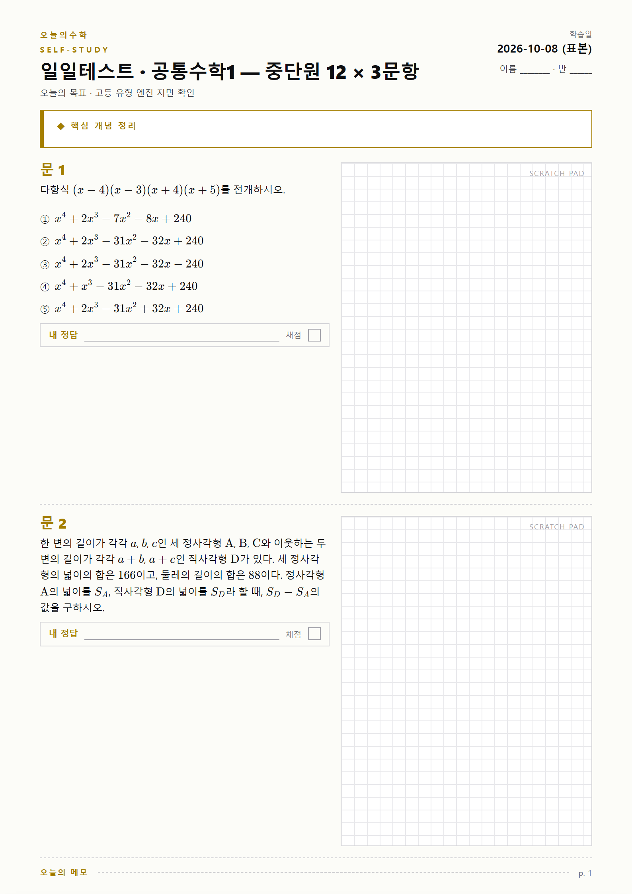
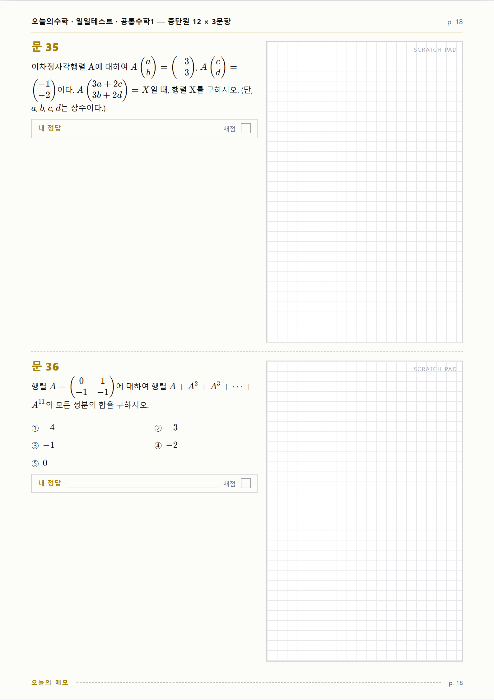
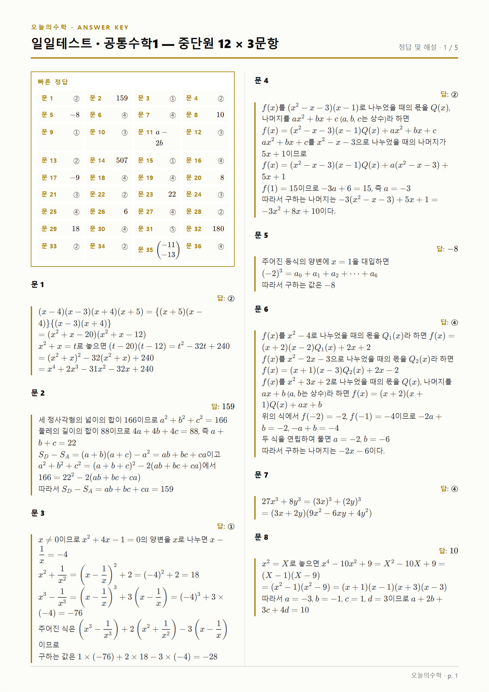
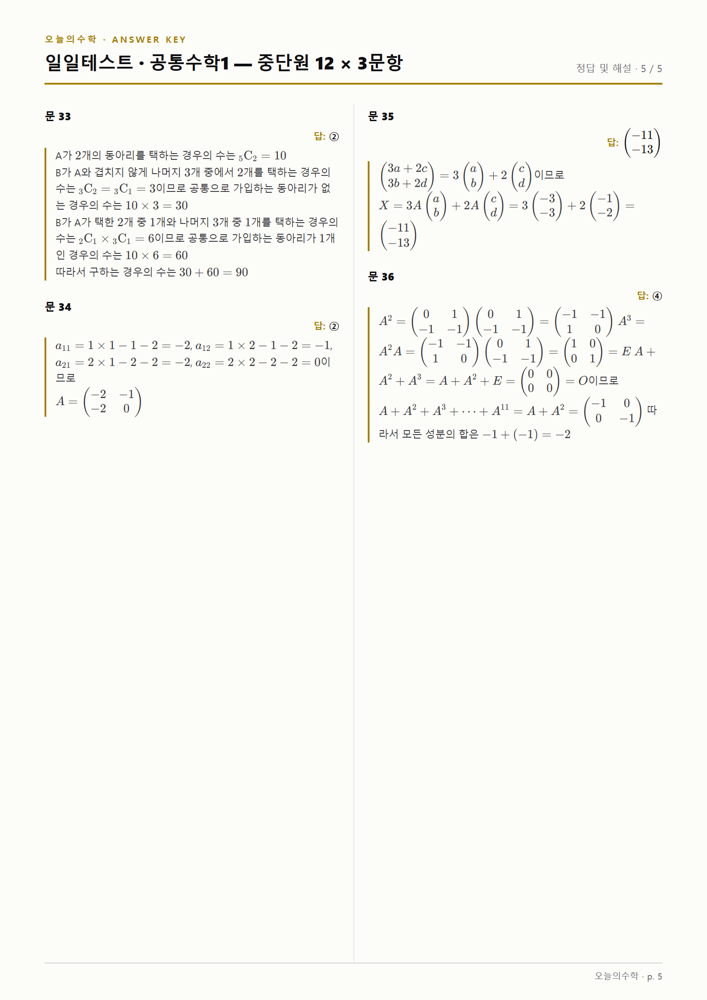

# 엔진 보강 ③-0 — 고등 엔진 배선 · 적재 전 관문 · 공통수학1 168유형 적재 준비 (2026-10-08)

지시서: `E:\todays-math-textbook-import\briefs\brief-high-wiring.md` · 합의안: `docs/planning/tracks/engine-upgrade-consensus-20261008.md` §3-3 · §3-5 · §5 의 ③-0 · §6-1 · §6-2.
가지 `chrismathone/high-wiring`(origin/main `ff3ca6a4e` 에서 갈림) · 커밋 넷:

| 커밋 | 무엇 |
|---|---|
| `db7688465` | 배선 — 열쇠 계약 · 적재기 `HighTarget` · 미적재 검사 정확한 키 · 제자리 갱신 · `high:` 출처 접두사 · 등록부 주입 · 168 고정값 → 과목별 보존 · 적재 계획 |
| `6cf19a387` | 적재 전 관문(고등 공용 판정기) · 값으로 견주는 보기 · 생성기 수리 다섯 · 수리마다 시험 · 탐침 · 변이 하네스 |
| `818aba923` | 보고서 · 표본 지면(PNG · PDF · 글) · 변이 [33] 의 가르는 예 · 무거운 적재 시험 가볍게 |
| (그 뒤 커밋) | 전체 시험 결과(§8) |

작업자가 한 번 바뀌었다(세션이 끊겨 이어 받음) — 앞 작업자가 첫 커밋과 관문 · 수리의 초안까지, 뒤 작업자가 수리의 시험 · 탐침 · 변이 · 드라이런 · 표본 · 이 보고서를 했다.

🔴 **공유 DB 에 적재하지 않았다**(드라이런 · 읽기만) · **main 에 밀지 않았다** · `SUPPORTED_GRADES` 는 안 건드렸다 · 판정형 파일(`src/lib/middle/judge/**`)은 안 건드렸다.
🔴 **이 가지는 적재 전에는 main 에 못 간다** — `checkUnloadedTypes` 가 이제 고등 168자리를 «새로 안 나가게 된 유형»으로 센다(§5.4). **리드의 적재가 남았다 — DB 먼저 · 코드 나중**(§7-1).

## 1. 요약

1. 공통수학1 168유형은 등록부(2026-09-13)에만 있고 문제은행에 한 행도 없었다. 적재기 · 미적재 검사 · 제자리 갱신 · 출처 판정을 고등 등록부에 이었다 — 판정형이 쓴 **한 분기 함수 `buildTargetRows`** 에 다섯째 갈래로 묶었다.
2. 싣기 직전의 행에 돌리는 **적재 전 관문**(`scripts/qa/highLoadGate.ts`)을 세웠다. 처음 돌렸을 때(씨앗 여덟 · 32,208행) 셋이 걸렸고 — 해설의 없는 명령 `\pmi` · 답이 발문에 그대로 · 값이 같은 보기 — 생성기에서 고쳤다(§4). 지금은 계획 행 4,026 · 씨앗 여덟 전수 모두 **막힌 것 0 · 못 읽은 보기 0**.
3. 적재 드라이런(공유 DB 읽기만): **넣을 것 4,026행**(단답 2,013 · 객관 2,013 · 차시 51 · 유형 168 · 그림 0). 제자리 갱신 드라이런: **바뀌는 행 0 · 건너뜀 0 · 문지기 거부 0 · 던진 대상 0**.
4. 표본 36문항(중단원 12 × 3)을 제품 `TestPrint` 로 떴다. KaTeX 오류 0 · 제품 경고 0 · 칸 밖으로 밀린 해설 0. **지면에서만 보이는 것 넷**을 찾았다(§6.2) — 그 가운데 «행렬 · 연립으로 끝나는 해설 줄이 다음 줄과 붙는다»는 엔진이 아니라 공용 렌더 경로의 결함이라 리드에게 넘긴다(리드 답 2026-10-08: 렌더러는 건드리지 않는다).
5. 남은 것: **적재(리드)** · 공통수학1 개방 결정 · `[고]` 배지 결정 · 렌더러 수리 · 인쇄 쪽 잔고(§7).

## 2. 배선

### 2.1 열쇠 계약 (`src/lib/high/loadKey.ts`)

```
유형 키     공통수학1|항등식과 나머지정리|03            ← `과목|중단원|번호`, 색인 바이트 그대로
familyKey   high:공통수학1|항등식과 나머지정리|03
externalId  engine-high:공통수학1|항등식과 나머지정리|03|s20261008|v0|단답형
variantKey  high:공통수학1|항등식과 나머지정리|03|s20261008|v0
```

중등 유형의 규칙 그대로다(`high-engine-plan.md` §0-㉡). 짓는 함수(`highExternalId`)와 읽는 함수(`parseHighExternalId`)가 **한 파일의 짝**이고, 읽기는 앞머리 · 꼬리를 끝까지 맞추는 **정확한 키**다 — 번호 `03` 은 확장 번호 `03A` 의 일부라 포함으로 대면 `…|03A` 만 실려도 `…|03` 이 «나갔다»로 읽힌다. 유형 키가 `과목|중단원|번호`(번호 `\d{2}[A-Z]?`) 꼴이 아니면 열쇠를 안 짓는다(꼬리 `|s…|v…` 를 흉내 내는 키를 막는다).

### 2.2 바꾼 자리

| 자리 | 바꾼 것 |
|---|---|
| `scripts/import/load-engine-problems.ts` | `engine: "high"` target(차시마다 하나 · `keys` 로 일부 유형만 · `variants`) · `buildHighRows` · **`buildTargetRows` 다섯째 갈래**(모르는 target 은 던진다) · 객관식은 생성기의 `distractors` 를 먼저 쓴다(`expandFamily` 그대로) · 되돌리기의 «우리 행» 판정 `isOwnExternalId` 가 `engine-high:` 를 안다 · 고등 차시 이름이 단원 둘에 걸리면 멈춘다(`ambiguousUnitKeys`) · `--table`(차시별 · 난이도별 · 형식별 표) · **고등 행이 있으면 적재 전 관문을 돌리고 걸리면 드라이런에서도 멈춘다**(`highPreloadVerdict`) |
| `scripts/qa/checkUnloadedTypes.ts` | `unloadedHigh`(정확한 키) · `loadedHighKeys` · `highKeyProbe`(짓는 함수 ↔ 읽는 함수 짝 · 비슷한 키 거부를 실행마다 점검) · **`unloadedAll`** — 스크립트가 부르는 한 함수가 중등 유형 · 결합형 · 판정형 · 고등을 같이 센다(따로 부르다 한 줄을 빠뜨리면 그 등록부가 구조적으로 0) |
| `scripts/qa/refresh-engine-content.ts` | `rebuild` 가 받은 등록부(`deps.highs`)를 분기 함수에 넘긴다 — 고등 행도 적재기와 같은 함수로 되만든다. 판정(`refreshEngineContentCore.ts` — `classifyDiff` · `identityRisk` · `decideApply`)은 손대지 않았다(문지기 우회 없음) |
| `src/lib/problem/provenance.ts` | `ENGINE_PREFIX` 에 `["high:", "middle_engine"]`. **새 갈래를 만들지 않고 기존 엔진 배지 `[중]` 을 같이 쓴다** — 새 글자 · 새 색은 형태를 정하는 일이라 짓지 않았다(D-07). 🔴 그래서 지금은 공통수학1 문항의 배지 이름이 «중등 엔진 생성»으로 나온다 — §7-3 |
| `src/lib/high/generate.ts` | 등록부를 `createHighRegistry(entries, holds)` 로 감싸 **주입할 수 있게** 했다(시험이 픽스처 등록부로 «등록부 누락 · 비슷한 키»의 양쪽을 직접 댄다). 산출은 전후 해시가 같다(4,032표본) |
| `src/__tests__/unit/highRegistry.test.ts` | 등록 수 **168 고정값 → 과목별 보존**(`PRESERVED` — 공통수학1 등록 168 · 보류 2 · 색인 170). 표에 없는 과목이 등록부에 생기면 운다 — 공통수학2 가 붙어도 공통수학1 의 168 을 지킨다 |
| `scripts/import/plans/2026-10-08-공통수학1-전량.json` | 적재 계획 — target 52(차시 51 · 「조합」만 둘로 가름) · 유형마다 12벌(`공통수학1\|조합\|02` 만 변형 공간이 좁아 9벌) · 씨앗 20261008 |

⚠️ 그림 전용 도구 `refresh-engine-figures.ts` · `fill-missing-figures.ts` 는 여전히 elem/middle 만 본다 — 공통수학1 등록 유형은 그림이 0 이라 이번엔 영향 없다. 물결 2 에서 `funcGraph` 를 들이면 같이 넓힐 것(판정형 보고서 §2.2 와 같은 자리).

## 3. 적재 전 관문 — 고등 공용 판정기 (`scripts/qa/highLoadGate.ts`)

생성기 시험은 **생성기가 낸 문항**을 보는데 실리는 것은 그 뒤에 객관식으로 파생하고 열쇠를 붙인 **행**이다(20번 문서 «엔진을 본 것과 적재본을 본 것은 다른 일»). 그래서 관문은 적재기 `buildHighRows` 가 낸 행을 통째로 받는다.

| 축 | 물음 | 걸리면 |
|---|---|---|
| 렌더 | 수식마다 KaTeX 오류가 없는가 · `$` 짝 · 빈 수식 · 죽은 역슬래시(`deadBackslashHits`) | 막는다 |
| 보기 | 보기가 다섯인가 · **값이 같은 보기**가 없는가(정답과 동치인 오답 포함) · 정답 번호가 단답 정답을 가리키는가 | 막는다 |
| 답이 발문에 | 답이 발문에 그대로 적혀 있는가(식 · 단위 붙은 수량) | 막는다 |
| 차시 대응 | `과목 + 차시` 가 단원 시드에 글자 그대로 **하나** 있는가 | 막는다 |
| 난이도 | 칸이 여섯 칸 가운데 하나인가 — 분포는 세어 낸다 | 막는다(모르는 칸) |

막지 않고 **세어서 찍는** 것 둘 — 값으로 못 읽은 보기(`unread` — 0 이 «깨끗»인지 «못 셈»인지 갈리게) · 맨 수 답이 발문의 수와 겹친 변형의 유형별 비율(`bareAnswer` — 맨 수는 계수와 우연히 겹치는 일이 흔해 한 건씩 막으면 거짓 경보가 가드를 끈다. 대신 시험이 «유형마다 20% 아래»를 잠근다).

규칙을 옮겨 적지 않았다 — 죽은 역슬래시는 `probe-middle-raw-latex`, 단위 붙은 수량은 `census-middle-degenerate`, 보기 가르기는 지면 파서 `parseProblemContent`, 렌더 실패 판정은 제품의 `isFailedKatexHtml` 를 그대로 부른다. 새로 적은 것은 **보기의 값 대조**(`scripts/qa/highChoiceValue.ts`)뿐이다: 수식을 읽어 문자에 수(무리수 표본 넷)를 넣어 본다. 분수 · 근호 · 복소수 · `\pm` · 등식 · 이어진 부등식(양의 상수배까지 같은 조건) · 행렬 · 계승을 읽고, **못 읽는 꼴은 던진다**(조용히 «다르다»로 넘기면 읽지 못한 보기가 전부 통과가 된다).

탐침 `scripts/qa/probe-high-gate.ts` 가 같은 관문을 표로 찍는다(계획 그대로 · `--seeds` 로 등록 유형 전부). 시험과 **같은 함수로** 행을 만든다.

### 3.1 판정기 결과

| 돌린 것 | 행 | 견준 보기 쌍 | 못 읽은 보기 | 막힌 것 |
|---|---:|---:|---:|---:|
| 처음(수리 전) — 씨앗 여덟 × 168유형 | 32,208 | — | 0 | 걸린 갈래 **셋**(렌더 · 답이 발문에 · 값이 같은 보기) + 맨 수 비율로 드러난 꼴 — §4 |
| 수리 뒤 — 적재 계획 그대로(씨앗 20261008) | 4,026 | 20,130 | 0 | **0** |
| 수리 뒤 — 씨앗 여덟 × 168유형(20261008 · 1 · 7 · 7777 · 20260913 · 424242 · 31337 · 99) | 32,208 | 161,040 | 0 | **0** |

계획 행에서 맨 수 답이 발문의 수와 겹친 변형은 셋뿐이다 — `이차방정식|17` 1/2 · `연립일차부등식|06` 1/8 · `조합|08` 1/12(읽어 보면 계수 · 사람 수와 답이 우연히 겹친 판). 씨앗 여덟을 모은 비율은 가장 높은 유형이 8%다(`경우의 수와 순열|01` · `이차방정식과 이차함수|02` 각 8/96) — 수리 전에는 `항등식과 나머지정리|07` 이 24% 였다. 시험은 «유형마다 20% 아래»를 잠근다.

## 4. 생성기 수리 — 관문이 찾은 것

값 검산(답이 맞나)도 렌더 시험도 못 본 자리들이다. 유형을 뺀 것은 없다(`HOLDS` 추가 0 — 보류는 물결 1 의 둘 그대로).

| 유형(파일) | 증상 | 고침 | 시험 |
|---|---|---|---|
| `여러 가지 방정식\|03` 외 — 공용 `surdPmTex`(`src/lib/high/numbers.ts`) | 해설에 `$x=\pmi$` — `\pm` 뒤에 `i` 를 붙여 써 **없는 명령**이 된다. 지면에서는 그 수식이 날 글자로 나간다 | `\pm` 뒤가 글자로 시작하면 한 칸 띈다(`\pm i`). 수 · 근호로 시작하는 꼴은 한 바이트도 안 바뀐다 | `highNumbers` — 꼴 넷 + 수치 1,008벌 전수 KaTeX |
| `인수분해\|04` 꼴 0(`h1Factor.ts`) | $r=-p$ 이면 「$y$ 의 부호를 둘 다 바꾼」 오답이 「상수 짝을 바꾼」 오답과 **인수의 차례만 다른 같은 식** — $(x-y-2)(x+y+3)$ 과 $(x+y+3)(x-y-2)$ 가 한 문항의 보기 둘 | 그 판에서만 둘째 후보를 「상수 하나의 부호를 틀린」 오답으로. 후보의 자리 · 수 · 난수 소비는 그대로 | `highFactor` — 오답끼리 값 대조(쌍 1,000+ · $r=-p$ 인 판 10+) |
| `항등식과 나머지정리\|07` 꼴 0 · `\|08` 꼴 0(`h1Identity.ts`) | $R(t)$ 를 묻는 점 $t$ 가 나누는 일차식의 근 — 「$x-2$ 로 나눈 나머지가 $-1$ … $R(2)$ 의 값」의 답이 $-1$. 씨앗 여덟에서 07 꼴 0 의 51판 중 12판 · 08 꼴 0 의 24판 중 4판 | 그런 판은 다시 뽑는다 | `highIdentity` — facts 로 300씨앗(분모 80+ · 50+) |
| `항등식과 나머지정리\|07` 꼴 1(`h1Identity.ts`) | 주어진 나머지의 기울기가 답의 기울기와 같으면 그 나머지가 곧 답 — 「… 나머지는 $x-3$ 이다. … 나머지를 구하시오」의 답이 $x-3$ | 그런 판은 다시 뽑는다 | `highIdentity` — facts + 지면(답의 다항식이 발문에 없다) |
| `이차방정식과 이차함수\|08` 꼴 1(`h1QuadFunc.ts`) | $g=0$ 이면 극값이 $k$ 그대로 — 「최솟값이 $4$ 일 때 $k$ 의 값」의 답이 $4$. 이 꼴 35판 중 4판 | 그런 판은 다시 뽑는다 | `highQuadFunc` — 300씨앗(분모 50+) |

`bankDecideEngineParity.test.ts`(수정 전 45유형 × 300씨앗 지문 대조)는 `인수분해|04` 의 바뀐 오답만 옛 글로 되돌려 넣어 «그 밖은 한 바이트도 안 바뀌었다»를 잰다 — 되돌린 판이 0 이면(수리가 안 닿았다) 빨갛고, 그대로 뽑은 지문이 기준선과 같아도(수리가 안 들어갔다) 빨갛다.

## 5. 시험 · 변이 · 드라이런 (다 됐다는 증거)

### 5.1 시험

| 시험 파일 | 건수 | 무엇을 |
|---|---:|---|
| `loadHighRows.test.ts` | 32 | 열쇠 계약(짓기 ↔ 읽기 · 모양) · 적재 행 · 생성기 오답 우선 · 출처 판정 · `keys` · **모르는 target 은 던진다** · **고등 등록부 누락은 관문이 운다** · **비슷한 키의 거짓 적재 반례**(`03` ⊂ `03A`) · `unloadedAll` · 제자리 갱신이 같은 함수로 되만듦 · 되돌리기 접두사 다섯 · 단원 겹침 · 표 · 적재 계획이 등록부를 빠짐없이 덮는다 |
| `highLoadGate.test.ts` | 62 | ㉠ 눈금 — 축마다 양성과 음성(관문이 처음 찾은 셋을 양성 예로) ㉡ 값 읽개 — 같다 15쌍 · 다르다 19쌍 · 못 읽음 ㉢ 관문 — 계획 그대로 + 씨앗 셋 더 · 적재기 연결 · 탐침 표 |
| `highRegistry.test.ts` | — | 과목별 보존(168 고정값 대체) |
| `highNumbers` · `highFactor` · `highIdentity` · `highQuadFunc` | +5 · +1 · +3 · +1 | 수리 다섯 자리(§4) |
| `problemProvenance` · `problemFormatFilter` · `loadJudgeRows` · `bankDecideEngineParity` | 고침 | `high:` 접두사 · «모르는 engine» 예 · 지문 대조 |

- 고등 · 관문 관련 묶음 **44파일 616건**(고등 18 · 적재 · 미적재 · 제자리 갱신 · 출처 판정 · 형식 필터 · 판정형 · 결합형 · `chooseAll` · 렌더 일치 · 전수 가드 `noRmSync` · `regexTemplateEscape` · `solutionWiring`) — 자세한 것은 §8.
- `npm run type-check` 초록.
- `npm run lint` — 오류 275건은 **전부 기존 잔고**다(`docs/planning/tracks/reports/concept-student-clear-20261006/` 의 증거 스크립트 21파일 — origin/main `ff3ca6a4e` 에 있는 파일이고 이 가지가 안 건드렸다 · 규칙 `no-explicit-any` 274 + 1). 이 가지가 바꾼 파일은 오류 0 · 경고는 적재기의 기존 2건(안 쓰는 이름)뿐.

### 5.2 변이 — `scripts/qa/mutate-high-wiring.mjs` (지문 `scripts/qa/high-wiring-digest.ts`)

판정 3단(파일이 바뀌었나 → **산출물 지문이 바뀌었나** → 시험이 빨개지나) · 원복은 시작 때 읽은 바이트 그대로.

**42 / 42 빨강**(가드가 산다) · 원복 바이트 동일 · 원복 뒤 `git status` 깨끗.

| 갈래 | 변이 | 예 |
|---|---:|---|
| 열쇠(`loadKey.ts`) | 3 | 읽기 · 짓기가 유형 키 모양을 안 본다 · 문항류 접두사를 `mid:` 로 |
| 적재기 | 10 | 고등 target 을 중등으로 · **모르는 target 을 중등으로 흘린다** · 등록부 주입을 버린다 · 생성기 오답을 안 넘긴다 · 다른 차시의 키를 조용히 뺀다 · 되돌리기가 고등 접두사를 모른다 · 단원 둘에 걸려도 통과 · 관문에 걸려도 안 막는다 · 관문을 안 돌린다 · 못 읽은 보기를 안 찍는다 |
| 미적재 검사 | 2 | **고등 유형을 포함으로 댄다**(비슷한 키의 거짓 적재) · 한 함수가 고등을 안 센다 |
| 제자리 갱신 · 출처 판정 | 1 · 1 | 등록부 주입을 버린다 · `high:` 접두사를 뺀다 |
| 관문 | 13 | 축마다 — KaTeX · `$` 짝 · 죽은 역슬래시 · 값 대조 · 정답 번호 둘 · 식 · 단위 누출 · 차시 둘 · 난이도 · 못 읽음 · 맨 수 겹침 |
| 값 읽개 | 6 | 부등식의 음수배 · 관계 기호 · 행렬 모양 · `\pm` · 허수 단위 · 못 읽는 꼴을 «다르다»로 |
| 생성기 수리 되돌림 | 6 | §4 의 자리마다 수리 한 줄을 지운다 |

⚠️ 첫 실행은 41 빨강 + **판정 거부 1** — [33] «행렬의 모양을 안 본다»가 «산출물이 그대로»였다. 말뭉치의 행렬 쌍(2×1 · 1×2)은 칸 수가 같아 **열 수만 봐도** 갈렸다 — 행 수 대조만 가르는 자리가 없었다(판정형 보고서의 [5] 와 같은 자리: 가드가 없는 게 아니라 가르는 예가 없다). 열 수는 같고 행 수만 다른 쌍(1×2 · 2×2)을 시험과 지문에 더하고 다시 재서 빨강을 확인했다.

### 5.3 적재 드라이런 — 공통수학1 전부 (공유 DB 읽기만 · `--apply` 없음 · `ALLOW_SHARED_IMPORT` 없음)

```
계획 「공통수학1-전량-12벌」 · 씨앗 20261008 · 목표 52개
생성 4026문항 · 서로 다른 문항 4026건 · 형식 — 객관식 2013 · 단답형 2013
고등 적재 전 관문 — 행 4026 · 문항류 168 · 견준 보기 쌍 20130 · 못 읽은 보기 0행 · 막힌 것 0
단원 연결 4026 · 이미 있음 0 · **넣을 것 4026** · 그림이 붙는 문항 0건
```

| 난이도 | 기본 | 응용 | 심화하 | 합 |
|---|---:|---:|---:|---:|
| 행 | 1,678 (41.7%) | 1,616 (40.1%) | 732 (18.2%) | 4,026 |

`연산` · `심화중` · `심화상` 칸은 0 이다 — RPM 고등의 검은 표(하 · 중하 · 중 · 상중 · 상)를 칸에 댄 결과이고 생성기가 그 칸을 내지 않는다(물결 1 의 확정 그대로). 차시마다 `기본` 칸이 있다(시험이 잠근다 — 하위 칸이 한 행도 없는 차시 0).

차시별(행 = 유형 × 변형 12 × 형식 2 · 단답 = 객관):

| 행 | 유형 | 기본 | 응용 | 심화하 | 차시 |
|---:|---:|---:|---:|---:|---|
| 24 | 1 | 10 | 14 | 0 | 다항식의 덧셈과 뺄셈 |
| 24 | 1 | 14 | 4 | 6 | 다항식의 곱셈 |
| 72 | 3 | 22 | 36 | 14 | 곱셈공식 |
| 120 | 5 | 42 | 36 | 42 | 곱셈공식의 변형 |
| 96 | 4 | 50 | 40 | 6 | 다항식의 나눗셈(1) |
| 96 | 4 | 34 | 46 | 16 | 항등식 |
| 48 | 2 | 16 | 32 | 0 | 다항식의 나눗셈과 항등식 |
| 144 | 6 | 84 | 44 | 16 | 나머지와 인수정리(1) |
| 48 | 2 | 32 | 8 | 8 | 나머지와 인수정리(2) |
| 120 | 5 | 70 | 34 | 16 | 인수분해 |
| 120 | 5 | 46 | 64 | 10 | 복잡한 식의 인수분해(1) |
| 72 | 3 | 38 | 34 | 0 | 복소수 |
| 72 | 3 | 36 | 26 | 10 | 복소수의 연산 |
| 96 | 4 | 30 | 48 | 18 | 켤레복소수의 성질 |
| 48 | 2 | 14 | 22 | 12 | i의 거듭제곱 |
| 48 | 2 | 20 | 20 | 8 | 음수의 제곱근 |
| 72 | 3 | 30 | 20 | 22 | 이차방정식 |
| 24 | 1 | 14 | 10 | 0 | 절댓값(가우스) 기호를 포함한 방정식 |
| 96 | 4 | 42 | 34 | 20 | 이차방정식의 판별식 |
| 144 | 6 | 52 | 70 | 22 | 이차방정식의 근과 계수의 관계 |
| 72 | 3 | 24 | 28 | 20 | 이차방정식의 식 구하기 |
| 120 | 5 | 52 | 48 | 20 | 이차방정식과 이차함수의 관계 |
| 48 | 2 | 22 | 14 | 12 | 이차함수의 최대·최소(1) |
| 96 | 4 | 38 | 32 | 26 | 이차함수의 최대·최소(2) |
| 72 | 3 | 26 | 34 | 12 | 삼차방정식과 사차방정식(1) |
| 48 | 2 | 16 | 22 | 10 | 삼차방정식과 사차방정식(2) |
| 24 | 1 | 6 | 12 | 6 | 삼차방정식의 근의 조건 |
| 72 | 3 | 44 | 20 | 8 | 삼차방정식의 근과 계수의 관계 |
| 24 | 1 | 8 | 8 | 8 | 허근의 성질 x³=1,x³=-1 |
| 72 | 3 | 20 | 46 | 6 | 미지수가 2개인 연립이차방정식(1) |
| 48 | 2 | 20 | 28 | 0 | 미지수가 2개인 연립이차방정식(2) |
| 24 | 1 | 12 | 0 | 12 | 인수분해가 되지 않는 연립이차방정식 |
| 48 | 2 | 20 | 0 | 28 | 부정방정식 |
| 72 | 3 | 30 | 36 | 6 | 일차부등식, 연립일차부등식(1) |
| 120 | 5 | 38 | 58 | 24 | 연립일차부등식(2) |
| 96 | 4 | 40 | 34 | 22 | 절댓값 기호를 포함한 일차부등식 |
| 120 | 5 | 50 | 56 | 14 | 이차부등식 |
| 24 | 1 | 12 | 12 | 0 | 절댓값(가우스) 기호를 포함한 이차부등식 |
| 120 | 5 | 46 | 48 | 26 | 이차부등식의 해의 조건 |
| 24 | 1 | 2 | 10 | 12 | 제한된 범위에서 항상 성립하는 이차부등식 |
| 144 | 6 | 66 | 42 | 36 | 연립이차부등식 |
| 24 | 1 | 12 | 12 | 0 | 이차방정식의 실근의 부호 |
| 24 | 1 | 10 | 4 | 10 | 이차방정식의 실근의 위치 |
| 168 | 7 | 64 | 74 | 30 | 경우의 수 |
| 144 | 6 | 62 | 54 | 28 | 순열 |
| 234 | 10 | 86 | 128 | 20 | 조합 |
| 72 | 3 | 18 | 24 | 30 | 조 나누기 |
| 48 | 2 | 18 | 14 | 16 | 행렬 |
| 72 | 3 | 56 | 16 | 0 | 행렬의 덧셈, 뺄셈과 실수배 |
| 72 | 3 | 30 | 34 | 8 | 행렬의 곱셈 |
| 96 | 4 | 34 | 26 | 36 | 행렬의 곱셈의 성질 |
| **4,026** | **168** | **1,678** | **1,616** | **732** | 합 — 차시 51 |

단원 시드의 공통수학1 차시는 53 이다 — 유형이 없는 차시가 둘(«다항식의 나눗셈(2)» · «복잡한 식의 인수분해(2)»)이고, 그 차시는 실리는 문항이 0 이다(RPM 색인의 유형이 (1) 쪽 차시에 대응돼 있다). 보류는 둘 그대로(`이차부등식과 연립이차부등식|01` — 그래프 · `경우의 수와 순열|08` — 영역 지도 그림 · 둘 다 물결 2).

### 5.4 미적재 검사 (공유 DB 읽기만)

```
적재본 113193행 · 안 나가는 유형 168자리 (원장 0)
🔴 새로 안 나가게 된 유형 168자리 — 엔진에만 산다.   → exit 1
```

168자리는 전부 고등 유형(공통수학1)이다 — 중등 유형 · 결합형 · 판정형은 0(판정형 36행은 리드가 실었다). **예상한 빨강이다.** 원장(`unloaded-types.json`)에 빚으로 적지 않았다 — 적재하면 0 이 된다.

### 5.5 제자리 갱신 드라이런 (`--all-plans --all-families` · 공유 DB 읽기만 · 최종 커밋 기준)

| 항목 | 값 |
|---|---:|
| 계획 | 31 |
| 되만든 행 | 118,241 |
| 던진 대상(재생 실패) | **0** |
| 계획끼리 어긋난 열쇠 | **0** |
| 적재본(`engine-`) | 100,830 |
| 같음 | 99,052 |
| 풀이 · 보기 · 발문 다름 | 0 · 0 · 0 |
| **바뀌는 행**(그림 포함) | **0** |
| 건너뜀 | **0** |
| 문지기 거부(`identityRefused`) | **0** |
| 출제 가능한 미대응(`unmatchedEligible`) | **0** |
| 못 맞댄 적재본 | 1,778 |

못 맞댄 1,778행은 판정형 보고서의 기준선과 같은 수다 — 전부 출제 불가로 잠긴 옛 행(이번 일과 무관 · 기존 잔고). 같음 99,052 는 기준선 99,016 에 판정형 36행이 더해진 수다. 고등 4,026행은 «새로 생긴 행(적재본에 없음 — 넣지 않는다)»에 들어 있다. 보고 JSON 은 저장소 밖(`.qa-artifacts/high-wiring/`)으로 옮겼다.

## 6. 지면 표본 36문항 (원장님께 보일 것)

적재 계획 그대로(씨앗 20261008)의 행에서 **중단원 12개마다 셋** — ㉮ 정답 글이 가장 긴 변형의 객관식 · ㉯ 발문이 가장 긴 변형의 단답형 · ㉰ 해설이 가장 긴 변형의 객관식(문항류는 서로 다르게). 지면이 버거운 쪽을 일부러 골랐다(분수가 든 문항 17 · 근호 2 · 행렬 3).
제품 일일테스트 지면 `TestPrint`(문제지 `JaseupTemplate` · 정답지 `PrintAnswerKeyPage`)를 Vite + Chromium 으로 떴다(`next/link` 만 대역 · 글꼴은 응답의 첫 바이트가 `wOF2` 인지 확인했다 — 200 인데 HTML 이 오는 전례).

- 문제지: [`high-wiring-step0/questions.pdf`](high-wiring-step0/questions.pdf) · `questions-p1.png` ~ `questions-p18.png`
- 정답지: [`high-wiring-step0/answers.pdf`](high-wiring-step0/answers.pdf) · `answers-p1.png` ~ `answers-p5.png`
- 글 그대로: [`high-wiring-step0/samples.md`](high-wiring-step0/samples.md)






### 6.1 잰 것

| 항목 | 문제지(18쪽) | 정답지(5쪽) |
|---|---:|---:|
| KaTeX 오류(`.katex-error`) | 0 | 0 |
| 제품 경고(`role=status`) | 0 | 0 |
| 칸 밖으로 밀린 해설(셋째 단 · 아래 넘침) | — | 0 |
| 쪽 상자 밖으로 나간 수식 | 0 | 0 |
| 문항 상자를 가로로 넘친 수식(수식 320 · 355개) | 0 | 0 |
| 위아래 줄의 분수 상자끼리 맞닿음(틈 2px 미만) | 0 | **7쌍 · 3문항**(문 19 · 20 · 21 — 틈 0 ~ 0.7px) |

### 6.2 지면에서만 보이는 것 넷 — 엔진 시험은 구조적으로 못 본다

**⑴ 🔴 행렬 · 연립으로 끝나는 해설 줄이 다음 줄과 붙는다 — 공용 렌더 경로의 결함(리드에게 넘김).**

정답지 5쪽 문 36: 해설 줄 「$A^{3}=A^{2}A=\cdots=E$」 와 다음 줄 「$A+A^{2}+A^{3}=\cdots$」 가 한 줄로 이어져 **「$=E\ A+A^{2}+A^{3}=A+A^{2}+E$」** 로 읽힌다. 문 35 · 문 23 도 같다(표본 36문항 중 **3문항**).

- **원인** — `src/lib/math/textPreprocess.ts:1170` 이 `\begin{pmatrix|cases|…}` 가 든 인라인 수식을 `$$…$$` 로 승격한다(`MULTILINE_ENV` · `:227`). 그 뒤 `src/lib/math/hardBreaks.ts:58-63` 의 `applyHardBreaks` 가 `$$` 블록을 건너뛰고 **블록 사이의 조각**에만 하드 브레이크 규칙(`:42` — `([^\s])[ \t]*\n`)을 대는데, 블록 바로 뒤 조각은 `\n` 으로 **시작**해서 정규식이 요구하는 «앞 글자»가 조각 안에 없다. 그래서 `$$…$$` 바로 뒤의 홑 줄바꿈은 하드 브레이크를 못 받고 Markdown 이 공백으로 읽는다.
- **재현 한 줄** — `preprocessMarkdown("$A=\\begin{pmatrix}1&2\\\\3&4\\end{pmatrix}$\n다음 줄")` → `"$$\displaystyle A=\begin{pmatrix}1&2\\3&4\end{pmatrix}$$\n다음 줄"`(공백 둘 없음). 대조: `preprocessMarkdown("$x=1$\n다음 줄")` → `"$\displaystyle x=1$  \n다음 줄"`. 함수만: `applyHardBreaks("$$x$$\n다음 줄")` 은 입력 그대로, `applyHardBreaks("$$x$$이다\n다음 줄")` 은 `"$$x$$이다  \n다음 줄"`.
- **수치** — 표본 36문항 중 해설 3문항(문 23 · 35 · 36). 공통수학1 적재 계획 4,026행 중 **해설 236행**(변형 118 · 문항류 12 — 행렬 10유형 · `여러 가지 방정식|15` · `연립일차부등식|06`) · 발문 0(보기는 지면이 따로 그려 안 걸린다). **공유 DB 에는 이미 219행**이 같은 증상이다 — 전부 교과서 문항이고 엔진 행은 0(중등 엔진은 승격되는 수식으로 줄을 끝내지 않는다):

  | 출처 · 과목 | 행 | 본문 | 해설 | 출제 가능 |
  |---|---:|---:|---:|---:|
  | 교과서 · 공통수학1 | 110 | 48 | 73 | 104 |
  | 교과서 · 중2 | 79 | 18 | 66 | 74 |
  | 교과서 · 대수 | 15 | 12 | 3 | 15 |
  | 교과서 · 공통수학2 | 8 | 6 | 3 | 7 |
  | 교과서 · 미적분1 | 6 | 5 | 1 | 5 |
  | 교과서 · 확률과 통계 | 1 | 1 | 1 | 1 |
  | 합 | **219** | | | |

- **세는 질의** — `SELECT … FROM problem p JOIN unit u ON u.id = p.unit_id WHERE p.content LIKE '%\begin{%' OR p.solution LIKE '%\begin{%'`(2,241행)로 줄인 뒤, 행마다 **제품 함수 그대로**(본문 `preprocessMarkdown(content)` · 해설 `preprocessMarkdown(solutionForDisplay(solution))`)를 돌려 «`$$…$$` 바로 뒤가 (공백 둘 없는) 홑 줄바꿈 + 글»인 자리를 센다. 스크립트는 저장소 밖 `.qa-artifacts/high-wiring/db-count-break.ts`(읽기만).
- **고칠 자리** — `hardBreaks.ts` 의 루프에서 «앞 토막이 수식 블록이고 조각이 `[ \t]*\n(?![ \t]*\n)` 으로 시작하면» 그 줄바꿈 앞에 공백 둘을 붙인다(`$$` 안은 그대로 · 빈 줄은 그대로). 시험은 `hardBreaks.test.tsx` 에 «`$$…$$` 바로 뒤의 홑 줄바꿈» 예가 없다 — 그 예를 더한다. 인쇄 변경이라 `/dev/print-check` 항목이 따른다(기존 219행의 지면이 «줄이 갈리는 쪽»으로 움직인다).
- **적재는 안 막는다** — 행은 멀쩡하고 렌더만의 문제다. 렌더러를 나중에 고쳐도 재적재가 필요 없다.
- 리드 답(2026-10-08): **렌더러는 이 가지에서 건드리지 않는다** — 공용 렌더 경로 · 인쇄 변경이라 리드가 따로 한다.

**⑵ 정답지에서 분수가 든 줄이 이어지면 위아래 분수가 맞닿는다.** 문 19 의 「$a\ge -\dfrac{13}{6}$」 아래 「$-\dfrac{13}{6}$이다」 가 틈 0 으로 붙는다(7쌍 · 3문항). 판정형 보고서 §7-2 · handoff §0-ZT 가 «인쇄 쪽으로» 넘긴 그 성질이다 — 고등은 분수가 든 줄이 훨씬 잦아(표본 36 중 17문항에 분수) 더 자주 보인다.

**⑶ 긴 식이 정답지 단 폭에서 괄호 안에서 끊긴다.** 「$(x+5)(x-$ / $4)\}\{(x-3)(x+4)\}$」(문 1) · 「$2(x+$ / $4)(x+3)=0$」(문 17). KaTeX 가 이항 연산자 뒤에서 줄을 바꾸는 기본 동작이고, 중등 해설에도 있지만 고등은 식이 길어 잦다. 값 · 뜻은 맞다.

**⑷ 빠른 정답 칸에서 식으로 된 단답이 두 줄로 접힌다.** 문 11 의 답 「$a-2b$」 가 「$a-$ / $2b$」 로 접힌다(칸 폭이 번호 · 맨 수 기준). 행렬 답(문 35)은 칸 높이를 넘지 않고 들어갔다.

⑵⑶⑷ 는 지면 코드의 성질이라 이번 범위 밖이다(D-07 · 절대 규칙 6) — 엔진 쪽에서 글을 고쳐 때우지 않았다.

## 7. 남은 것

1. **적재(리드)** — 병합 뒤, DB 먼저 · 코드 나중:
   ```
   npx tsx --env-file=<.env> scripts/import/load-engine-problems.ts --plan "scripts/import/plans/2026-10-08-공통수학1-전량.json" --table   # 드라이런 — 넣을 것 4026 · 관문 막힌 것 0
   ALLOW_SHARED_IMPORT=1 npx tsx --env-file=<.env> scripts/import/load-engine-problems.ts --plan "scripts/import/plans/2026-10-08-공통수학1-전량.json" --apply
   npx tsx --env-file=<.env> scripts/qa/checkUnloadedTypes.ts                                    # 새로 안 나가는 0
   npx tsx --env-file=<.env> scripts/qa/refresh-engine-content.ts --all-plans --all-families     # 되읽기 — 고등 4,026행이 «같음» · 바뀌는 행 0
   ```
   원장은 `engine-load-공통수학1-전량-12벌.json`. 미적재 원장(`unloaded-types.json`)은 비어 있으므로 적재만 하면 초록이다(`--write` 불필요). 적재기는 고등 행에 관문을 먼저 돌린다 — 엔진을 고친 뒤 막히면 계획(벌 수)부터 다시 본다.
   ⚠️ 문항 코드 접두사(`HC1…`)는 DB 트리거가 붙인다(D-105) — 적재 뒤 표본 몇 행의 코드를 읽어 볼 것. 드라이런은 코드까지는 안 본다.
2. **공통수학1 개방 결정(원장님)** — `SUPPORTED_GRADES` 는 초3 ~ 중3 그대로다. 합의안 §6-2 의 차례는 «적재 → 되읽기 → 출제 → 화면 → 인쇄 확인 뒤 개방»이다. 개방 전에는 고등 엔진 행도 출제 범위 고르개에 안 보인다.
3. **`[고]` 배지 결정(원장님 · D-07)** — 지금 고등 엔진 문항은 `[중]` 배지를 같이 쓰고 이름이 «중등 엔진 생성»으로 나온다. 새 글자 · 새 색을 정하시면 `provenance.ts` 의 `ENGINE_PREFIX` 한 줄 + `ProblemOrigin` 값 + `ORIGIN_BADGE` · 색 토큰 · 필터 · 통계의 표를 같이 더한다(타입은 배열 길이를 안 센다 — 전수로).
4. **렌더러 수리(리드)** — §6.2-⑴. 고치기 전에 공통수학1 을 실어도 되지만, **행렬 12유형과 연립 · 절댓값 꼴의 해설이 정답지에서 줄이 붙어 나간다** — 개방(2번) 전에 고치는 것이 좋다.
5. **인쇄 쪽 잔고** — §6.2-⑵⑶⑷. 분수 줄 간격 · 긴 식의 줄바꿈 · 빠른 정답 칸의 식 답. 이번에 `/dev/print-check` 에 항목을 더하지 않았다(지면 코드를 안 바꿨다). 고등이 종이에 처음 나가는 자리라, 개방 전에 원장님이 PDF 를 한 번 뽑아 보시길 권한다.
6. **변형 공간이 좁은 유형** — `공통수학1|조합|02` 는 12벌을 못 채워 9벌이다(계획이 그 유형만 target 을 갈랐다). 시험이 «낮춘 유형은 이 하나»를 잠근다 — 늘면 계획을 다시 본다.
7. **그림 도구** — `refresh-engine-figures.ts` · `fill-missing-figures.ts` 는 고등을 모른다. 물결 2(`funcGraph`) 때 넓힌다.

## 8. 전체 시험

**관련 묶음 44파일 616건** — 한 번에 돌린 실행(다른 작업트리 여럿 + 타입 검사가 같이 도는 부하)에서 614건 초록 · **2건이 20초 상한 시간 초과**였다. 둘 다 따로 돌려 초록을 확인했다.

| 시간 초과 | 판단 |
|---|---|
| `chooseAllRule.test.ts` «초등 엔진 — 소단원 전량 × 갈래 × 씨앗 12» | 이 가지와 무관(초등 훑기) · 판정형 보고서 §8 이 적은 그 부하성 시간 초과 · 따로 돌려 18/18 초록(훑기 10초 안쪽) |
| `loadHighRows.test.ts` «변형 공간이 좁아 못 채우면 던진다» | 이 가지의 시험 — 픽스처 유형(수천 가지)으로 5,000벌을 물어 던지기까지 30초가 걸렸다. **낼 수 있는 문항이 둘뿐인 유형으로 다섯 벌**을 묻게 고쳤다(시험 전체 0.3초) · 32/32 초록 |

### 8.1 전체 vitest (커밋 `818aba923` 의 코드 · 한 번에 1,575초)

**1,350파일 중 30파일 · 34,867건 중 42건 실패**(1,291파일 통과 · 29 건너뜀). 실패 30파일을 갈랐다 — **이 가지의 변경으로 생긴 실패는 0** 이다. 고등 모듈 · 적재 · 미적재 · 제자리 갱신 · 출처 판정 · 형식 필터 · 판정형 시험은 전체 실행에서도 전부 초록이었다(가볍게 고친 `loadHighRows` 포함).

| 갈래 | 파일 | 판단 |
|---|---:|---|
| 다시 돌리니 초록 — 전체 실행의 부하 속 시간 초과(20초 상한 · 그림 렌더 120 ~ 300초 상한) | 18 | `chooseAllRule` · `choiceCountRule` · `affordanceGuard` · `elementaryDifficulty` · `elemFigureReference` · `elemNoNegativeAnswer` · `elemStemSelfContained` · `elemTierBacksolveEligibility` · `elemTiersG4Line` · `middleFigureRenderable` · `middleM3Func` · `middleM3Stat2` · `conceptBlankSheetCode` · `conceptStudentClearExampleCorrections` · `devAiFigureDash` · `AdminAccountRelations` · `TextbookStudioGuards` · `fadingCatalogResponsive`. 실패 파일만 따로 돌려 아홉이 초록 · 남은 아홉은 한 번에 하나씩 돌려 초록 |
| **기존 잔고** — 따로 돌려도 같은 실패 | 11 | 교과서 스튜디오(`TextbookStudio`) · 빠른 만들기(`textbookQuickCreate`) · 회수 측정 넷(`textbookRecoveryMeasurement` · `textbookRecoveryWriter` · `textbookTeacherBlank` · `textbookBankActivityScaffolds`) · 문제은행 출처 필터(«교과서» 칸 — `ProblemBank`) · 그림 보기 대응(`bankChoiceFigures`) · Decision Log 머리글(`decisionLogNumbers`) · 영어 라우트 둘의 `withErrorLog` 누락(`errorLogRouteCoverage`) · `load-school-textbook.ts:1227` 기출 배선 «판단불가»(`examWiringAudit`). 판정형 보고서 §8 이 갈래 기준 커밋에서 확인한 11파일과 같다 |
| 이 기계의 상태 | 1 | `devAiCliProcess` 2건 — `EBUSY: resource busy or locked, rmdir …\Temp\today-math-subscription-…`. `taskkill.exe` 로 자식 프로세스를 끊은 뒤 임시 폴더를 지우는 시험인데, 이 기계는 지금 프로세스 도구(`tasklist` · CIM)가 응답하지 않는다. 한 번에 하나씩 돌려도 같다 · 이 가지가 바꾼 파일과 무관 |

기존 잔고 11파일 가운데 이 가지가 바꾼 파일을 직접 import 하는 것은 없다. 출처 판정(`provenance.ts`)을 화면 부품이 거쳐 쓰는 둘(`ProblemBank` «네 출처를 모두 고를 수 있다» · `bankChoiceFigures`)은 **그 파일만 갈래 기준 판(`ff3ca6a4e`)으로 되돌려 다시 돌려도 똑같이 실패한다** — `high:` 접두사 탓이 아니다(되돌린 파일은 바로 원복 · `git diff` 깨끗).

## 9. 이번에 밟은 함정 (다음 사람에게)

- **값이 맞으면 시험이 다 초록이다** — 답이 발문에 그대로인 판(§4)은 `VERIFY`(답을 다시 계산)도 `SHOWN`(있어야 할 식이 있나)도 못 본다. 관문이 «실리는 행»을 보고 나서야 나왔다. 그리고 맨 수 답은 한 건씩 막을 수 없어(계수와 우연히 겹친다) **유형별 비율**로 봐야 꼴의 결함이 드러난다.
- **글자로만 겹침을 보면 같은 값의 보기가 지나간다** — `pickDistractors` 는 문자열 `Set` 이다. $(x-y-2)(x+y+3)$ 과 $(x+y+3)(x-y-2)$ 는 글자가 다르다.
- **시험 초록 ≠ 지면** — 행렬로 끝나는 줄이 붙는 것(§6.2-⑴)은 표본을 떠서야 보였고, 원인은 엔진이 아니라 «승격된 수식 바로 뒤»라는 렌더러의 빈자리였다. 같은 증상이 공유 DB 에 이미 219행 있었는데 아무 시험도 울지 않았다.
- **`.katex-base` 상자로 «줄이 닿는다»를 재면 거짓 경보다** — 받침대(strut) 높이라 보통 줄도 전부 닿은 것으로 재진다(처음 452쌍). 분수의 `.mfrac > .vlist-t` 로 좁히니 7쌍이었다(20번 문서 2026-09-27 «KaTeX 를 상자로 재면» 과 같은 자리).
- **포맷터가 변이의 앵커를 옮긴다** — 변이 하네스를 쓴 뒤 `prettier` 가 긴 줄을 접어 앵커 둘이 0개가 됐다. 하네스의 `--anchors` 로 커밋 전에 한 번 센다. 그리고 Git Bash 의 `grep` 은 4바이트 이모지(🛑)를 못 본다 — 걸린 줄을 찾을 때는 `✓` 를 빼는 쪽으로.
- **Windows 에서 `npx … -t "가|나"` 는 셸을 두 번 지난다** — 하네스는 `node node_modules/vitest/vitest.mjs` 를 셸 없이 바로 부른다.
- 이 기계는 `Get-CimInstance` · `tasklist` 가 응답하지 않을 때가 있다(다른 작업트리가 여럿 도는 중) — 프로세스 확인을 명령에 섞으면 그 명령째 2분을 먹는다.
