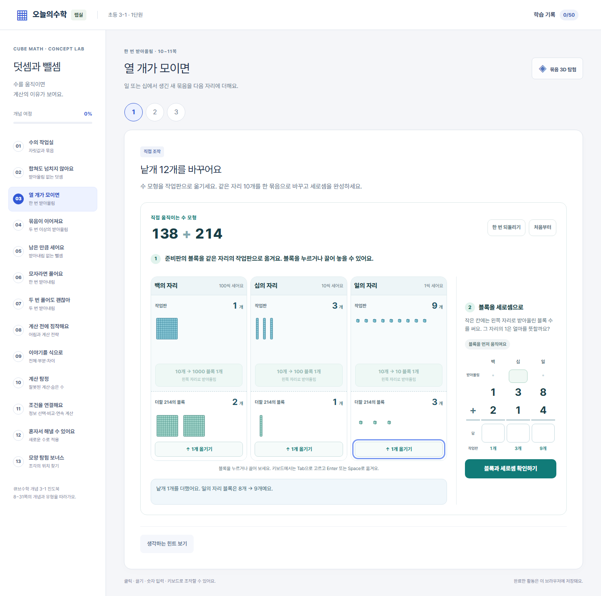
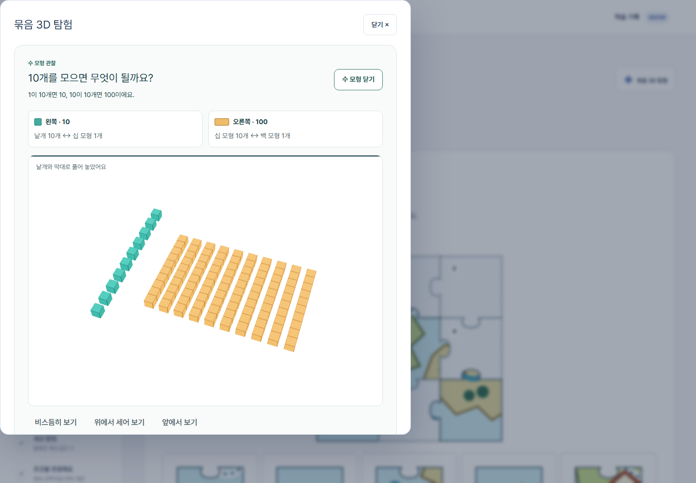
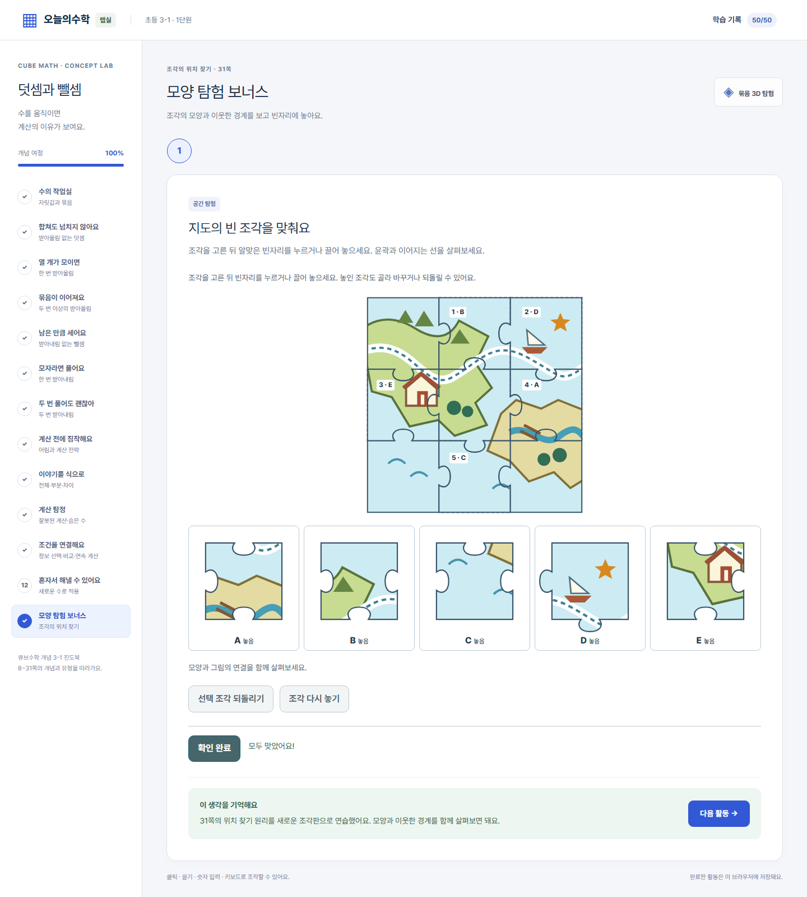

# 초3-1 덧셈·뺄셈 실험실 구현과 검증

2026-09-22. 진입점은 **/lab → 덧셈과 뺄셈 실험실**, 직접 주소는 **/lab/cube-3-1**이다. 기존 영역별 랩실을 유지하면서 이 단원에는 전용 학습 흐름을 연결했다. 교사용 범위에서도 3-1-1을 수업으로 표시한다.

## 원본 범위와 활동 설계

지정 PDF의 인쇄/PDF 8~31쪽을 모두 시각 검수했다. [원문 감사](../planning/tracks/cube-3-1-unit1-coverage.md)와 [94항목·357세부필드 원장](../../src/lib/lab/cube31Unit1Source.json)을 남겼다. 반복 계산을 지면 그대로 나열하는 대신, 전체 범위의 개념과 응용 유형을 **13개 여정, 50개 활동**, 별도의 **6유형 독립 적용**으로 재구성했다. 원문의 모든 289개 응답 칸을 그대로 옮긴 UI라는 뜻은 아니다.

| 교재 범위 | 학습 여정과 구현                                                                                                     |
| --------- | -------------------------------------------------------------------------------------------------------------------- |
| 8~9       | 자릿값, 같은 자리 합치기, 자리 정렬, 일/백부터 분해하는 두 순서                                                      |
| 10~11     | 일→십과 십→백의 한 번 교환, 받아올린 작은 1의 실제 값                                                                |
| 12~15     | 연속 받아올림, 올라온 묶음 포함, 천의 자리까지의 합                                                                  |
| 16~17     | 같은 자리 제거, 부분과 전체, 덧셈으로 뺄셈 확인                                                                      |
| 18~19     | 십→일과 백→십 풀기, 왼쪽 묶음 수 감소, 큰 숫자−작은 숫자로 뒤집는 오류                                               |
| 20~23     | 연속 받아내림, 11십의 이유, 402−175·500−268의 0 통과 교환, 감소 누락 오류                                            |
| 8·16      | 수직선 슬라이더/숫자 입력으로 가까운 십 선택, 어림값과 정확값 구분                                                   |
| 24~26     | 카드로 큰 수 만들기와 덧셈/뺄셈, 정보 선택, 식의 결과 비교, 연속 연산, 전체·부분·차이의 이야기, 동일 경로, 숨은 숫자 |
| 27        | 잘못된 자리 선택 + 원인 선택 + 수정 답의 세 조건, 역연산                                                             |
| 28~30     | 새 수로 여섯 계산 유형 적용, 중간 결과 이어 쓰기, 숨은 덧셈 숫자, 805−128 교환                                       |
| 31        | 공간추론 보너스. 새로운 섬 지도 9조각 중 5개를 윤곽·그림 연속성으로 맞추기                                           |

수 모형은 클릭·마우스 드래그·터치/펜·키보드로 옮기고 묶거나 푼다. 자동으로 받아올림/받아내림을 대신하지 않는다. 실제 조작과 답 자리, 필요한 교환 표시가 모두 맞아야 완료된다. 되돌리기와 초기화도 제공한다. 넓은 화면은 모형과 세로셈을 나란히 표시한다.

카드·퍼즐은 선택 후 목표 칸 클릭으로도 배치할 수 있다. 어림은 각 피연산자의 가까운 십과 계산 결과를 함께 검사한다. 잘못된 계산은 답만 맞혀서 통과할 수 없다. 문제를 틀렸거나 도움을 열었다면 그 시도는 독립 적용 완료로 기록하지 않는다.

## 내부 엔진과 Blender

- 기존 `generateElementaryProblem`의 초3 1-1-1~4 연산 생성기를 서버에서 호출한다. 실제 `columnOp` 결과에서 피연산자를 읽고 답을 재검산하며, 자리별 교환 수로 여섯 유형을 분류한다.
- 각 유형 6개, 총 36개의 중복 없는 문제를 작은 데이터로만 브라우저에 전달한다. 다음 도전에서는 유형마다 다른 문제를 선택하고 6회 뒤 순환한다. 큰 초등 생성기 전체를 클라이언트로 보내지 않는다.
- `scripts/blender/build_base10_exchange.py`가 낱개10→십1, 십10→백1 모형과 애니메이션을 만든다. 기존 `LabModelViewer`를 재사용하고 37,864바이트 GLB를 탐험 창을 열 때 불러온다.
- 카메라 회전, 시점 선택, 애니메이션 위치 조절, 시스템 움직임 줄이기를 지원한다. 3D를 열지 않아도 모든 계산 활동을 진행할 수 있다.

## 검증 결과

- 원장: 24쪽, 94항목, 357세부필드 대조, 188식 독립 산술 검산. 감사 보고서에 상세 근거가 있다.
- 묶음 엔진: 3,240개 생성 계산의 모든 조작 단계에서 값 보존, 금지 조작, 0 통과 받아내림, 네 자리 합 검증.
- 엔진 생성: 실제 생성기의 답·분류·중복·시드 재현성, 천으로 넘어가는 합과 0 통과 뺄셈 검증.
- 활동: 선택과 입력 동시 충족, 카드 단계 생략 방지, 오류 수정 세 조건, 잘못된 어림 거부, 퍼즐 이동/교환, 완료 콜백 중복 방지 검증.
- 통합: **50개 활동 전체를 실제 Chromium에서 해결**, 새 문제 6유형 독립 적용, 저장 후 새로고침 복원, 3D GLB 로드, Escape 닫기 검증. uncaught page error 0.
- 실제 마우스 드래그 → 되돌리기 → Space 키 조작, 320px 버튼 조작과 가로 넘침 없음 확인. 1440/390/320px 화면을 검사했다.
- 관련 단위/컴포넌트 검사, 전체 TypeScript, 변경 파일 ESLint 및 affordance 검사 통과.
- 반복 명령: 개발 서버 실행 후 `npx tsx scripts/qa/check-cube31-lab.ts`. 기본 주소는 localhost:3107이고 `CUBE_QA_URL`로 바꿀 수 있다.

## 저장과 배포 범위

학습 진행과 도움/시도 기록은 이 브라우저의 전용 키에 저장된다. 계정별 서버 학습 기록이나 교사 대시보드 전송은 추가하지 않았다. 저장 공간을 사용할 수 없으면 화면에 알린다. 원본 PDF 비트맵을 서비스에 게시하거나 문제은행 DB에 넣지 않았다. 실제 초3 학습자의 이해도·몰입 효과는 아직 측정하지 않았다. 이번 작업은 로컬 main 병합과 검증이며 운영 배포는 별도다.
