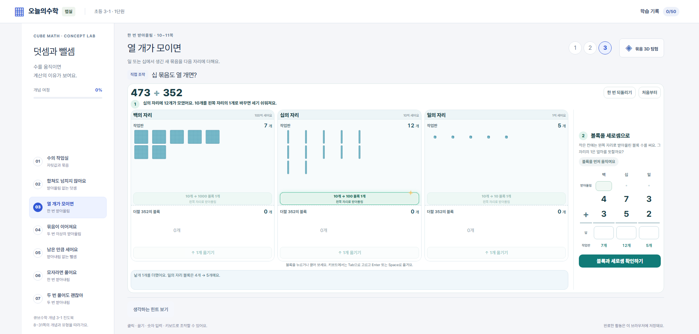
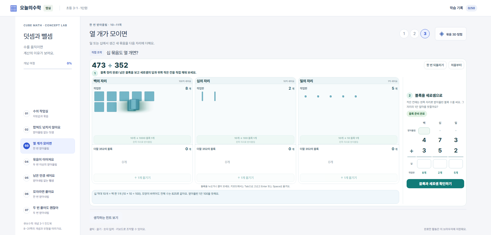
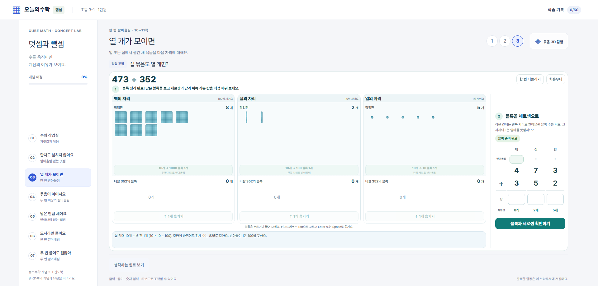

# 한 화면 학습과 블록 이동 검증

2026-09-22 · `/lab/cube-3-1` · 로컬 main 통합

## 화면 구조

- 페이지를 화면 높이에 고정하고 왼쪽 단원 목록만 세로 스크롤한다. 처음·중간·마지막 단원 선택, 창 높이 변경 시 선택 항목을 목록 중앙에 맞춘다.
- 단원 제목과 활동 번호를 같은 상단 행에 배치했다. 수 모형 활동의 중복 바깥 카드와 안내를 줄여 조작판이 학습 영역의 전체 너비를 쓴다.
- 화면 안에서 조작·입력·확인·다음 활동까지 진행한다. 새 문제의 모형 도움은 같은 영역에서 답 입력과 전환된다.
- 지도 퍼즐과 조각, 잘못된 세로셈과 이유 선택을 넓은 화면에서 나란히 배치한다.

## 크기와 움직임

작업판 20칸, 준비판 10칸을 미리 확보한다. 블록 수가 바뀌어도 카드와 블록 크기는 유지되며, 화면 너비에 따라서만 크기를 조정한다. 넓은 화면은 백 모형 38px와 높이 40px의 조작 칸을 사용한다.

블록은 실제 시작점에서 도착점까지 420ms 동안 이동한다. 묶기는 10개가 모여 다음 자리의 1개로, 풀기는 1개가 이전 자리의 10개로 바뀌는 모션을 보인다. 도착 모형은 착지할 때 나타난다. 가능한 교환 버튼에는 테두리 빛과 별 반짝임을 표시한다.

계산 상태는 즉시 갱신한다. 모션이 답이나 완료를 결정하지 않는다. 빠른 연속 입력, 되돌리기, 초기화, 화면 전환, 움직임 줄이기 설정에서도 장식 모형과 애니메이션을 정리한다.

## 확인한 결과

- 실제 Chromium에서 1920×920, 1440×900, 1366×768, 1024×768, 390×844의 각 56개 활동 화면 검사: 문서 가로·세로 스크롤 없음, 학습 버튼 잘림 없음, 현재 단원 중앙 배치 통과. 데스크톱 수 모형은 80% 이상 크기를 유지한다. 작은 휴대전화에서는 전체 활동을 맞추기 위한 축소가 적용된다.
- 단원 목록에 실제 휠 입력을 보내도 학습 영역과 페이지 위치가 움직이지 않는다. 화면 높이를 920→768→600→1000으로 바꿔도 목록을 다시 맞추며 페이지 오류가 없다.
- 최종 넓은 화면의 473+352 조작판은 **1474×577.09375px**. 이동 전, 백 7개·십 12개, 묶은 뒤 백 8개·십 2개의 조작판·카드·작업판 좌표와 크기가 정확히 일치했다. 묶는 동안 실제 이동 모형 10개를 확인했다.
- 별도 모션 검사: 최대 19개 모형의 영역 내 표시, 조상 요소의 0.7배 확대/축소 아래 이동 좌표, 취소·정리와 움직임 줄이기 검증. 관련 수 모형·엔진·모션 검사 39개 통과.
- 통합 후 컴포넌트 검사 42개, 전체 TypeScript, ESLint 및 affordance 검사 통과.
- 통합 후 원래 50개 활동 전체 해결, 새 문제 6유형 독립 적용, 저장 복원 및 3D 열기/닫기 검사 통과. 브라우저 페이지 오류 0.

재실행: `npx tsx scripts/qa/check-cube31-viewport.ts`, `npx tsx scripts/qa/check-cube31-lab.ts`, `npx tsx scripts/qa/check-cube31-motion.ts`. 앞의 두 검사는 기본 localhost:3107을 사용하고 `CUBE_QA_URL`로 변경할 수 있다. 마지막 검사는 자체 임시 Vite 서버를 사용하고 종료한다.

