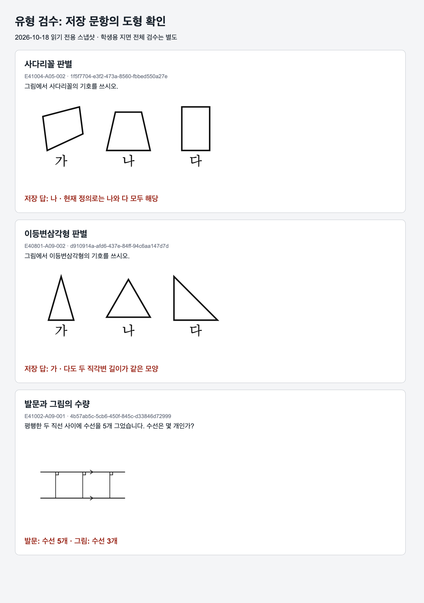

# 초등 문형의 변형 수와 내용 검수

2026-10-18 13:58 KST의 읽기 전용 스냅샷 118,020행을 기준으로 한다. 생성 소스는 `cd067a49a`이며, [문항별 근거](elementary-quality.json)에 저장 ID·코드·필드 해시를 남겼다. 제품이나 DB는 수정하지 않았다.

## 확정 보완 대상: 4문항류, 출제 가능 14행

| 항목  | 문항류와 저장 영향                                          | 문제와 필요한 보완                                                                                                                                                                                                   |
| ----- | ----------------------------------------------------------- | -------------------------------------------------------------------------------------------------------------------------------------------------------------------------------------------------------------------- |
| Q-E01 | 초4 `2-6-3 대각선` 문형 10, 4행                             | 모든 변의 길이가 같다는 조건만 주고 정오각형~정팔각형을 답으로 정한다. 모든 각의 크기가 같다는 조건도 필요하다. 조건·정답·해설을 함께 재검토해야 한다.                                                               |
| Q-E02 | 초4 `2-4-4 사다리꼴` 문형 05, 3행                           | 사다리꼴 하나를 고르게 하면서 직사각형도 함께 제시한다. 같은 소스의 `QUAD_KINDS`와 포함 관계 문항은 직사각형을 사다리꼴에 포함한다. 현재 정의로는 정답 기호가 둘이다. 판별 기준에 맞는 오답 도형을 구성해야 한다.    |
| Q-E03 | 초4 `2-2-1 삼각형을 변의 길이에 따라 분류하기` 문형 09, 3행 | 이등변삼각형 하나를 고르는데 일반 이등변·정삼각형·직각이등변 모양을 함께 제시한다. 정삼각형을 제외하는 정의를 쓰더라도 두 직각변이 같은 모양이 남는다. 길이 표식·제외 조건·도형을 함께 고쳐 답을 하나로 정해야 한다. |
| Q-E04 | 초4 `2-4-2 평행과 평행선` 문형 09 중 4·5개 조건, 4행        | 본문·정답은 수선 4개 또는 5개인데 SVG에는 3개만 그려진다. 생성기 `Math.min(k,3)`이 원인이다. 그림 엔진 자체는 9개까지 받으므로 표현 용량의 한계가 아니다. 발문과 실제 작도 수가 같아야 한다.                         |

Q-E01의 반례는 길이가 모두 1이고 내각이 90·120·150·90·120·150도인 볼록육각형이다. 변 방향을 0·90·150·180·270·330도로 두면 여섯 단위벡터의 합은 0이다. 길이·폐합·각의 차이를 별도 계산으로 확인했으며, 모든 변이 같아도 정다각형으로 정해지지 않는다.

Q-E02의 정의 근거는 `src/lib/elementary/g4.ts:14217`의 포함 관계 문항과 `QUAD_KINDS`이다. Q-E03의 `rightTri` 작도는 `scripts/figure/elementary.py:_shape_points`에서 두 직각변 길이가 같은 좌표를 사용한다. 세 그림은 저장 SVG 그대로 재출력해 육안으로도 확인했다. 별도 엔진 검수 세션에서 네 항목의 수학·소스 근거를 독립 재확인했다.



위 14행은 현재 스냅샷에서 확인한 영향 범위다. 네 문형에서 향후 생성할 수 있는 모든 문항의 오류 수나 문제은행 전체 오류율을 뜻하지 않는다.

## 유형별 수량: 작은 유한 영역과 실제 저장 부족을 구분

[전수 유형 재고](type-inventory.csv)의 보기 제외 발문·그림 기준으로 5개 미만인 초등 문형은 84개다. 해당 문형을 현재 등록부와 대조하고, 등록된 70개를 seed 0~511로 각각 생성했다. 총 **35,840회** 관측이며 [문형별 결과](elementary-variation.json)에 전부 기록했다.

| 결과                                        | 문형 수 | 해석                                                                                                                                                                                    |
| ------------------------------------------- | ------: | --------------------------------------------------------------------------------------------------------------------------------------------------------------------------------------- |
| 생성기에서도 1~4개만 관측                   |      53 | 53개 함수의 실제 소스를 모두 읽었다. 고정 성질·유한 도형 위치·좁은 정수 범위를 사용한다. 같은 생성기를 더 적재하는 방식으로 수량을 늘릴 수 없는 경우다.                                 |
| 생성기에서 5개 이상 관측, 저장본은 5개 미만 |      17 | 현재 저장본은 각 3개다. 문형마다 서로 다른 발문 5개를 비교 기준으로 삼으면 합계 최소 34개의 추가 발문이 필요하다. 숫자 범위가 넓다는 사실은 수학적 품질의 증명이 아니다.                |
| 이 소스 기준에 등록되지 않은 저장 문형      |      14 | 초3·초5·초6 일곱 차시의 31/32번, 합계 42행이다. 별도 `e331f90c6` 소스와 `550096afc` 적재 이력이 있는 변경이며 이번 보강 108행과 다르다. 현행 스냅샷과 감사 기준 소스의 차이를 보존했다. |

53개 소스의 발문·그림 영역은 1개 29문형, 2개 1문형, 3개 12문형, 4개 11문형이다. 고정 성질 자체는 유효한 학습 문항일 수 있다. 이 53개를 모두 오류나 필수 보강 대상으로 세지 않는다. 다만 동일한 질문이 다시 나오고 답이 고정되는 문형을 독립적인 반복 연습 재고가 넉넉한 유형처럼 표현해서는 안 된다.

특히 평행선 문형 09는 ‘수선을 몇 개 그었다’고 알려준 다음 바로 수선 개수를 묻는다. 그림 수를 바로잡아도 평행의 성질을 적용하는 과제인지 별도로 검토해야 한다. 대각선 차시의 08~10번은 정다각형의 변·각·이름을 묻고 대각선을 사용하지 않으므로, 선수 확인 문항과 해당 차시의 핵심 유형을 구분할 필요가 있다. 이 판단은 문항의 실제 과제에 관한 것이며 공식 성취기준 전부와의 대응을 검증한 결과는 아니다.

‘한 유형에 5개’는 이번 감사의 비교 시나리오다. 제품 기본값이나 공식 최소량으로 새로 정한 것이 아니다. 원래 객관식에서 보기 자체가 조건을 제공하는 경우에는 발문만으로 서로 다른 문제 수를 확정하지 않는다.

## 재현과 범위

```sh
npx tsx scripts/qa/bank/math-type-elementary-probe.ts
npx tsx scripts/qa/bank/math-type-elementary-quality.ts
```

두 명령은 이미 확보한 로컬 입력과 현재 소스만 읽는다. 첫 명령은 변형 관측이고, 두 번째는 네 문형의 실제 영향 행·그림 수·수학 반례를 재확인한다. 학생 기록·사용 이력·실물 인쇄·모든 문항의 독립 풀이를 검사한 결과는 아니다.
